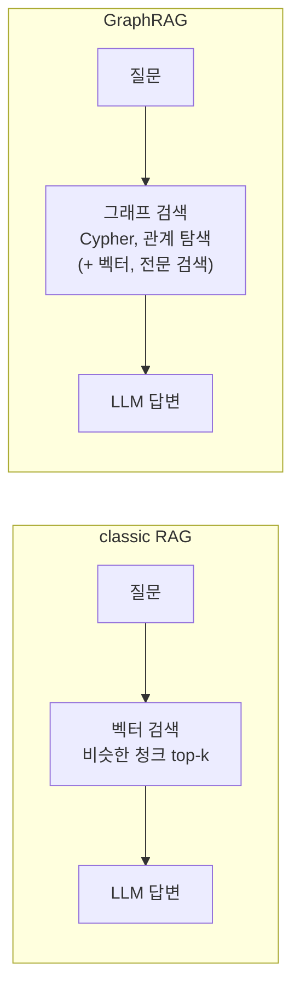

# KG_P0 Why GraphRAG (읽기 전에)

> 먼저 읽으면 좋은 글

## 이 글의 목표

이 글을 읽고 나면 다음을 할 수 있어요.

1. classic RAG와 GraphRAG가 어디까지 같고 어디서부터 다른지 한 문장으로 설명할 수 있어요.
2. classic RAG가 구조적으로 잘 못 푸는 질문 세 종류를 알아볼 수 있어요.
3. GraphRAG에 드는 비용과 한계를 알고, 언제 쓰지 말아야 하는지 판단할 수 있어요.

읽는 내내 이 질문 하나를 머리에 두면 좋아요. **"내 데이터와 내 질문에 GraphRAG가 정말 필요할까, 아니면 classic RAG로 충분할까?"**

## 1. 한 문장으로: GraphRAG = RAG + 관계를 따라가는 검색

RAG는 "질문을 받고 → 관련 자료를 검색하고 → 그 자료를 프롬프트에 넣어 → LLM이 답하는" 구조예요. 그런데 GraphRAG도 이 뼈대는 똑같아요. 다른 건 **검색 단계 하나**뿐이에요.

classic RAG는 문서를 청크로 잘라 두고 **질문과 비슷한 조각**을 찾아요. 반면 GraphRAG는 데이터를 노드와 관계로 저장해 두고, **관계를 따라가거나 세어서** 답의 근거를 찾아요. 그래서 처음 공부할 때 "Neo4j 쓰고 Cypher로 데이터 꺼내는 것 말고는 classic RAG랑 똑같네?"라는 느낌이 드는 게 정상이에요. 실제로 생성 단계는 똑같거든요.

그러니까 GraphRAG를 배운다는 건 결국 두 가지를 배우는 거예요. **그래프를 어떻게 만들고**, **그래프에서 어떻게 꺼내느냐**예요.

## 2. classic RAG가 막히는 세 가지 질문

차이는 질문의 종류에서 드러나요. 이 교재에서 쓰는 영화 데이터(영화 4,803편)로 예를 들어 볼게요.

| 질문 유형 | 예시 | classic RAG | GraphRAG |
|---|---|---|---|
| **집계** | "Tom Hanks 출연작은 몇 편이야?" | 비슷한 청크 k개만 보고 세니까 틀리기 쉬워요 | `count()`로 정확히 29편 |
| **여러 홉 연결** | "Apollo 13 배우들이 다른 영화에서 가장 많이 함께 일한 감독은?" | 답이 여러 문서에 흩어져 있어서 한 번의 유사도 검색으로는 이어 붙이지 못해요 | 영화 → 배우 → 다른 영화 → 감독으로 관계를 따라가면 돼요 |
| **정확한 조건** | "2010년 이후 Drama 중 평점 높은 순으로" | 의미가 비슷한 것과 조건에 맞는 것은 다른 문제라서 조건을 정확히 못 걸어요 | `WHERE`로 정확히 걸러요 |

두 번째 질문을 실제로 돌려 보면 답이 꽤 흥미로워요. Apollo 13의 출연 배우 5명(Tom Hanks, Kevin Bacon, Ed Harris, Bill Paxton, Gary Sinise) 중 **4명이 Ron Howard 감독의 다른 영화**(Splash, A Beautiful Mind, Frost/Nixon 등)에도 나왔어요. 이 사실은 어느 한 문서에도 적혀 있지 않아요. 여러 사실을 관계로 이어야만 나오는 답이죠.

왜 이런 차이가 날까요? classic RAG의 검색은 "질문과 **비슷한** 조각 찾기"라서, 답이 한두 조각 안에 들어 있을 때 강해요. 반대로 답을 얻으려면 여러 조각을 **세거나 이어야** 하는 질문에서는 구조적으로 약해요. 그리고 그 "세고 잇는" 일이 바로 그래프 DB가 잘하는 일이에요.

## 3. 그래서 좋은 점

- **여러 홉을 이어서 답할 수 있어요.** "A와 연결된 B와 연결된 C"처럼 몇 단계 떨어진 정보를 쿼리 한 번에 찾아요.
- **집계와 조건이 정확해요.** 개수, 순위, 기간 같은 질문을 LLM의 추측이 아니라 DB의 계산으로 답해요.
- **근거를 경로로 보여 줄 수 있어요.** "Apollo 13 ← Tom Hanks → Splash ← Ron Howard"처럼 답이 나온 길을 그대로 보여 줄 수 있어서, 사용자도 개발자도 답을 검증하기 쉬워요.
- **벡터 검색과 섞을 수 있어요.** Neo4j는 벡터 인덱스도 지원해서, 벡터 검색으로 시작점을 찾고 관계로 주변 정보를 넓히는 식으로 둘의 장점을 함께 써요. 이게 실무 GraphRAG에서 가장 흔한 모양이에요.

## 4. 그만큼 드는 비용 (단점)

장점만 있으면 모두 GraphRAG를 썼겠죠. 그런데 비용이 꽤 커요.

- **그래프를 만들어야 해요. 그리고 이게 가장 어려워요.** 원본이 CSV처럼 정리된 데이터라면 쉽지만, 보통은 뉴스나 보고서 같은 글이에요. 그러면 LLM이 글을 읽고 노드와 관계를 뽑아내야 해서 시간과 비용이 들고, 빠뜨리거나 잘못 뽑는 것도 생겨요.
- **같은 대상을 하나로 합치는 문제가 생겨요.** "삼성전자"와 "Samsung Electronics"를 같은 노드로 볼지, 이름이 같은 두 사람을 다른 노드로 둘지를 정해야 해요. 이게 틀리면 관계가 끊기거나 엉뚱하게 이어져요.
- **온톨로지 설계가 필요해요.** 어떤 노드와 관계로 나눌지를 미리 정해야 하고, 이 설계가 곧 검색 품질로 이어져요.
- **LLM이 짠 쿼리가 틀릴 수 있어요.** 예를 들어 이 교재의 Text2Cypher 강의에서는 개봉일이 날짜 문자열인데 LLM이 숫자처럼 비교해서 결과가 0건이 나와요.
- **인프라와 배울 것이 하나씩 늘어요.** 그래프 DB를 운영해야 하고, Cypher 같은 쿼리 언어도 알아야 해요.

한눈에 정리하면 이래요.

| | classic RAG | GraphRAG |
|---|---|---|
| 준비 | 청크로 자르고 임베딩 | 온톨로지 설계 + 그래프 구축 (+ 임베딩) |
| 강한 질문 | "이 문서에 뭐라고 써 있어?" | 집계, 여러 홉, 정확한 조건 |
| 근거 | 비슷한 텍스트 조각 | 노드와 관계, 경로 |
| 실패하는 곳 | 검색이 엉뚱한 조각을 가져올 때 | 그래프가 잘못 만들어졌거나 쿼리가 틀렸을 때 |
| 비용 | 낮음 | 높음 (특히 구축 단계) |

## 5. 언제 쓰고, 언제 쓰지 말까

질문을 보면 판단이 쉬워요. 질문에 아래 같은 표현이 자주 나온다면 그래프가 맞는 신호예요.

- "몇 개", "가장 많은", "평균" → 집계
- "~와 같이 일한", "~를 거쳐서", "~와 연결된" → 여러 홉
- "~ 이후", "~ 이상", "~ 중에서" → 정확한 조건

그리고 데이터가 **사람, 회사, 제품, 조항처럼 서로 얽힌 대상**으로 이루어져 있을수록 그래프가 잘 맞아요.

| 도메인 | 그래프로 보면 | 이런 질문에 강해요 |
|---|---|---|
| 뉴스 | 기업, 인물, 사건이 서로 연결 | "이 사건에 얽힌 기업들의 다른 이슈는?" |
| 금융 상품 | ETF → 구성 종목 → 섹터 | "반도체 비중이 높은 ETF는?" |
| 기업 보고서 | 기업 → 자회사, 리스크, 경쟁사 | "이 회사와 공급망이 겹치는 회사는?" |
| 법률 문서 | 법 → 시행령 → 시행규칙 (위임 관계) | "이 조항을 구체화한 시행규칙은?" |

반대로 제품 매뉴얼, FAQ처럼 **답이 한 문단 안에 들어 있는** 질문이 대부분이라면 classic RAG로 충분해요. 굳이 그래프를 만드는 비용을 낼 이유가 없어요.

그래서 실무에서 권하는 순서는 이래요. 먼저 classic RAG로 시작해 보고, 틀리는 질문을 모아 봐요. 그 질문들이 집계, 연결, 조건 쪽이라면 그때 그래프를 붙이면 돼요. 처음부터 그래프로 가는 건 대부분 과한 선택이에요.

## 참고: "GraphRAG"라는 이름의 다른 뜻

Microsoft가 공개한 GraphRAG라는 방법도 있어요. 문서 전체에서 그래프를 만든 다음 관련 있는 노드끼리 커뮤니티로 묶고 미리 요약해 둬서, "이 문서들의 전체 주제가 뭐야?" 같은 큰 질문에 답하는 방식이에요. 이 교재가 다루는 "Neo4j + Cypher로 관계를 따라가는 검색"과는 결이 달라서, 그런 게 있다는 것만 알아 두면 돼요.
