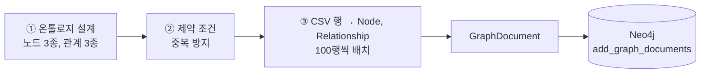
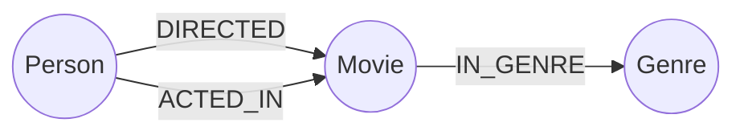

# KG_P1_03 Movie 01 CSV (섹션 4)

> 강의: CSV 정형 데이터를 지식 그래프(KG)로 변환하기

## 이 강의의 학습 목표

이 강의를 마치면 다음을 할 수 있어요.

1. 영화 CSV를 보고 어떤 노드와 관계로 나눌지, 즉 온톨로지를 설계할 수 있어요.
2. 제약 조건은 왜 데이터를 넣기 **전에** 필수로 걸고, 인덱스는 왜 선택인지 설명할 수 있어요.
3. LangChain의 `Node`, `Relationship`, `GraphDocument`로 CSV 행을 그래프로 바꾸고, `add_graph_documents`로 Neo4j에 저장할 수 있어요.
4. 실무에서 대량 데이터를 넣을 때 쓰는 다른 방법(`UNWIND` + `MERGE`, `LOAD CSV`, `neo4j-admin import`)이 있다는 걸 알고 고를 수 있어요.

읽기 전에 이 질문 하나를 머리에 두고 보면 좋아요. **"감독이면서 배우이기도 한 사람은 노드를 몇 개 만들어야 할까?"**

## 한눈에 보기

정형 데이터를 그래프로 옮기는 순서는 세 단계예요. 먼저 온톨로지(어떤 노드, 어떤 관계)를 정하고, 그다음 제약 조건부터 걸고, 마지막으로 행마다 노드와 관계를 만들어 넣어요.



여기서 온톨로지는 어떤 도메인의 개념과 개념 사이의 관계를 표현한 지식 구조예요. 강사는 "Neo4j로 노드와 관계 기반 지식 그래프를 구현하면 그 자체로 온톨로지가 구현된 것"이라고 표현했어요. 조금 나눠서 보면 노드 레이블, 관계 타입, 제약 조건이 설계도(온톨로지)이고, 거기에 실제 데이터를 채운 게 지식 그래프예요.

## 1. 온톨로지 설계: 노드 3개, 관계 3개



이 설계의 핵심은 **감독과 배우를 Director, Actor 노드로 나누지 않는다**는 점이에요. 둘 다 Person 하나로 두고, 역할은 관계 타입(`DIRECTED`, `ACTED_IN`)으로 구분해요. 그래서 처음 질문의 답은 "노드 하나"예요. 같은 사람이 감독도 하고 출연도 하면, Person 노드 하나에 관계만 두 종류가 붙는 거죠.

만약 Director와 Actor를 따로 만들었다면 같은 사람이 노드 두 개로 쪼개지고, "감독 겸 배우인 사람"을 찾으려면 두 노드가 같은 사람인지부터 맞춰 봐야 했을 거예요.

## 2. 제약 조건은 필수, 인덱스는 선택

```cypher
CREATE CONSTRAINT movie_id_unique IF NOT EXISTS FOR (m:Movie) REQUIRE m.id IS UNIQUE
CREATE CONSTRAINT person_name_unique IF NOT EXISTS FOR (p:Person) REQUIRE p.name IS UNIQUE
CREATE CONSTRAINT genre_name_unique IF NOT EXISTS FOR (g:Genre) REQUIRE g.name IS UNIQUE

CREATE INDEX movie_title_index IF NOT EXISTS FOR (m:Movie) ON (m.title)
CREATE INDEX movie_release_index IF NOT EXISTS FOR (m:Movie) ON (m.released)
```

- **제약 조건은 무결성을 위한 거예요.** 같은 id의 영화나 같은 사람이 두 번 들어가면 안 되니까요. 강사가 "온톨로지 구축의 필수 조건이자 선결 조건"이라고 두 번이나 강조했어요. 그래서 데이터를 넣기 **전에** 걸어요.
- **인덱스는 검색 속도를 위한 거예요.** 그래서 구축 단계에는 없어도 돼요. 제목, 개봉일처럼 자주 검색할 속성에 미리 걸어 두거나, 실제 사용량을 보고 나중에 추가하면 돼요.
- `IF NOT EXISTS`를 붙였기 때문에 여러 번 실행해도 에러가 나지 않아요.
- 제약 조건만 걸어도 Browser에 레이블(Movie, Person, Genre)이 먼저 보여요. 물론 노드는 아직 0개예요.

다만 주의할 점이 하나 있어요. Person의 고유 기준이 `name`이라서 **동명이인은 한 사람으로 합쳐져요.** 실습에서는 넘어가지만, 실무라면 사람마다 고유 id가 필요해요.

## 3. CSV 데이터 살펴보기

데이터는 `data/movies_tmdb_small.csv`예요. Kaggle의 TMDB 데이터를 강의용으로 가공한 것으로, 영화 4,803편에 컬럼은 `id`, `released`, `title`, `actors`, `director`, `genres`, `rating`, `overview`, `runtime`, `tagline` 10개예요.

그래프로 바꿀 때 신경 쓸 점은 두 가지예요.

- **값이 여러 개인 컬럼**(`actors`, `director`, `genres`)은 `|`로 구분돼 있어요. 그래서 `split('|')`로 쪼개서 사람, 장르마다 노드를 만들어요.
- **결측값**이 있어요(`overview`, `tagline` 등). 그래서 `pd.notna()`로 값이 있을 때만 속성에 넣어요.

메모리가 부족하면 노트북의 주석 코드를 풀어서 2010년 이후 개봉작만 써도 돼요.

## 4. 행을 노드와 관계로 바꾸기

LangChain이 그래프를 표현하는 클래스 세 개를 줘요.

| 클래스 | 필드 |
|---|---|
| `Node` | `id`, `type`(레이블), `properties` |
| `Relationship` | `source`, `target`, `type`, `properties` |
| `GraphDocument` | `nodes`, `relationships` |

흐름은 이래요.

1. `node_dict = {}`(id → Node)와 `relationships = []`를 준비해요.
2. 100행씩 배치로 돌면서 행마다 다음을 해요.
   - `movie-{id}`로 Movie 노드를 만들어요 (dict에 없을 때만).
   - `director`를 쪼개서 `person-{이름}` Person 노드와 `DIRECTED`(사람 → 영화)를 만들어요.
   - `actors`를 쪼개서 Person 노드와 `ACTED_IN`(사람 → 영화)을 만들어요.
   - `genres`를 쪼개서 `genre-{이름}` Genre 노드와 `IN_GENRE`(영화 → 장르)를 만들어요.
3. 그러면 노드 16,528개, 관계 40,921개가 나와요. 그런데 **이때는 아직 DB에 들어가 있지 않아요.** 파이썬 dict와 list에만 있어요.
4. 마지막에 한 번에 저장해요.

```python
graph_doc = GraphDocument(nodes=list(node_dict.values()), relationships=relationships)
graph.add_graph_documents([graph_doc])
```

강의 PC 기준으로 저장에 약 9분 걸렸어요. 노드가 먼저 들어가고, 관계는 나중에 채워져요.

여기서 두 가지를 짚고 갈게요.

- **id 앞에 `movie-`, `person-`, `genre-`를 붙이는 이유**는 종류가 다른 노드끼리 id가 겹치지 않게 하려는 거예요.
- **`node_dict`는 이번 실행 안에서만 중복을 막아요.** 노트북을 다시 돌리거나 다른 데이터를 더 넣을 때 DB 쪽 중복을 막는 건 제약 조건이에요. 그래서 제약 조건이 먼저예요.

## 5. 실무에서는

정형 데이터를 대량으로 넣을 때는 이 방식보다 아래 방법들이 더 흔해요.

| 방식 | 언제 |
|---|---|
| `UNWIND $rows` + `MERGE` | 파이썬에서 1,000행씩 묶어 파라미터로 보내요. 가장 흔해요 |
| `LOAD CSV` | DB가 파일에 직접 접근할 수 있을 때 (AuraDB는 로컬 파일을 못 읽어요) |
| `neo4j-admin database import` | 수백만 건을 처음 한 번에 넣을 때 |

그런데도 강의가 GraphDocument를 쓰는 이유가 있어요. 뒤에서 LLM이 문서를 읽고 뽑아낸 그래프도 같은 GraphDocument 형식이거든요. 즉 CSV로 만든 그래프와 LLM이 만든 그래프를 같은 방법으로 저장하는 흐름을 미리 보여 주는 거예요.

## 6. 정리하며 기억할 것

- 순서는 온톨로지 설계 → 제약 조건 → 데이터 넣기예요.
- 역할(감독, 배우)은 노드를 나누지 말고 관계 타입으로 구분해요. 그래야 같은 사람이 노드 하나로 남아요.
- 제약 조건은 무결성이라 필수고 먼저 걸어요. 인덱스는 속도라서 선택이고 나중에 걸어도 돼요.
- `Node`, `Relationship`을 모아 `GraphDocument`로 묶고, `add_graph_documents`로 한 번에 저장해요.

## 다음이랑 어떻게 이어지나

여기서 만든 영화 지식 그래프(영화, 사람, 장르)를 섹션 4의 나머지 강의에서 검색해요. 다음 [기본 검색](../KG_P1_03_neo4j_movie_02_basic_search)에서는 이 그래프를 Cypher로 조회하고 집계해서, 배우와 장르를 이용한 추천 쿼리까지 만들어요.
