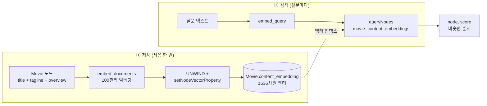
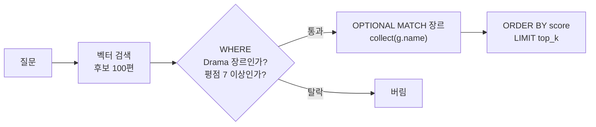

# KG_P1_03 Movie 04 Vector Search (섹션 4)

> 강의: 지식그래프(KG) 검색 - 벡터 검색 (Semantic Search)

## 이 강의의 학습 목표

이 강의를 마치면 다음을 할 수 있어요.

1. 앞 강의의 키워드 검색과 이번 벡터 검색이 각각 무엇을 보고 "비슷하다"고 판단하는지 구분해서 설명할 수 있어요.
2. Neo4j에 벡터 인덱스를 만들고, 영화 텍스트를 임베딩해서 노드 속성으로 저장할 수 있어요 (`UNWIND`, `db.create.setNodeVectorProperty`).
3. `db.index.vector.queryNodes`로 의미가 비슷한 영화를 찾을 수 있어요.
4. 벡터 검색 뒤에 장르와 평점 조건을 붙인 하이브리드 검색을 만들고, 왜 후보를 100개나 가져오는지 설명할 수 있어요.

읽기 전에 이 질문 하나를 머리에 두고 보면 좋아요. **"영화 줄거리는 전부 영어인데, 한국어로 물어봐도 왜 비슷한 영화가 나올까?"**

## 한눈에 보기

앞의 두 강의에서는 결국 **단어**로 찾았어요. 기본 검색은 속성 값이 조건과 맞는지를 봤고, 전문 검색은 오타나 와일드카드까지 봐 주긴 하지만 같은 단어가 들어 있는지를 봤죠. 그래서 "인공지능 영화"라고 검색하면 줄거리에 `artificial intelligence`라고 적힌 영화는 못 찾아요. 단어 자체가 다르니까요.

이번 강의에서는 텍스트를 숫자 벡터(임베딩)로 바꿔서 **의미**로 찾아요. 의미가 비슷한 문장은 벡터도 가까운 곳에 놓이기 때문에, 단어가 하나도 안 겹쳐도 찾을 수 있어요.

| 강의 | 검색 방식 | 무엇이 같으면 찾나 | 예 |
|---|---|---|---|
| 02 기본 검색 | `MATCH ... WHERE` | 속성 값 | `m.title = 'Apollo 13'` |
| 03 전문 검색 | 풀텍스트 인덱스 | 단어(토큰) | `love`, `star*`, `afair~0.7` |
| 04 벡터 검색 | 벡터 인덱스 | 의미 | "인공지능과 현실에 관한 SF 영화" |

전체 흐름은 저장과 검색, 두 단계로 나뉘어요. 저장은 처음에 한 번만 하고, 검색은 질문이 올 때마다 해요.



여기서 꼭 기억할 규칙이 하나 있어요. 저장할 때와 검색할 때 **같은 임베딩 모델**을 써야 해요. 같은 자로 재야 길이를 비교할 수 있는 것처럼, 모델이 다르면 벡터끼리 거리를 재는 게 의미가 없어지거든요.

## 1. 준비: 임베딩 모델과 벡터 인덱스

임베딩은 OpenAI의 `text-embedding-3-small`을 써요. 텍스트 하나를 숫자 1536개짜리 벡터로 바꿔 주는 모델이에요.

```python
from langchain_openai import OpenAIEmbeddings
embeddings = OpenAIEmbeddings(model="text-embedding-3-small")
```

그다음 Neo4j 안에 벡터 인덱스를 만들어요. 앞 강의에서 `CREATE FULLTEXT INDEX`로 전문 검색 인덱스를 만들었던 것과 모양이 거의 같아요.

```cypher
CREATE VECTOR INDEX movie_content_embeddings IF NOT EXISTS
FOR (m:Movie) ON m.content_embedding
OPTIONS {
  indexConfig: {
    `vector.dimensions`: 1536,
    `vector.similarity_function`: 'cosine'
  }
}
```

- **`ON m.content_embedding`**: 이 속성은 아직 영화 노드에 없어요. 인덱스를 먼저 걸어 두고, 다음 절에서 속성을 채우면 그때 인덱스에 들어가요.
- **`vector.dimensions: 1536`**: 임베딩 모델이 내놓는 벡터 길이와 같아야 해요. 그래서 나중에 모델을 바꾸면 인덱스도 다시 만들어야 해요.
- **`cosine`**: 두 벡터가 얼마나 같은 방향을 가리키는지로 비슷한 정도를 재요. 텍스트 임베딩에서는 거의 항상 이걸 써요.

만든 뒤에는 `SHOW VECTOR INDEXES`로 확인하면 되고, `type`이 `VECTOR`로 나와요. 참고로 벡터 인덱스는 질문 벡터를 4,803편과 하나하나 비교하지 않고, 근사 탐색(HNSW)으로 가까운 것만 골라서 빠르게 찾아 줘요.

## 2. 임베딩을 만들어 노드에 저장하기

이 절이 이번 강의에서 코드가 가장 긴 부분이지만, 하는 일은 네 단계예요.

1. 영화의 `id`, `title`, `tagline`, `overview`를 가져와요 (4,803편).
2. 영화마다 세 텍스트를 줄바꿈으로 이어 붙여 문자열 하나로 만들어요.
3. 100편씩 묶어서 `embed_documents`로 한 번에 임베딩해요.
4. 묶음째로 Neo4j에 보내서 `UNWIND`로 풀고, 영화마다 `content_embedding` 속성에 저장해요.

```python
content_text = f"{movie['title']}"
if movie['tagline']:                       # 태그라인이 없는 영화가 844편 있어요
    content_text += f"\n\n{movie['tagline']}"
if movie['overview']:
    content_text += f"\n\n{movie['overview']}"
```

```cypher
UNWIND $batch AS item
MATCH (m:Movie {id: item.id})
CALL db.create.setNodeVectorProperty(m, 'content_embedding', item.embedding)
RETURN count(m) AS updated
```

### UNWIND는 뭐예요?

리스트 하나를 행 여러 개로 풀어 주는 구문이에요. 파이썬에서 `$batch`로 영화 100편짜리 리스트를 통째로 넘기면, `UNWIND`가 그걸 100개의 행으로 펼치고, 그다음 줄부터는 행마다 따로 실행돼요. 즉 Cypher 안에서 도는 for 문이라고 생각하면 돼요.

```
$batch (파이썬에서 넘긴 리스트 1개)              UNWIND $batch AS item 이후 (행 100개)
[ {id: 101, embedding: [0.01, -0.02, ...]},      행 1: item = {id: 101, ...} → MATCH → 저장
  {id: 102, embedding: [0.03,  0.00, ...]},      행 2: item = {id: 102, ...} → MATCH → 저장
  ... 100개 ]                                     ... 행 100까지
```

(`id`와 숫자는 예시 값이에요.)

`setNodeVectorProperty`는 노드에 벡터 속성을 넣는 전용 프로시저예요. `SET m.content_embedding = item.embedding`으로 넣어도 되긴 하지만, 이 프로시저를 쓰면 벡터를 더 공간 효율적인 형태로 저장해 줘요.

### 왜 굳이 100편씩 묶나요?

한 편씩 처리해도 결과는 똑같아요. 그런데 시간의 대부분은 계산이 아니라 네트워크 왕복(OpenAI에 요청하고, Neo4j에 쿼리를 보내는 일)에서 나와요. 그래서 왕복 횟수를 줄이는 게 핵심이에요.

| 방식 | OpenAI 호출 | Neo4j 쿼리 |
|---|---|---|
| 한 편씩 | 4,803번 | 4,803번 |
| 100편씩 (강의) | 49번 | 49번 |

`embed_documents`는 문자열 리스트를 받아 한 번에 임베딩해 주고, `UNWIND`는 리스트를 한 번에 받아 저장해 주니까, 양쪽 모두 묶음으로 처리할 수 있는 거예요. 강의에서는 전체가 2분 22초쯤 걸렸어요. 메모리가 부족하면 `BATCH_SIZE`를 10처럼 더 작게 줄이면 돼요.

> **비용**: 4,803편을 전부 임베딩해도 약 37만 5천 토큰(편당 평균 78토큰)이라서, `text-embedding-3-small` 가격($0.02 / 100만 토큰)으로 계산하면 1센트가 안 돼요. 다만 셀을 다시 돌리면 그만큼 다시 과금되고, 속성도 새 값으로 덮어써요.

저장이 끝났는지는 아래 쿼리로 확인해요. 4,803이 나오면 전부 들어간 거예요.

```cypher
MATCH (m:Movie) RETURN count(m.content_embedding)
```

## 3. 의미로 검색하기

저장이 끝나면 검색은 간단해요. 질문을 같은 모델로 임베딩한 다음, 그 벡터와 가까운 노드를 인덱스에서 꺼내면 돼요.

```python
query_embedding = embeddings.embed_query(search_text)   # 문장 하나 → 벡터 하나
```

```cypher
CALL db.index.vector.queryNodes('movie_content_embeddings', $top_k, $query_embedding)
YIELD node, score
RETURN node.title AS title, node.released AS released,
       node.rating AS rating, score AS similarity
ORDER BY similarity DESC
```

- `embed_documents`는 여러 문서를 한 번에, `embed_query`는 질문 하나를 임베딩해요.
- `queryNodes`에는 인덱스 이름, 몇 개를 가져올지(`top_k`), 질문 벡터를 넘겨요. 그러면 `node`(영화 노드)와 `score`(비슷한 정도)를 돌려줘요. 앞 강의의 `db.index.fulltext.queryNodes`와 쓰는 법이 거의 같아요.

강의에서는 같은 주제를 영어와 한국어로 한 번씩 물어봤어요.

- 영어 `"a Drama movie about artificial intelligence and reality"`: 제목에 인공지능이 들어간 영화가 1위였고, 로봇이나 매트릭스 같은 SF 영화가 뒤를 이었어요.
- 한국어 `"인공지능과 현실에 관한 SF 영화"`: 5편 중 **4편이 영어 결과와 겹쳤어요.**

이제 처음 질문에 답할 수 있어요. `text-embedding-3-small`은 여러 언어를 지원하는 모델이라서, 언어가 달라도 뜻이 같으면 벡터를 비슷한 위치에 놓아요. 그래서 한국어 질문으로 영어 줄거리를 찾을 수 있는 거예요. 다만 언어를 한 번 건너가는 만큼 점수는 조금 다르게 나오고, 순위도 완전히 똑같지는 않아요.

점수를 읽을 때 조심할 점도 하나 있어요. Neo4j는 코사인 유사도(-1~1)를 `(1 + cos) / 2`로 바꿔서 0~1 사이로 돌려줘요. 그래서 전혀 관련 없는 영화도 0이 아니라 0.5 근처가 나올 수 있어요. 즉 점수는 "몇 % 일치"로 읽기보다 순위를 매기는 용도로 보는 게 좋아요.

그리고 벡터 검색에는 약점이 두 가지 있어요. 하나는 관련 있는 영화가 없어도 **항상 `top_k`개를 채워서** 돌려준다는 점이에요. 다른 하나는 "Drama 장르만", "평점 7점 이상"처럼 **정확한 조건은 걸 수 없다**는 점이에요. 의미가 비슷한 것과 조건에 맞는 것은 서로 다른 문제니까요. 이 두 번째 약점을 보완하는 게 다음 절이에요.

## 4. 하이브리드 검색: 벡터로 찾고 조건으로 거르기

하이브리드 검색은 벡터 검색으로 의미가 비슷한 후보를 먼저 넉넉히 뽑고, 그다음 `WHERE`로 장르와 평점 조건을 거는 방식이에요.



파이썬에서는 조건이 주어졌을 때만 `WHERE` 절을 만들어서 쿼리에 끼워 넣어요.

```python
filters = []
if genre:
    filters.append("EXISTS { MATCH (node)-[:IN_GENRE]->(:Genre {name: $genre}) }")
if min_rating:
    filters.append("node.rating >= $min_rating")

where_clause = ""
if filters:
    where_clause = "WHERE " + " AND ".join(filters)
```

```cypher
CALL db.index.vector.queryNodes('movie_content_embeddings', 100, $query_embedding)
YIELD node, score
{where_clause}
WITH node, score
OPTIONAL MATCH (node)-[:IN_GENRE]->(g:Genre)
RETURN node.title AS title, node.rating AS rating,   // released, tagline, overview도 함께 반환
       collect(g.name) AS genres, score AS similarity
ORDER BY similarity DESC
LIMIT $top_k
```

여기서 짚고 갈 점이 네 가지예요.

**왜 후보를 100개나 가져오나요?** 조건이 벡터 검색 **뒤에** 걸리기 때문이에요. 만약 5편만 가져온 다음에 Drama이면서 평점 7점 이상인 영화만 남기면, 5편 중 하나도 안 남을 수도 있어요. 그래서 일단 100편을 넉넉히 뽑아 놓고 거른 뒤에 상위 5편을 잘라요. 반대로 말하면 100편 안에 조건을 통과하는 영화가 5편보다 적으면 결과도 5편보다 적게 나와요. 그러니까 조건이 까다로울수록 후보 수를 더 늘려야 해요.

**`EXISTS { ... }`는 뭐예요?** "이 영화에서 그 장르로 가는 `IN_GENRE` 관계가 하나라도 있니?"를 묻는 조건이에요. 있으면 참, 없으면 거짓이라서 `WHERE`에 그대로 쓸 수 있어요. 장르는 영화의 속성이 아니라 Genre 노드와의 **관계**로 저장돼 있으니까, 조건도 그래프 패턴으로 거는 거예요. 강의 첫머리에서 말한 "벡터 검색과 그래프 탐색의 결합"이 바로 이 부분이에요.

**f-string으로 쿼리를 만들어도 괜찮나요?** 괜찮아요. 쿼리 문장에 끼워 넣는 건 코드에 미리 적어 둔 고정 문자열뿐이고, 사용자가 넣는 값(`genre`, `min_rating`)은 `$genre`, `$min_rating` 파라미터로 따로 넘기거든요. 그래서 입력값이 쿼리 문장에 섞이지 않아요. Cypher 고급 편에서 본 파라미터 원리 그대로예요.

**장르는 왜 OPTIONAL MATCH로 다시 찾나요?** 결과에 장르 목록을 같이 보여 주려고요. 영화 하나에 장르가 평균 2.5개라서 그냥 이어 붙이면 장르 수만큼 행이 늘어나요. 그래서 `collect(g.name)`으로 영화당 한 행에 장르 리스트로 모아요(`node`, `score` 기준의 암묵적 그룹핑이에요). 장르 필터를 걸었더라도 여기서는 그 영화의 장르를 전부 모으기 때문에, 결과에는 Drama 말고 다른 장르도 같이 보여요. 그리고 `OPTIONAL`인 이유는 장르가 하나도 없는 영화가 28편 있어서, 장르 필터 없이 검색할 때 이 영화들이 결과에서 빠지지 않게 하려는 거예요.

강의에서 돌린 예시는 두 개예요.

| 질문 | 조건 | 결과 |
|---|---|---|
| "가족간의 사랑과 신뢰 회복을 주제로 한 영화" | Drama, 평점 ≥ 7 | 5편 모두 Drama가 들어 있고 평점 7 이상 |
| "친구들의 우정을 그린 영화" | 평점 ≥ 7 (장르 조건 없음) | 5편 모두 평점 7 이상, 태그라인이나 줄거리에 friend 계열 단어가 많음 |

두 번째 예시는 마침 5편 모두 Drama가 들어 있었는데, 장르 조건을 건 게 아니라 우연히 그렇게 나온 거예요.

## 5. 정리하며 기억할 것

- 저장할 때와 검색할 때 같은 임베딩 모델을 써야 해요. 모델을 바꾸면 임베딩도 인덱스도 다시 만들어야 해요.
- 텍스트를 벡터로 저장하는 패턴은 "배치로 임베딩 → `UNWIND $batch` → `MATCH` → `setNodeVectorProperty`"예요. 노드에 임베딩을 붙일 일이 생기면 이 모양 그대로 쓰면 돼요.
- 벡터 검색은 단어가 달라도, 심지어 언어가 달라도 의미로 찾아 줘요. 대신 정확한 조건은 못 걸고, 관련이 없어도 항상 `top_k`개를 돌려줘요.
- 조건은 `WHERE`와 그래프 패턴이 맡아요. 조건이 벡터 검색 뒤에 걸리면 후보를 넉넉히 가져와야 해요.

## 다음이랑 어떻게 이어지나

다음 강의 [Text2Cypher](../KG_P1_03_neo4j_movie_05_text2cypher)는 쓰임새가 반대예요. 벡터 검색은 "이런 느낌의 영화"처럼 의미로 묻는 질문에 강하고, Text2Cypher는 "2010년 이후 Drama 중 평점 높은 영화"처럼 조건이 분명한 질문에 강해요. 그리고 이번에 붙인 `content_embedding` 때문에, Text2Cypher에서 LLM이 `RETURN m`으로 노드를 통째로 돌려주면 숫자 1536개가 답변 단계로 넘어가는 문제도 생겨요.

그다음 graphRAG 구현 강의에서는 이 검색 방법들을 LangChain LCEL로 엮어서 RAG 체인을 만들어요. 참고로 LangChain의 `Neo4jVector`가 이번 강의의 인덱스 생성, 임베딩 저장, 검색을 한꺼번에 감싸 주는데, 이번 강의는 그 안에서 실제로 무슨 일이 일어나는지 Cypher로 직접 해 본 셈이에요.
