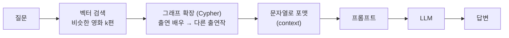
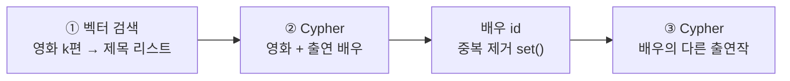
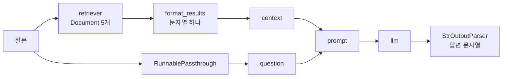

# KG_P1_03 Movie 06 GraphRAG (섹션 4)

> 강의: graphRAG 구현 (랭체인 LCEL 활용)

> **실행 전에**: 이 노트북은 [벡터 검색](../KG_P1_03_neo4j_movie_04_vector_search) 강의에서 만든 `movie_content_embeddings` 인덱스와 영화 임베딩을 그대로 써요. 그래서 04 노트북의 인덱스 생성과 임베딩 셀을 먼저 돌려 둬야 첫 셀부터 막히지 않아요.

## 이 강의의 학습 목표

이 강의를 마치면 다음을 할 수 있어요.

1. `Neo4jVector.from_existing_index`로 Neo4j의 벡터 인덱스를 LangChain 벡터 스토어로 연결하고, 검색 결과의 `page_content`와 `metadata`가 어떻게 채워지는지 설명할 수 있어요.
2. 유사도 검색과 MMR 검색의 차이를 알고, `fetch_k`, `lambda_mult`를 조절할 수 있어요.
3. 벡터 검색으로 영화를 찾은 다음, Cypher로 배우와 그 배우의 다른 출연작까지 넓히는 "벡터 → 그래프 확장" 검색을 만들 수 있어요.
4. LCEL로 `검색 → 포맷 → 프롬프트 → LLM → 파서` 체인을 만들고, 검색 부분만 바꿔 끼울 수 있어요.

읽기 전에 이 질문 하나를 머리에 두고 보면 좋아요. **"'2차 세계대전 영화 중 평점이 가장 높은 작품'을 물었는데, 왜 베트남 전쟁 영화가 답으로 나왔을까?"**

## 한눈에 보기

이번 강의는 섹션 4에서 배운 것들을 하나로 엮는 시간이에요. 04강의 벡터 검색으로 시작점을 찾고, 02강의 관계 패턴으로 정보를 넓히고, 마지막으로 LLM이 답을 써요.



노트북에는 RAG 체인이 세 개 나오는데, 프롬프트와 LLM은 모두 같고 **검색 부분만** 달라요.

| 체인 | 검색 부분 | 컨텍스트에 들어가는 것 |
|---|---|---|
| `rag_chain` | `graph_db.as_retriever()` | 영화 5편의 정보 |
| `graph_rag_chain` | `similarity_search_with_score`를 직접 부르는 함수 | 영화 5편의 정보 + 유사도 점수 |
| `graph_path_rag_chain` | 벡터 검색 + 그래프 확장 | 영화 5편 + 출연 배우 + 배우들의 다른 출연작 |

[읽기 전에](../KG_P0_why_graphrag)에서 "GraphRAG = RAG + 관계를 따라가는 검색"이라고 했던 게 바로 이 표예요. 생성 쪽은 그대로 두고 검색만 그래프로 바꾸는 거죠.

## 1. 벡터 스토어로 연결하기: Neo4jVector

LangChain은 Neo4j용 벡터 스토어 클래스 `Neo4jVector`를 제공해요. 그리고 04강에서 이미 벡터 인덱스를 만들어 뒀으니까 `from_existing_index`로 그 인덱스에 연결만 하면 돼요.

```python
from langchain_openai import OpenAIEmbeddings
from langchain_neo4j import Neo4jVector

embeddings = OpenAIEmbeddings(model="text-embedding-3-small")

graph_db = Neo4jVector.from_existing_index(
    embeddings,
    url=os.getenv("NEO4J_URI"),
    username=os.getenv("NEO4J_USERNAME"),
    password=os.getenv("NEO4J_PASSWORD"),
    index_name="movie_content_embeddings",   # 04강에서 만든 인덱스
    text_node_property="overview",           # page_content에 들어갈 속성
)
```

- **임베딩 모델은 04강과 같아야 해요.** 강사가 "꼭 주의하라"고 한 부분이에요. 저장할 때와 다른 모델로 질문을 임베딩하면 같은 자로 잰 게 아니라서 검색이 엉망이 돼요.
- **`text_node_property="overview"`**: 먼저 `Document`는 LangChain이 검색 결과 하나를 담는 객체로, 본문(`page_content`)과 부가 정보(`metadata`) 두 필드로 되어 있어요. 이 옵션을 주면 `page_content`에 줄거리가 들어가요. 그리고 나머지 속성(title, tagline, rating, released, runtime)은 `metadata`에 자동으로 들어가요. 그러니까 LLM에게 넘길 핵심 텍스트를 여기에 지정하면 돼요. title이나 tagline으로 바꿔도 동작해요.
- LangChain 벡터 스토어의 표준 인터페이스를 따르기 때문에, 다른 벡터 DB에서 쓰던 `similarity_search`, MMR 검색, `as_retriever()`를 그대로 쓸 수 있어요. 여기서 retriever는 "질문을 넣으면 `Document` 리스트를 돌려주는 검색 부품"이에요. 4절의 LCEL 체인에 끼우려면 이 모양이어야 해요.

## 2. 벡터 검색 두 가지: 유사도와 MMR

```python
graph_db.similarity_search_with_score(query, k=5, return_embeddings=False)

graph_db.max_marginal_relevance_search(query, k=5, fetch_k=20, lambda_mult=0.5)
```

- **`return_embeddings=False`**: 결과에 1536차원 임베딩을 빼고 돌려줘요. [Text2Cypher](../KG_P1_03_neo4j_movie_05_text2cypher)에서 `RETURN m`으로 노드를 통째로 돌려주면 임베딩까지 컨텍스트에 실려서 길어지던 문제를, 여기서는 옵션 하나로 막는 거예요.
- **MMR**은 관련성과 **다양성**을 함께 봐요. 먼저 `fetch_k=20`편을 유사도로 가져온 다음, 그중에서 서로 너무 비슷한 건 빼면서 최종 `k=5`편을 골라요. 그리고 `lambda_mult`가 0에 가까울수록 다양성을 더 중시하는데, 기본값이 0.5라서 더 다양하게 받고 싶으면 0.5보다 작게 주면 돼요. 예를 들어 비슷한 시리즈물 다섯 편이 결과를 다 채우는 걸 막고 싶을 때 써요.

## 3. 벡터로 찾고 그래프로 넓히기 (이 강의의 핵심)

벡터 검색만으로는 "이 영화에 누가 나왔고, 그 배우는 또 뭘 찍었지?"에 답할 수 없어요. 그런 정보는 줄거리 텍스트가 아니라 **관계**에 있으니까요. 그래서 `find_movies_and_actors_filmography` 함수는 세 단계로 검색을 넓혀요.



②에서는 검색된 영화와 출연 배우를 함께 가져와요.

```cypher
MATCH (movie:Movie)
WHERE ANY(title IN $movie_titles WHERE movie.title CONTAINS title)
OPTIONAL MATCH (movie)<-[acted:ACTED_IN]-(actor:Person)
WITH movie, collect(actor) AS actors
RETURN movie.title AS movie_title, movie.rating AS rating,
       [actor IN actors | actor.name] AS actor_names,
       [actor IN actors | {name: actor.name, id: id(actor)}] AS actors
```

`[actor IN actors | actor.name]`은 리스트 컴프리헨션이에요. 그래서 배우 노드 리스트에서 이름만 뽑아 새 리스트를 만들어요. 그리고 배우가 없는 영화도 결과에서 빠지지 않도록 `OPTIONAL MATCH`를 썼어요.

③에서는 그 배우들이 출연한 **다른** 영화를 찾아요.

```cypher
MATCH (actor:Person) WHERE id(actor) IN $actor_ids
MATCH (actor)-[:ACTED_IN]->(movie:Movie)
WHERE NOT movie.title IN $movie_titles        // 처음 검색된 영화는 빼요
WITH actor.name AS actor_name,
     collect({title: movie.title, released: movie.released, rating: movie.rating}) AS other_movies
RETURN actor_name, other_movies
ORDER BY actor_name
```

배우 id를 `set()`으로 중복 제거하는 이유는, 한 배우가 검색된 영화 여러 편에 나올 수 있기 때문이에요. 그리고 처음 검색된 영화를 빼야 "다른 작품"만 남아요.

이 모양, 즉 **벡터 검색으로 시작점을 찾고 관계로 넓히는** 패턴이 실무 GraphRAG에서 가장 흔한 모양이에요. 그런데 이 코드에는 고칠 점이 두 가지 있어요.

- **`CONTAINS`로 제목을 맞추면 다른 영화가 딸려 와요.** 실제로 DB에서 확인해 보면 `'Fury'`를 포함하는 제목은 Fury와 **Mad Max: Fury Road** 두 편이고, `'Glory'`는 8편이나 돼요. 그래서 벡터 검색이 2차 세계대전 영화 Fury를 찾아도, 매드맥스 배우들까지 컨텍스트에 섞여요. 정확히 맞추려면 `WHERE movie.title IN $movie_titles`로 바꾸면 돼요.
- **`id()`는 Neo4j 5에서 deprecated예요.** 지금은 동작하지만 `elementId()`로 바꾸는 게 맞아요.

## 4. LCEL로 RAG 체인 만들기

### LCEL이 뭐예요?

LCEL(LangChain Expression Language)은 LangChain 부품들을 `|`로 이어서 체인을 만드는 문법이에요. 리눅스 파이프처럼 앞 부품의 출력이 뒤 부품의 입력으로 들어가요. 사실 하는 일은 함수를 차례로 부르는 것과 똑같아서, 아래 두 코드는 결과가 같아요.

```python
# LCEL 없이: 함수를 차례로 부르기
def answer(question):
    docs = retriever.invoke(question)                                     # 검색
    context = format_results(docs)                                        # 문자열로 합치기
    messages = prompt.invoke({"context": context, "question": question})  # 프롬프트 채우기
    return llm.invoke(messages).content                                   # LLM 답변

# LCEL로: 같은 일을 | 로 잇기
chain = (
    {"context": retriever | RunnableLambda(format_results), "question": RunnablePassthrough()}
    | prompt | llm | StrOutputParser()
)
```

같은 일인데도 LCEL을 쓰는 이유는 세 가지예요.

1. **부품을 갈아 끼우기 쉬워요.** 프롬프트, LLM, retriever, 파서가 모두 `Runnable`이라는 같은 규격을 따라요. 그래서 이번 강의처럼 검색 부분만 바꿔서 체인 세 개를 만들 수 있어요.
2. **공짜 기능이 따라와요.** 체인을 만들기만 하면 `.stream()`(답변을 글자 단위로 흘려보내기), `.batch()`(질문 여러 개를 한 번에), `.ainvoke()`(비동기)가 자동으로 생겨요. 평범한 함수로 하려면 직접 다 짜야 해요.
3. **LangChain 코드를 읽으려면 필요해요.** 공식 문서와 예제가 거의 다 이 문법으로 쓰여 있어요.

외울 건 네 개면 충분해요.

| 문법 | 뜻 |
|---|---|
| `a \| b` | a의 출력을 b에 넣어요 |
| `{"x": ..., "y": ...}` | 같은 입력으로 여러 갈래를 동시에 실행해서 딕셔너리로 모아요 (`RunnableParallel`) |
| `RunnablePassthrough()` | 입력을 그대로 통과시켜요 |
| `RunnableLambda(함수)` | 평범한 파이썬 함수를 체인 부품으로 만들어요 |

다만 체인이 단순하면 평범한 파이썬 함수로 써도 괜찮아요. 그리고 LCEL은 에러가 나면 어느 단계에서 났는지 찾기 어렵다는 단점도 있어요.

### 이번 강의의 체인 뜯어보기

```python
rag_chain = (
    {
        "context": retriever | RunnableLambda(format_results),
        "question": RunnablePassthrough(),
    }
    | prompt
    | llm
    | StrOutputParser()
)
answer = rag_chain.invoke("2차 세계대전을 배경으로 군인들의 활약상을 그린 영화를 찾아주세요.")
```



- **맨 앞의 딕셔너리**는 `RunnableParallel`이에요. 그래서 같은 질문이 두 갈래로 들어가요. 한쪽은 검색해서 `context`가 되고, 다른 쪽은 `RunnablePassthrough`로 그대로 `question`이 돼요.
- **`format_results`**는 `Document` 리스트를 "영화 제목, 개봉일, 평점, 줄거리" 형식의 문자열 하나로 합쳐요. 프롬프트의 `{context}`에는 문자열이 들어가야 하니까요.
- 프롬프트는 "주어진 정보에 있는 사실만 쓰고, 없으면 없다고 답하라"고 지시해요. 그래서 강의에서는 5편을 검색했지만, LLM이 군인 활약상과 관련 있는 2편만 골라서 답했어요.

그리고 검색 부분만 바꿔 끼우면 나머지 두 체인이 돼요. `graph_rag_chain`은 retriever 대신 직접 만든 함수를 넣었고, `graph_path_rag_chain`은 3절의 그래프 확장 함수를 넣었어요. 이렇게 일반 파이썬 함수를 `|`로 이으면 LCEL이 자동으로 `RunnableLambda`로 감싸 줘요. 참고로 강사는 LangSmith(LangChain 체인의 실행 과정을 단계별로 기록해 보여 주는 추적 도구)로 체인이 실제로 LLM에 어떤 컨텍스트를 넘겼는지 보여 줬는데, 이런 도구가 있다는 것만 알아 두면 돼요.

## 5. 실패 사례: 베트남 전쟁 영화가 "2차 세계대전 최고 평점"이 되다

강의 마지막에 `graph_path_rag_chain`에 "2차 세계대전 영화 중에서 가장 평점이 높은 작품과, 그 작품에 출연한 배우들의 다른 작품을 알려 주세요"라고 물었어요. 그랬더니 답은 **The Deer Hunter(평점 7.8)** 와 Robert De Niro의 다른 작품들이었어요.

그런데 DB에서 The Deer Hunter의 줄거리를 확인해 보면 이렇게 시작해요.

> A group of working-class friends decides to enlist in the Army during the **Vietnam War** ...

즉 2차 세계대전이 아니라 베트남 전쟁 영화예요. 처음 질문의 답은 원인 세 가지가 겹친 결과예요.

1. **벡터 검색은 정확한 조건을 못 걸어요.** "전쟁, 군인"이라는 의미까지는 잡지만, "2차 세계대전"이라는 조건은 걸러 주지 못해서 베트남 전쟁 영화도 후보에 들어와요. 04강에서 본 벡터 검색의 약점 그대로예요.
2. **"가장 높은"은 검색된 5편 안에서만 계산돼요.** 예를 들어 Saving Private Ryan(평점 7.9)은 2차 세계대전 영화이고 The Deer Hunter보다 평점이 높지만, 검색된 5편에 없으면 후보에도 오르지 못해요. [읽기 전에](../KG_P0_why_graphrag)에서 말한 "top-k 안에서만 세는" 문제예요.
3. **LLM도 컨텍스트를 꼼꼼히 거르지 않았어요.** 줄거리에 Vietnam War라고 적혀 있었는데도 2차 세계대전 영화로 답했어요.

그래서 이런 질문은 강의 방식만으로는 부족해요. 해결 방향을 정리하면 이래요(강의 밖 내용이에요). 조건과 집계가 들어간 질문은 Text2Cypher나 04강의 하이브리드 검색처럼 `WHERE`와 `ORDER BY`가 동작하는 쪽으로 보내야 해요. 그리고 "전쟁 배경" 같은 정보를 줄거리에서 뽑아 노드나 속성으로 만들어 두면, 그때부터는 정확한 조건으로 걸 수 있어요. 결국 [읽기 전에](../KG_P0_why_graphrag)에서 말한 것처럼 "그래프를 어떻게 만드느냐"가 품질을 정해요.

## 6. 정리하며 기억할 것

- `Neo4jVector.from_existing_index`로 기존 벡터 인덱스를 LangChain 벡터 스토어로 쓸 수 있고, 임베딩 모델은 저장할 때와 같아야 해요.
- `text_node_property`는 `page_content`, 나머지 속성은 `metadata`예요. 그리고 `return_embeddings=False`로 임베딩이 컨텍스트에 실리는 걸 막아요.
- MMR은 `fetch_k`개 후보에서 다양성을 고려해 `k`개를 골라요. `lambda_mult`가 작을수록 더 다양해요.
- "벡터로 시작점 → Cypher로 관계 확장 → 문자열로 포맷 → LCEL 체인"이 이 강의의 GraphRAG 모양이에요.
- LCEL 체인에서는 검색 부분만 바꿔 끼우면 돼요. 그리고 조건과 집계가 들어간 질문은 벡터 검색 기반 체인으로는 틀리기 쉬워요.

## 다음이랑 어떻게 이어지나

여기까지가 영화 그래프로 하는 섹션 4의 끝이에요. CSV로 그래프를 만들고, 기본, 전문, 벡터 검색과 Text2Cypher로 꺼내 보고, 이번에 LCEL 체인으로 엮었어요.

다음 섹션부터는 뉴스, ETF, 기업 보고서, 법률 문서로 프로젝트를 해요. 원본이 정리된 CSV가 아니라 글인 경우가 많을 테니, 그래프를 만드는 단계부터 이번과 달라질 거예요. 그리고 강사가 마지막에 덧붙인 것처럼, 이미 운영 중인 벡터 스토어가 있다면 검색 결과의 키를 지식 그래프의 노드와 연결해서 같은 "벡터 → 그래프 확장" 구조를 만들 수도 있어요.
