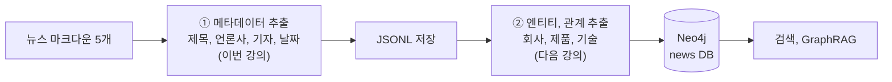
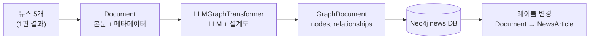
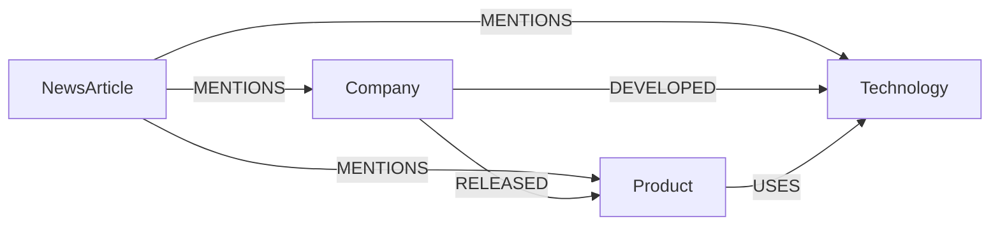
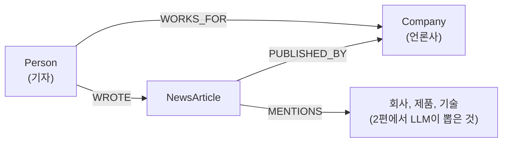
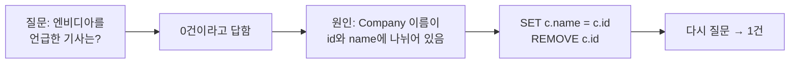
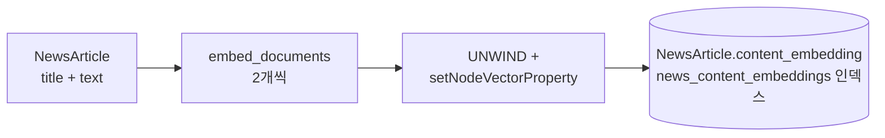
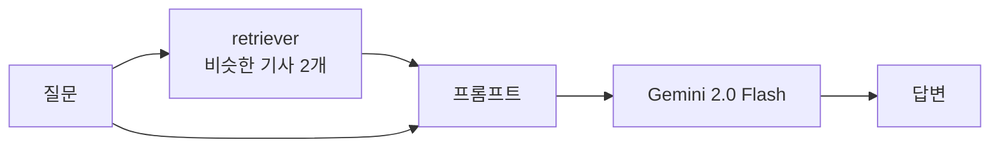
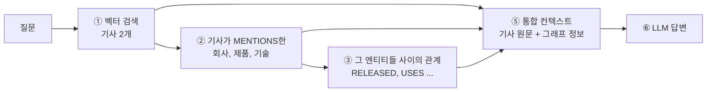
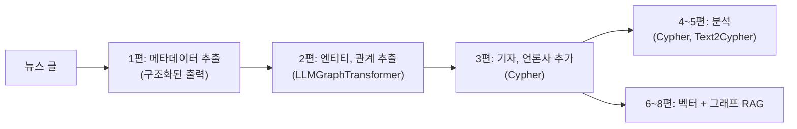

# KG_P2_01 News Analysis (섹션 5)

> 강의: 프로젝트 1 - 뉴스 기사 분석. 노트북 하나를 여러 강의에 걸쳐 진행해서, 이 README도 강의를 들으며 이어서 채웠어요. 노트북 끝(8편)까지 정리돼 있어요.
>
> - [1편: 환경 설정과 뉴스 메타데이터 추출](#1편-환경-설정과-뉴스-메타데이터-추출-노트북-1장--21절)
> - [2편: LLM으로 뉴스에서 그래프 뽑기](#2편-llm으로-뉴스에서-그래프-뽑기-노트북-22절)
> - [3편: 언론사와 기자 노드 추가하기](#3편-언론사와-기자-노드-추가하기-노트북-22절-4)
> - [4편: Cypher로 뉴스 그래프 분석하기](#4편-cypher로-뉴스-그래프-분석하기-노트북-31절)
> - [5편: Text2Cypher로 뉴스 그래프에 질문하기](#5편-text2cypher로-뉴스-그래프에-질문하기-노트북-32절)
> - [6편: 뉴스 본문에 벡터 인덱스 붙이기](#6편-뉴스-본문에-벡터-인덱스-붙이기-노트북-33절-13)
> - [7편: 벡터 검색만 쓰는 기본 RAG](#7편-벡터-검색만-쓰는-기본-rag-노트북-33절-45)
> - [8편: 지식 그래프로 강화한 RAG](#8편-지식-그래프로-강화한-rag-노트북-33절-6)
> - [뉴스 프로젝트를 마치며](#뉴스-프로젝트를-마치며)

> **실행 전에 꼭 확인할 것**: 노트북의 `reset_database()`는 연결된 DB의 노드, 관계, 제약 조건, 인덱스(벡터 인덱스 포함)를 **전부** 지워요. 그래서 `.env`가 아직 AuraDB(영화 데이터)를 가리키는 상태에서 돌리면 섹션 4의 영화 그래프가 다 사라져요. 아래 1절대로 `.env`를 Neo4j Desktop의 `news` DB로 바꾼 다음에 실행하세요.

## 1편: 환경 설정과 뉴스 메타데이터 추출 (노트북 1장 ~ 2.1절)

### 이 강의의 학습 목표

이 강의를 마치면 다음을 할 수 있어요.

1. Neo4j Desktop이 무엇이고, 이번 섹션에서 왜 AuraDB 대신 쓰는지 설명하고 `.env`를 바꿔 연결할 수 있어요.
2. 마크다운 뉴스 파일들을 읽어 텍스트 리스트로 만들 수 있어요.
3. Pydantic 스키마와 `with_structured_output`으로 LLM이 정해진 형식에 맞춰 메타데이터(제목, 언론사, 기자, 날짜, 본문)를 뽑게 할 수 있어요.
4. 추출 결과를 JSONL 파일로 저장하고 다시 읽어 올 수 있어요.

읽기 전에 이 질문 하나를 머리에 두고 보면 좋아요. **"뉴스 맨 위에 '언론사 | 기자 | 날짜'가 정해진 형식으로 적혀 있는데, 굳이 LLM으로 뽑을 필요가 있을까?"**

### 한눈에 보기

섹션 4의 영화 데이터는 이미 CSV로 정리돼 있어서 행을 바로 노드로 바꿨어요. 그런데 이번 뉴스 데이터는 **글**이에요. 그래서 [읽기 전에](../KG_P0_why_graphrag)에서 "GraphRAG에서 가장 어려운 부분"이라고 했던, 글에서 그래프를 만드는 단계가 드디어 나와요.



이번 강의는 그중 첫 단계예요. 뉴스 본문에서 그래프를 뽑기 전에, 먼저 기사마다 "누가, 언제, 어디서 쓴 글인지"를 정리해 둬요.

### 1. Neo4j Desktop으로 바꾸기

#### Neo4j Desktop이 뭐예요?

Neo4j Desktop은 내 컴퓨터에 Neo4j DB를 띄우고 관리하는 앱이에요. 섹션 4까지 쓴 AuraDB가 Neo4j 회사의 클라우드에서 돌아가는 DB라면, Desktop은 같은 DB를 내 PC에서 돌려요. Cypher도, LangChain 코드도 똑같고, 접속 주소만 달라요.

#### 왜 이번에는 Desktop을 써요?

이유는 두 가지예요.

- **프로젝트마다 DB를 따로 만들 수 있어요.** 원래 한 서버에 DB를 여러 개 만드는 건 Enterprise Edition 기능인데, Desktop에는 개발자 개인용 Enterprise 라이선스가 들어 있어요. 그래서 영화 DB는 그대로 두고 `news`라는 DB를 새로 만들 수 있어요. 반면 AuraDB 무료판은 DB가 하나뿐이라, 뉴스 데이터를 넣으려면 영화 데이터를 지워야 해요.
- **플러그인을 직접 설치할 수 있어요.** 강의에서는 APOC 플러그인을 설치해요. APOC은 기본 Cypher에 없는 유용한 프로시저와 함수를 모아 둔 Neo4j 공식 확장 라이브러리예요. 노트북 설정의 `dbms.security.procedures.unrestricted=apoc.meta.*,apoc.*`는 APOC 프로시저를 제한 없이 쓰도록 허용하는 줄이에요. LangChain의 `Neo4jGraph`가 그래프 스키마를 읽을 때 `apoc.meta` 프로시저를 쓰기 때문에 필요해요.

설치는 노트북 1장에 정리돼 있어요. Neo4j 5.24.0으로 DBMS를 만들고, APOC 플러그인을 설치하고, 설정 파일에 위 한 줄을 추가하면 돼요.

#### .env 바꾸기

```bash
# AuraDB 설정은 주석 처리
# NEO4J_URI=neo4j+s://xxxx.databases.neo4j.io

NEO4J_URI=neo4j://localhost:7687     # Desktop 기본 주소
NEO4J_USERNAME=neo4j
NEO4J_PASSWORD=<Desktop에서 DBMS 만들 때 정한 비밀번호>
NEO4J_DATABASE=news                  # 기본값 neo4j가 아니라 news
```

강사가 "가장 중요하다"고 한 건 두 가지예요. 비밀번호는 Desktop에서 DBMS를 만들 때 정한 것이어야 하고, DB 이름은 `news`여야 해요. 그리고 이번 섹션은 OpenAI와 Google Gemini를 둘 다 쓰니까 `OPENAI_API_KEY`, `GOOGLE_API_KEY`도 `.env`에 있어야 해요.

연결할 때는 `Neo4jGraph`에 `database=` 인자가 새로 들어가요. DB가 여러 개니까 어느 DB에 붙을지 정해 줘야 하거든요.

```python
graph = Neo4jGraph(
    url=os.getenv("NEO4J_URI"),
    username=os.getenv("NEO4J_USERNAME"),
    password=os.getenv("NEO4J_PASSWORD"),
    database=os.getenv("NEO4J_DATABASE"),   # news
    enhanced_schema=True,
)
```

연결을 확인하려고 강의에서는 `Test` 노드를 하나 만들고, Neo4j Browser에서 `news` DB에 생겼는지 본 다음, `reset_database()`로 지워요. 이 함수가 맨 위에서 경고한 "전부 지우는" 함수예요.

### 2. 뉴스 데이터 읽기

`news_data/` 폴더에 예제 뉴스 5개가 마크다운으로 들어 있어요. 형식은 모두 같아요.

```markdown
# 구글, 안드로이드 14에 생성형 AI 기능 대거 탑재

**디지털타임스 | 박승리 기자 | 2024-03-20**

구글이 안드로이드 14에 생성형 AI 기능을 대거 탑재했다고 발표했다. ...
```

코드는 `glob`으로 `.md` 파일 목록을 이름순으로 가져온 다음, 파일마다 내용을 통째로 읽어 `news_articles` 리스트에 넣어요. 아직 아무것도 나누지 않은, 기사 하나당 문자열 하나인 상태예요.

### 3. 구조화된 출력으로 메타데이터 뽑기

#### 새로 나오는 두 가지: Pydantic과 with_structured_output

**Pydantic**은 "데이터가 어떤 필드를 어떤 타입으로 가져야 하는지"를 클래스로 정의하는 파이썬 라이브러리예요. `BaseModel`을 상속해서 필드를 적고, `Field(description=...)`으로 각 필드의 뜻을 적어요.

```python
class NewsArticleMetadata(BaseModel):
    title: str = Field(description="뉴스 기사의 제목")
    source: str = Field(description="뉴스 출처/발행처")
    author: str = Field(description="기사 작성자의 이름 (직위 등 표시 불필요)")
    date: str = Field(description="발행일(YYYY-MM-DD 형식)")
    content: str = Field(description="기사의 전체 텍스트 내용")
```

**`with_structured_output`** 은 LLM이 자유로운 문장 대신 **이 스키마 모양 그대로** 답하게 만드는 LangChain 기능이에요. 그래서 결과가 문자열이 아니라 `NewsArticleMetadata` 객체로 나와요. 그리고 `Field`의 `description`은 그냥 주석이 아니라, LLM에게 "이 필드에는 이런 값을 넣어"라는 지시로 전달돼요. 예를 들어 "직위 등 표시 불필요"라고 적었기 때문에 "박승리 기자"가 아니라 "박승리"로 뽑혀요.

```python
llm = ChatOpenAI(model="gpt-4.1-mini", temperature=0)
llm_with_structured_output = llm.with_structured_output(NewsArticleMetadata)
chain = prompt | llm_with_structured_output        # 06강에서 본 LCEL 그대로예요
metadata = chain.invoke({"article_text": article_text})
```

나머지 코드는 안전장치예요. 값이 비어 있으면 `"미상"` 같은 기본값을 넣고, 본문이 비어 있으면 원문을 그대로 넣어요. 그리고 API 호출이 실패하면 예외를 잡아서 빈 메타데이터를 돌려줘요. 이걸 기사 5개에 반복해서 `extracted_metadata` 리스트를 만들어요.

#### 처음 질문으로: 이걸 꼭 LLM으로 해야 할까?

솔직히 이 예제 데이터는 아니에요. 다섯 기사 모두 `**언론사 | 기자 | 날짜**` 형식이 똑같아서, 정규식 몇 줄이면 비용 없이 항상 같은 결과를 얻을 수 있어요. 강사도 "정규식이나 룰 기반으로 처리할 수도 있다"고 짚었어요.

그런데도 LLM을 쓰는 걸 보여 주는 이유는, 실제로 크롤링한 뉴스는 언론사마다 형식이 제각각이기 때문이에요. 날짜가 맨 아래에 있기도 하고, 기자 이름이 본문 끝에 붙어 있기도 하죠. 그러니까 형식이 고정돼 있으면 정규식, 형식이 들쭉날쭉하면 LLM, 이렇게 고르면 돼요.

그리고 강의 밖에서 한 가지 덧붙일게요. 이 스키마는 `content`(본문 전체)까지 LLM에게 다시 적게 해요. 그러면 본문 길이만큼 출력 토큰 비용이 나가고, LLM이 본문을 한 글자도 안 바꾸고 옮긴다는 보장도 없어요. 그래서 실무에서는 본문은 원문을 그대로 쓰고, LLM에게는 제목, 언론사, 기자, 날짜처럼 짧은 값만 뽑게 하는 게 나아요.

### 4. JSONL로 저장하고 다시 읽기

**JSONL**(JSON Lines)은 한 줄에 JSON 객체 하나씩 적는 파일 형식이에요. 기사 5개면 5줄이 돼요.

```python
with open('../news_data/news_metadata.jsonl', 'w', encoding='utf-8') as f:
    for metadata in extracted_metadata:
        json.dump(metadata.model_dump(), f, ensure_ascii=False)
        f.write('\n')
```

- **왜 저장해요?** LLM 추출은 돈과 시간이 드니까 결과를 파일로 남겨 두는 거예요. 그러면 다음에 노트북을 다시 열 때 LLM을 또 부르지 않고 파일만 읽으면 돼요.
- **`model_dump()`**: Pydantic 객체는 그대로 `json.dump`에 넣을 수 없어서 딕셔너리로 바꿔요. 예전에는 `.dict()`를 썼는데, 지금 Pydantic(v2)에서는 `model_dump()`를 쓰라는 경고가 떠요. 강의에서도 그래서 바꿨어요.
- **`ensure_ascii=False`**: 이걸 빼면 한글이 `\uad6c\uae00`처럼 깨진 모양으로 저장돼요.

읽을 때는 반대로 한 줄씩 `json.loads`해서 딕셔너리 리스트로 만들어요. 마지막으로 기사마다 `article_0`, `article_1` 같은 `id`를 붙여서 `extracted_articles`를 만드는데, 이 `id`가 다음 강의에서 `NewsArticle` 노드의 고유 키(제약 조건)로 쓰여요.

### 5. 정리하며 기억할 것

- Neo4j Desktop은 내 PC에서 돌리는 Neo4j예요. 이번 섹션에서는 DB를 프로젝트별로 나누고(`news`), APOC 플러그인을 쓰려고 Desktop을 써요.
- `reset_database()`는 연결된 DB를 통째로 비워요. 실행 전에 `.env`가 어느 DB를 가리키는지 꼭 확인해요.
- Pydantic으로 출력 모양을 정의하고 `with_structured_output`을 붙이면, LLM이 그 모양 그대로 답해요. 그리고 `Field`의 `description`은 LLM에게 가는 지시예요.
- 형식이 고정된 데이터는 정규식이 싸고 정확해요. LLM은 형식이 제각각일 때 빛나요.
- LLM 결과는 JSONL로 저장해 두고 다시 읽어 써요.

### 다음이랑 어떻게 이어지나

다음 강의는 노트북 2.2절 "KG 온톨로지 구현"이에요. `NewsArticle`, `Company`, `Product`, `Technology` 노드와 `MENTIONS`, `RELEASED` 같은 관계로 온톨로지를 정하고, LangChain의 `LLMGraphTransformer`로 뉴스 본문에서 회사, 제품, 기술과 그 관계를 뽑아 그래프로 만들어요. 섹션 4의 CSV 강의에서 `GraphDocument`를 미리 써 본 이유가 여기서 나와요. LLM이 글에서 뽑은 그래프도 같은 `GraphDocument` 형식이거든요.

---

## 2편: LLM으로 뉴스에서 그래프 뽑기 (노트북 2.2절)

### 이 강의의 학습 목표

이 강의를 마치면 다음을 할 수 있어요.

1. 뉴스 그래프의 온톨로지(어떤 노드와 관계로 만들지)를 읽고, 제약 조건을 왜 먼저 거는지 설명할 수 있어요.
2. `LLMGraphTransformer`가 무엇인지 알고, `allowed_nodes`, `allowed_relationships`, `node_properties`로 LLM이 뽑을 범위를 정할 수 있어요.
3. 뉴스를 `Document`로 바꾸고, `convert_to_graph_documents`와 `add_graph_documents`로 그래프를 만들어 Neo4j에 저장할 수 있어요.
4. 원본 기사 노드의 레이블을 `Document`에서 `NewsArticle`로 바꿀 수 있어요.

읽기 전에 이 질문 하나를 머리에 두고 보면 좋아요. **"기사에 엔비디아 CEO '젠슨 황'이 분명히 나오는데, 왜 그래프에는 사람 노드가 하나도 안 생겼을까?"**

### 한눈에 보기

섹션 4의 [CSV 강의](../KG_P1_03_neo4j_movie_01_csv)에서는 CSV 행을 보고 `Node`, `Relationship`, `GraphDocument`를 **사람이 코드로** 만들었어요. 이번에는 같은 일을 **LLM이** 해요. 기사를 읽고 노드와 관계를 뽑아서 똑같은 `GraphDocument`로 돌려줘요. 그래서 저장하는 코드(`add_graph_documents`)는 CSV 강의와 같아요.



그리고 이번에 만들 그래프의 설계도(온톨로지)는 이래요.



### 1. 온톨로지와 제약 조건

노드는 `NewsArticle`(기사), `Company`(회사), `Product`(제품), `Technology`(기술) 네 종류예요. 이 중 회사, 제품, 기술 사이의 관계 세 개(`RELEASED`, `DEVELOPED`, `USES`)는 LLM이 본문에서 뽑고, 기사에서 각 엔티티로 가는 `MENTIONS`는 저장할 때 자동으로 생겨요(4절).

CSV 강의에서 배운 대로 데이터를 넣기 **전에** 제약 조건부터 걸어요.

```cypher
CREATE CONSTRAINT IF NOT EXISTS FOR (n:NewsArticle) REQUIRE n.id IS UNIQUE
CREATE CONSTRAINT IF NOT EXISTS FOR (c:Company) REQUIRE c.name IS UNIQUE
CREATE CONSTRAINT IF NOT EXISTS FOR (p:Product) REQUIRE p.name IS UNIQUE
CREATE CONSTRAINT IF NOT EXISTS FOR (t:Technology) REQUIRE t.name IS UNIQUE
CREATE CONSTRAINT IF NOT EXISTS FOR (p:Person) REQUIRE p.name IS UNIQUE
```

다만 여기에는 하나 짚을 점이 있어요. `LLMGraphTransformer`가 만드는 노드는 이름을 `name`이 아니라 **`id` 속성**에 넣어요. 강의의 Browser 화면에서도 회사 이름이 `id`에 들어 있고, 노트북 뒤쪽의 분석 쿼리도 `c.id`로 회사 이름을 꺼내요. 그래서 `name`에 건 제약 조건은 LLM이 만든 노드를 지켜 주지 못해요. LLM이 뽑은 같은 이름의 노드가 하나로 합쳐지는 건, 저장할 때 `id` 기준으로 MERGE하기 때문이에요. 그러니 이 제약 조건들은 다음 단계에서 Cypher로 직접 만드는 언론사, 기자 노드(`name` 사용)를 위한 거라고 보면 돼요.

### 2. LLMGraphTransformer: LLM에게 그래프를 뽑게 하기

#### LLMGraphTransformer가 뭐예요?

텍스트를 LLM에게 읽혀서 노드와 관계를 뽑고, 그 결과를 `GraphDocument`로 돌려주는 LangChain 도구예요. 원리는 1편의 `with_structured_output`과 같아요. 내부 프롬프트에 "이런 노드와 관계만, 이런 모양으로 뽑아라"라는 지시가 들어 있고, LLM은 그 모양대로 답해요.

이 도구는 `langchain_experimental` 패키지에 있어요. 이름 그대로 아직 실험 단계 기능을 모아 둔 패키지라서 버전이 바뀌면 사용법이 달라질 수 있어요. 그리고 이 레포에는 아직 설치돼 있지 않아서, 처음 한 번 설치해야 해요.

```bash
uv add langchain-experimental
```

#### 설정하기

```python
from langchain_experimental.graph_transformers import LLMGraphTransformer

llm = ChatOpenAI(model="gpt-4.1", temperature=0)

allowed_nodes = ["Company", "Product", "Technology"]
allowed_relationships = [
    ("Company", "RELEASED", "Product"),      # 회사가 제품을 출시함
    ("Company", "DEVELOPED", "Technology"),  # 회사가 기술을 개발함
    ("Product", "USES", "Technology"),       # 제품이 기술을 사용함
]

transformer = LLMGraphTransformer(
    llm=llm,
    allowed_nodes=allowed_nodes,
    allowed_relationships=allowed_relationships,
    node_properties=["industry", "version", "releaseDate", "category"],
)
```

| 인자 | 뜻 |
|---|---|
| `llm` | 추출할 LLM이에요. 추출은 모델 성능에 따라 품질 차이가 커서, 강사는 mini가 아닌 `gpt-4.1`을 골랐어요 |
| `allowed_nodes` | 뽑을 노드 종류예요. 여기 없는 종류는 뽑지 않아요 |
| `allowed_relationships` | (시작 노드, 관계, 끝 노드) 튜플이에요. 관계 이름과 **방향**을 함께 고정해요 |
| `node_properties` | 노드에 붙일 수 있는 속성 후보예요. 어떤 노드에 어떤 속성을 붙일지는 LLM이 기사를 보고 판단해요 |

#### 왜 미리 정해 둬요?

안 정하면 LLM이 기사마다 그때그때 이름을 지어요. 예를 들어 "출시했다"를 어떤 기사에서는 `ANNOUNCED`, 다른 기사에서는 `LAUNCHED`, 또 다른 기사에서는 `RELEASES`로 만들 수 있어요. 그러면 "회사가 출시한 제품"을 Cypher로 찾을 때 이름을 전부 알아야 하고, 새 이름이 나오면 빠져요. 반대로 미리 정해 두면 "출시"는 항상 `(Company)-[:RELEASED]->(Product)` 하나라서 쿼리 한 줄로 다 찾을 수 있어요.

대신 비용도 있어요. **설계도에 없는 정보는 버려져요.** 이게 처음 질문의 답과 이어지는데, 6절에서 다룰게요.

그리고 `node_properties`는 LLM에게 판단을 맡기는 부분이라 강사도 "일관성이 좀 부족할 수 있다"고 했어요. 예를 들어 `releaseDate`가 어떤 노드에는 "2024-03", 다른 노드에는 "올해 3월"처럼 들어갈 수 있어요. 그래서 실무에서는 추출한 다음 속성 값을 한 번 표준화해서 넣는 게 안정적이에요.

### 3. 뉴스 → Document → GraphDocument

먼저 1편에서 만든 기사 딕셔너리를 LangChain `Document`로 바꿔요. 본문은 `page_content`에, 나머지(id, 제목, 언론사, 기자, 날짜)는 `metadata`에 넣어요. `LLMGraphTransformer`가 `Document`를 입력으로 받기 때문이에요.

```python
doc = Document(
    page_content=article["content"],
    metadata={"id": article["id"], "title": article["title"], "source": article["source"],
              "author": article["author"], "date": article["date"]},
)
```

그다음 한 줄로 변환해요.

```python
graph_documents = transformer.convert_to_graph_documents(documents)   # 기사 5개 → GraphDocument 5개
```

`GraphDocument`마다 `nodes`와 `relationships`가 들어 있어요. 강의에서 첫 번째 기사(구글 안드로이드 14)를 열어 보면 이렇게 나왔어요.

- **노드:** 회사(구글), 제품(안드로이드 14, 구글 어시스턴트), 기술(생성형 AI 등). 일부 노드에는 속성도 붙었어요.
- **관계:** 구글 -`RELEASED`→ 안드로이드 14, 구글 -`DEVELOPED`→ 생성형 AI, 안드로이드 14와 구글 어시스턴트 -`USES`→ 각 기술

즉 정해 둔 세 가지 관계 안에서만 뽑혔어요.

### 4. Neo4j에 저장하기

```python
for doc in graph_documents:
    graph.add_graph_documents([doc], include_source=True)
```

`add_graph_documents`는 CSV 강의에서 쓴 그 메서드예요. 새로 나온 건 `include_source=True`인데, 이걸 켜면 뽑힌 노드와 관계만이 아니라 **원본 기사도 노드로 저장**하고, 원본 기사에서 뽑힌 엔티티마다 `MENTIONS` 관계를 이어 줘요. 그래서 나중에 "이 회사는 어느 기사에 나왔지?", "이 관계는 어느 기사에서 뽑았지?"를 거꾸로 추적할 수 있어요. 온톨로지의 `(NewsArticle)-[:MENTIONS]->(엔티티)`가 여기서 생겨요.

저장한 뒤 Browser에서 보면 Company(삼성전자, 엔비디아 등), Product(H200 AI 전용 GPU 등), Technology(HBM, LLM, 생성형 AI 워크로드 등) 노드가 생겨 있어요. 다만 강의 화면에서는 같은 대상을 다른 이름으로 부른 노드(예: "삼성"과 "삼성전자")가 따로 생겼는지는 따로 확인하지 않았어요. 기사가 많아지면 이런 중복이 꼭 생기니까, 저장 후에 한 번 살펴보는 습관을 들이면 좋아요.

### 5. Document 레이블을 NewsArticle로 바꾸기

`include_source=True`로 저장한 원본 기사는 LangChain 기본값인 `Document` 레이블로 들어가요. 그런데 우리 온톨로지에서는 `NewsArticle`이라고 부르기로 했으니 레이블을 바꿔요.

```cypher
MATCH (d:Document)
SET d:NewsArticle        // 새 레이블 추가 (잠깐 레이블 두 개)
REMOVE d:Document        // 옛 레이블 제거
RETURN count(d) AS count
```

[Introduction](../KG_P1_01_neo4j_Introduction)에서 배운 `SET`, `REMOVE`를 레이블에 쓴 거예요. 노드 하나에 레이블을 여러 개 붙일 수 있으니까, 새 레이블을 붙이고 옛 레이블을 떼는 순서로 바꾸면 돼요. 실행하면 `Document`는 사라지고 `NewsArticle` 5개만 남아요.

### 6. 처음 질문으로: 젠슨 황은 왜 사라졌을까?

강사는 Browser에서 Person 노드가 하나도 없는 걸 보고 "사람을 추출하는 데 실패한 것 같다"고 했어요. 그런데 코드를 다시 보면 실패가 아니에요.

```python
allowed_nodes = ["Company", "Product", "Technology"]   # Person이 없어요
```

`allowed_nodes`에 Person이 없으니, LLM은 처음부터 "사람은 뽑지 마"라는 지시를 받은 거예요. 즉 LLM이 젠슨 황을 놓친 게 아니라, **설계도가 사람을 뽑지 않도록 되어 있었던** 거예요. 1절의 Person 제약 조건이 있어서 헷갈리기 쉬운데, 그건 다음 단계에서 Cypher로 만드는 기자 노드를 위한 거예요.

사람도 뽑고 싶다면 설계도를 넓혀서 다시 추출하면 돼요. 예를 들면 이렇게요.

```python
allowed_nodes = ["Company", "Product", "Technology", "Person"]
allowed_relationships = [..., ("Person", "WORKS_FOR", "Company")]
```

다만 설계도를 바꾸면 기사 전체를 다시 추출해야 해서 LLM 비용이 또 들어요. 그래서 추출 결과가 이상할 때는 LLM 탓을 하기 전에 **설계도부터 확인**하는 게 순서예요.

### 7. 정리하며 기억할 것

- `LLMGraphTransformer`는 LLM이 글에서 노드와 관계를 뽑아 `GraphDocument`로 돌려주는 도구예요. CSV 강의에서 손으로 만든 `GraphDocument`를 LLM이 대신 만들어요.
- `allowed_nodes`, `allowed_relationships`로 설계도를 주면 관계 이름과 방향이 일정해져서 쿼리하기 쉬워져요. 대신 설계도 밖의 정보는 버려져요.
- `node_properties`는 LLM 판단이라 들쭉날쭉할 수 있으니, 추출 후 표준화하는 게 좋아요.
- `include_source=True`는 원본 기사를 노드로 함께 저장하고 `MENTIONS`로 이어서, 어느 기사에서 나온 정보인지 추적하게 해 줘요.
- LLM이 만든 노드는 이름이 `id` 속성에 들어가요. 쿼리할 때 `name`이 아니라 `id`로 꺼내야 해요.

### 다음이랑 어떻게 이어지나

노트북의 다음 부분에서는 1편에서 뽑은 메타데이터로 언론사(`Company`, `PUBLISHED_BY`)와 기자(`Person`, `WROTE`, `WORKS_FOR`) 노드를 **Cypher로 직접** 만들어요. 본문 속 엔티티는 LLM이 뽑고, 형식이 정해진 메타데이터는 Cypher로 확실하게 넣는 식으로 역할을 나누는 거예요. 그다음 3장에서는 이렇게 만든 그래프로 "가장 많이 언급된 회사", "회사별 보유 기술" 같은 분석 쿼리를 해요.

---

## 3편: 언론사와 기자 노드 추가하기 (노트북 2.2절 (4))

### 이 강의의 학습 목표

이 강의를 마치면 다음을 할 수 있어요.

1. 1편에서 뽑아 둔 메타데이터(언론사, 기자)를 Cypher로 노드와 관계로 만들 수 있어요.
2. `MATCH`, `MERGE`, `WITH`가 여러 번 이어지는 쿼리를 단계별로 읽을 수 있어요.
3. 본문 속 엔티티는 LLM이, 메타데이터는 Cypher가 맡는 이유를 설명할 수 있어요.
4. Neo4j Browser에서 노드 하나를 중심으로 주변 관계를 펼쳐 보며 그래프를 탐색할 수 있어요.

읽기 전에 이 질문 하나를 머리에 두고 보면 좋아요. **"기자 이름과 언론사는 이미 기사 노드의 속성에 들어 있는데, 왜 굳이 따로 노드로 빼낼까?"**

### 한눈에 보기

2편까지 만든 그래프에서 기사(`NewsArticle`) 노드는 언론사와 기자를 **속성**으로만 갖고 있어요. 이번 강의에서는 그걸 **노드와 관계**로 바꿔요.

```
전:  (NewsArticle {source: "전자일보", author: "김송이", ...})

후:  (김송이:Person) ─WROTE→ (NewsArticle) ─PUBLISHED_BY→ (전자일보:Company)
          └──────────────────── WORKS_FOR ───────────────────────┘
```



여기서는 LLM을 쓰지 않아요. 언론사와 기자는 1편에서 이미 정리된 값이라, Cypher로 넣으면 비용 없이 항상 같은 결과가 나오거든요. 즉 본문처럼 형식이 없는 건 LLM이, 형식이 정해진 메타데이터는 Cypher가 맡는 식으로 역할을 나눈 거예요.

### 1. 언론사를 Company 노드로 만들기

```cypher
MATCH (n:NewsArticle)
WITH DISTINCT n.source AS source
MERGE (c:Company {name: source, type: 'news'})
RETURN count(c) AS count
```

기사들의 `source` 값을 중복 없이 모아서, 언론사마다 `Company` 노드를 하나씩 만들어요. 그리고 `type: 'news'`를 붙여서 2편에서 LLM이 뽑은 일반 회사와 구분해요. 결과는 디지털타임스와 전자일보, 두 개예요.

다음으로 기사와 언론사를 `PUBLISHED_BY`로 이어요.

```cypher
MATCH (n:NewsArticle), (c:Company)
WHERE n.source = c.name
MERGE (n)-[:PUBLISHED_BY]->(c)
RETURN count(n) AS count
```

"기사의 `source`와 회사의 `name`이 같으면 잇는다"는 뜻이에요. 기사 5개가 모두 이어져서, 디지털타임스에 3개, 전자일보에 2개가 연결돼요.

참고로 `MATCH (n:NewsArticle), (c:Company)`는 기사와 회사의 **모든 조합**을 만든 다음 `WHERE`로 거르는 방식이에요. 지금은 데이터가 작아서 괜찮지만 많아지면 느려지니까, 그때는 `MATCH (n:NewsArticle) MATCH (c:Company {name: n.source})`처럼 처음부터 맞는 것만 찾게 쓰는 게 좋아요.

### 2. 기자를 Person 노드로: 여러 단계 쿼리 읽기

이번 강의에서 가장 긴 쿼리예요. 그런데 강사 말대로 "복잡해 보이지만 몇 줄 안 돼요". 단계로 끊어 읽으면 돼요.

```cypher
MATCH (n:NewsArticle)
WITH DISTINCT n.author AS author, n.source AS source, n.id AS articleId   // ①
MERGE (p:Person {name: author})                                           // ②
WITH p, source, articleId
MERGE (c:Company {name: source})                                          // ③
MERGE (p)-[:WORKS_FOR]->(c)                                               // ④
WITH p, articleId
MATCH (a:NewsArticle {id: articleId})
MERGE (p)-[:WROTE]->(a)                                                   // ⑤
RETURN count(DISTINCT p) AS count
```

| 단계 | 하는 일 |
|---|---|
| ① | 기사마다 기자 이름, 언론사, 기사 id를 꺼내요 |
| ② | 기자 `Person` 노드를 만들어요. 이미 있으면 그 노드를 써요 |
| ③ | 언론사 노드를 찾아요. 1절에서 이미 만들었으니 새로 만들지 않고 찾기만 해요 |
| ④ | 기자 → 언론사로 `WORKS_FOR`(소속)를 이어요 |
| ⑤ | 기사 id로 기사를 다시 찾아서, 기자 → 기사로 `WROTE`(작성)를 이어요 |

중간중간 `WITH`가 들어가는 이유는 두 가지예요. 하나는 [기본 검색](../KG_P1_03_neo4j_movie_02_basic_search)에서 본 "여기까지 정리해서 다음 단계로 넘겨"예요. 다음 단계에 필요한 변수만 남기는 거죠. 다른 하나는 문법 규칙이에요. Cypher에서는 `MERGE`, `CREATE` 같은 쓰기 다음에 `MATCH` 같은 읽기를 다시 하려면 사이에 `WITH`가 꼭 있어야 해요. 그래서 ⑤의 `MATCH` 앞에도 `WITH`가 있어요.

결과는 기자 5명이에요. 기사 다섯 개를 모두 다른 기자가 썼어요(디지털타임스의 박승리, 최기상, 정주리, 전자일보의 이승지, 김송이).

**실무 팁: MERGE는 적은 속성이 전부 같은 노드를 찾아요.** 그래서 1절의 `MERGE (c:Company {name: source, type: 'news'})`로 만든 노드를 ③의 `MERGE (c:Company {name: source})`가 잘 찾아요. 하지만 순서가 반대였다면, 즉 `name`만 있는 노드가 먼저 있고 나중에 `{name, type}`으로 MERGE했다면, 같은 노드로 보지 않아서 새로 만들려고 해요. 그러면 `Company.name` 제약 조건에 걸려 에러가 나요. 그래서 MERGE는 고유 키(`name`)로만 하고, 나머지 속성은 [Introduction](../KG_P1_01_neo4j_Introduction)에서 본 `ON CREATE SET`으로 넣는 게 안전해요.

```cypher
MERGE (c:Company {name: source})
ON CREATE SET c.type = 'news'
```

### 3. Browser에서 노드 중심으로 펼쳐 보기

강의 후반은 Neo4j Browser에서 그래프를 탐색하는 시간이에요. 노드를 더블클릭하면 그 노드에 연결된 노드들이 펼쳐져요.

- **기자에서 시작하면:** 김송이 → 소속 언론사 전자일보 → 같은 언론사의 이승지 기자까지 이어져요. 김송이가 쓴 기사를 펼치면 그 기사가 `MENTIONS`로 언급한 회사(엔비디아), 제품, 기술이 보여요.
- **회사에서 시작하면:** 엔비디아를 펼치면 `RELEASED`로 출시한 H200이 보이고, H200을 다시 펼치면 `USES`로 이어진 기술(기사에 나온 트랜스포머 엔진, LLM 같은 것)이 보여요.

이렇게 노드 하나에서 시작해 관계를 따라 넓혀 가며 패턴을 찾는 게 그래프의 강점이라고 강사가 정리했어요. 참고로 Browser에서 레이블을 클릭하면 노드 색을 바꿀 수 있어서, Company, NewsArticle, Product를 색으로 구분해 두면 보기 편해요.

### 4. 처음 질문으로: 속성으로 두면 안 되나요?

속성은 **막다른 길**이고, 노드는 **갈림길**이에요.

`author: "김송이"`가 기사 속성으로만 있으면, 그건 그 기사 안에 적힌 글자일 뿐이에요. 그래서 "김송이가 쓴 다른 기사", "김송이와 같은 언론사 기자"를 찾으려면 모든 기사의 글자를 비교해야 해요. 반면 `(김송이:Person)` 노드가 있으면 거기서 `WROTE`, `WORKS_FOR` 관계를 바로 따라갈 수 있어요. 예를 들어 "전자일보 기자들이 쓴 기사에서 가장 많이 언급된 회사는?" 같은 질문도 이렇게 길을 따라가면 돼요.

```
(전자일보) ←WORKS_FOR─ (기자) ─WROTE→ (기사) ─MENTIONS→ (회사)
```

[CSV 강의](../KG_P1_03_neo4j_movie_01_csv)에서 감독과 배우를 Person 하나로 두고 역할을 관계로 나눈 것과 같은 생각이에요. 자주 따라가고 싶은 대상은 노드로 만들어요.

다만 이제 `Company` 레이블 안에 두 종류가 섞였어요. 2편에서 LLM이 만든 회사는 이름이 `id`에 있고, 이번에 만든 언론사는 `name`에 있어요. 같은 레이블인데 이름이 든 속성이 달라서 쿼리할 때 헷갈리기 쉬워요. 노트북 다음 부분에서 `SET c.name = c.id REMOVE c.id`로 이걸 정리해요.

### 5. 정리하며 기억할 것

- 형식이 정해진 메타데이터(언론사, 기자)는 LLM 없이 Cypher로 넣어요. 싸고 결과가 항상 같아요.
- `MERGE`는 "없으면 만들고 있으면 찾기"라서 여러 번 돌려도 중복이 안 생겨요. 단, 적은 속성이 전부 같아야 같은 노드로 봐요. 고유 키로만 MERGE하고 나머지는 `ON CREATE SET`으로 넣어요.
- 쓰기(`MERGE`, `CREATE`) 다음에 다시 `MATCH`하려면 사이에 `WITH`가 필요해요.
- 자주 따라가고 싶은 값은 속성이 아니라 노드로 빼요. 그래야 관계를 타고 넓혀 갈 수 있어요.

### 다음이랑 어떻게 이어지나

이제 그래프가 다 만들어졌어요. 노트북 3장에서는 이 그래프로 "가장 많이 언급된 회사, 제품, 기술", "회사별로 기사를 쓴 기자", "회사별 개발 기술" 같은 분석 쿼리를 직접 짜 보고, 3.2절에서는 섹션 4에서 배운 Text2Cypher(`GraphCypherQAChain`)를 이번에는 Gemini로 붙여 봐요.

---

## 4편: Cypher로 뉴스 그래프 분석하기 (노트북 3.1절)

### 이 강의의 학습 목표

이 강의를 마치면 다음을 할 수 있어요.

1. `refresh_schema()`로 그래프 스키마를 확인하고, 그걸 보며 분석 쿼리를 짤 수 있어요.
2. `MENTIONS` 관계와 집계로 회사, 제품, 기술이 기사에 몇 번 언급됐는지 셀 수 있어요.
3. 패턴 두 개를 엮어서 "이 회사를 다룬 기사를 쓴 기자"처럼 두 단계 떨어진 정보를 찾을 수 있어요.
4. 기사 수를 셀 때 왜 `COUNT(DISTINCT ...)`를 쓰는지 설명할 수 있어요.

읽기 전에 이 질문 하나를 머리에 두고 보면 좋아요. **"'우리 회사를 다룬 기자가 누구고, 몇 건 썼어?'를 classic RAG에 물으면 답할 수 있을까?"**

### 한눈에 보기

1~3편에서 만든 그래프를 이제 **쓰는** 시간이에요. 문법은 새로울 게 없어요. [기본 검색](../KG_P1_03_neo4j_movie_02_basic_search)에서 배운 패턴 + 집계(`count`, `collect`)를 뉴스 도메인에 적용하는 거예요. 새로운 건 "이 쿼리를 실무에서 어디에 쓰나"예요.

| 분석 | 따라가는 패턴 | 실무에서 쓰는 곳 | 강의 결과 |
|---|---|---|---|
| 회사 언급 횟수 | 기사 -`MENTIONS`→ 회사 | 홍보팀의 미디어 노출, 평판 파악 | 회사마다 1번 |
| 제품 언급 횟수 | 기사 -`MENTIONS`→ 제품 | 제품 마케팅 효과 | iOS 18, Llama 3, H200 등 6개, 각 1번 |
| 기술 언급 순위 | 기사 -`MENTIONS`→ 기술 | 기술 트렌드, 미디어 관심도 | 각 1번 |
| 회사별 기자 | 회사 ←`MENTIONS`- 기사 ←`WROTE`- 기자 | 언론 대응, 보도 패턴 분석 | 기사마다 다른 기자 |
| 회사별 개발 기술 | 회사 -`DEVELOPED`→ 기술 | 기술 포트폴리오 파악 | 애플, 메타, 삼성전자, 구글 |

결과가 전부 1번인 건 예제 기사가 5개뿐이고 회사마다 기사가 하나씩이라서예요. 지금은 쿼리 모양을 익히는 단계라고 보면 돼요.

### 1. 스키마부터 확인하기

```python
graph.refresh_schema()
print(graph.schema)
```

쿼리를 짜기 전에 어떤 레이블, 관계, 속성이 있는지부터 봐요. 데이터를 넣은 뒤에는 `refresh_schema()`로 최신 상태로 다시 읽어야 하고, 1편에서 `enhanced_schema=True`를 줬기 때문에 속성의 예시 값까지 보여서, 사람이 쿼리를 짤 때 참고하기 좋아요. 다만 다음 강의의 `GraphCypherQAChain`은 이 출력을 그대로 LLM에게 주지 않고, 속성 이름과 타입만 추린 스키마를 따로 만들어 줘요.

여기서 확인할 점이 하나 있어요. 2편에서 말했듯이 LLM이 만든 회사, 제품, 기술 노드는 이름이 `id`에 들어 있어요. 그래서 이번 강의의 쿼리들은 전부 `c.id`, `p.id`, `t.id`로 이름을 꺼내요.

### 2. 언급 횟수 세기

```cypher
MATCH (n:NewsArticle)-[:MENTIONS]->(c:Company)
WITH c.id AS companyName, COUNT(n) AS mentionCount
RETURN companyName, mentionCount
ORDER BY mentionCount DESC
```

"회사를 언급한 기사"를 모두 찾은 다음, 회사 이름별로 묶어서 기사 수를 세요. `GROUP BY`가 없어도 집계 함수와 함께 적은 `c.id`가 묶는 기준이 되는 건 [기본 검색](../KG_P1_03_neo4j_movie_02_basic_search)에서 본 그대로예요. 제품은 `Company`를 `Product`로 바꾸면 똑같아요.

이 쿼리는 `WITH`에서 집계하고 `RETURN`으로 넘겼는데, 기술 쿼리는 `RETURN`에서 바로 집계해요. 둘 다 결과는 같아요. 다만 집계 결과로 다시 거르고 싶을 때, 예를 들어 "2번 이상 언급된 회사만"이라면 `WITH ... WHERE mentionCount >= 2`처럼 `WITH`가 필요해요.

```cypher
MATCH (n:NewsArticle)-[:MENTIONS]->(t:Technology)
RETURN t.id, COUNT(DISTINCT n) AS news_coverage
ORDER BY news_coverage DESC
LIMIT 5
```

### 3. 패턴 두 개 엮기: 회사별 기자

이번 강의에서 그래프다운 쿼리는 이거예요.

```cypher
MATCH (n:NewsArticle)-[:MENTIONS]->(c:Company),
      (n)<-[:WROTE]-(person:Person)
RETURN c.id AS companyName,
       COLLECT(DISTINCT person.name) AS authors,
       COUNT(DISTINCT n) AS article_count
ORDER BY article_count DESC
```

쉼표로 패턴 두 개를 적었는데, 둘 다 같은 `n`을 쓰고 있어요. 그래서 "회사를 언급한 기사 `n`"이면서 "그 `n`을 쓴 기자"라는 뜻이 돼요. 길로 그리면 이래요.

```
(회사) ←MENTIONS─ (기사) ←WROTE─ (기자)
```

2편에서 LLM이 만든 `MENTIONS`와 3편에서 Cypher로 만든 `WROTE`가 여기서 처음 함께 쓰여요. 그래서 3편에서 기자를 속성이 아니라 노드로 뺀 거예요.

#### 왜 COUNT(DISTINCT n)이에요?

`MATCH`는 패턴이 맞는 **조합마다** 한 줄을 만들어요. 그래서 만약 기사 하나를 기자 두 명이 함께 썼다면, (회사, 기사, 기자A)와 (회사, 기사, 기자B)로 두 줄이 생겨요. 이때 `COUNT(n)`은 줄 수를 세니까 기사가 2건으로 잡혀요. 반면 `COUNT(DISTINCT n)`은 서로 다른 기사만 세니까 정확히 1건이에요. 지금 예제는 기사마다 기자가 한 명이라 차이가 없지만, 패턴을 여러 개 엮을 때는 `DISTINCT`를 붙이는 습관을 들이는 게 안전해요.

### 4. 회사별 개발 기술

```cypher
MATCH (c:Company)-[:DEVELOPED]->(t:Technology)
RETURN c.id AS companyName, COLLECT(t.id) AS technologies
```

결과에는 애플, 메타, 삼성전자, 구글이 나오고 엔비디아는 없어요. 엔비디아 기사에서는 LLM이 H200을 **제품**으로 뽑아 `RELEASED`로만 이은 것으로 보여요. 즉 "엔비디아가 개발한 기술"이라는 질문의 답은, 2편에서 LLM이 무엇을 어떤 관계로 뽑았느냐에 달려 있어요. 분석 결과가 이상하면 쿼리보다 추출 결과부터 보는 게 순서예요.

### 5. 처음 질문으로: classic RAG로는 안 되나요?

어려워요. classic RAG는 질문과 비슷한 기사 몇 개(top-k)만 가져와서 LLM에게 읽혀요. 그래서 "우리 회사를 다룬 **모든** 기사를 쓴 기자와 건수"처럼 전체를 세고, 회사 → 기사 → 기자로 이어야 하는 질문은 구조적으로 약해요. 반면 그래프에서는 위의 쿼리 한 번이면 돼요. [읽기 전에](../KG_P0_why_graphrag)에서 말한 "집계"와 "여러 홉 연결"이 바로 이런 질문이에요.

다만 이 결과는 2편의 추출 품질만큼만 정확해요. 예를 들어 같은 제품이 기사마다 "H200"과 "H200 AI 전용 GPU"처럼 다른 이름으로 뽑히면, 노드가 둘로 나뉘어서 언급 횟수도 나뉘어요. 기사가 수백 개가 되면 이런 이름 정리가 분석 정확도를 좌우해요.

### 6. 정리하며 기억할 것

- 분석 쿼리는 새 문법 없이 "패턴 + 집계"예요. 묶는 기준은 집계 함수와 함께 적은 값이에요.
- LLM이 만든 노드는 이름이 `id`에 있어서 `c.id`로 꺼내요.
- 패턴 여러 개를 같은 변수로 엮으면 여러 단계 떨어진 정보(회사 ← 기사 ← 기자)를 한 번에 찾을 수 있어요.
- 패턴을 엮으면 조합마다 줄이 생기니까, 개수를 셀 때는 `COUNT(DISTINCT ...)`를 써요.
- 분석 결과는 추출 품질에 달려 있어요. 이상하면 추출 결과와 이름 정리부터 확인해요.

### 다음이랑 어떻게 이어지나

이번에는 사람이 Cypher를 직접 짰어요. 노트북 3.2절에서는 섹션 4의 [Text2Cypher](../KG_P1_03_neo4j_movie_05_text2cypher)를 다시 써서, "엔비디아를 언급한 기사는 몇 개야?" 같은 질문을 LLM(이번에는 Gemini)이 Cypher로 바꾸게 해요. 그 전에 `Company` 노드의 `id`를 `name`으로 옮기는 정리도 해요. 그다음 3.3절에서는 기사 본문에 벡터 인덱스를 붙여서, 벡터 검색과 그래프를 함께 쓰는 GraphRAG를 만들어요.

---

## 5편: Text2Cypher로 뉴스 그래프에 질문하기 (노트북 3.2절)

### 이 강의의 학습 목표

이 강의를 마치면 다음을 할 수 있어요.

1. `GraphCypherQAChain`을 Gemini로 설정하고, `validate_cypher` 같은 옵션의 뜻을 설명할 수 있어요.
2. Text2Cypher가 틀린 답을 냈을 때, 생성된 Cypher와 스키마를 비교해서 원인을 찾을 수 있어요.
3. 같은 레이블 안에서 제각각인 속성 이름을 Cypher(`SET`, `REMOVE`)로 통일할 수 있어요.
4. `return_direct=True`로 LLM 답변 없이 쿼리 결과만 받을 수 있어요.

읽기 전에 이 질문 하나를 머리에 두고 보면 좋아요. **"엔비디아 기사가 분명히 1개 있는데, 왜 LLM은 '없다'고 답했을까?"**

### 한눈에 보기

Text2Cypher는 섹션 4에서 이미 배웠어요([Text2Cypher](../KG_P1_03_neo4j_movie_05_text2cypher)). 질문을 받으면 LLM이 스키마를 보고 Cypher를 짜고, Neo4j가 실행하고, 그 결과로 LLM이 답을 쓰는 구조예요. 이번에는 같은 체인을 뉴스 그래프에, 그리고 OpenAI 대신 Gemini로 붙여요.

그런데 이번 강의의 진짜 내용은 체인 사용법이 아니라 **실패와 수리**예요.



2편에서 "LLM이 만든 노드는 이름이 `id`에 들어가요", 3편에서 "`Company` 안에 두 종류가 섞였어요"라고 짚었던 문제가 여기서 실제로 터져요.

### 1. Gemini로 체인 만들기

```python
from langchain_neo4j import GraphCypherQAChain
from langchain_google_genai import ChatGoogleGenerativeAI

llm = ChatGoogleGenerativeAI(model="gemini-2.0-flash", temperature=0)

cypher_chain = GraphCypherQAChain.from_llm(
    llm=llm,
    graph=graph,
    validate_cypher=True,             # 생성된 Cypher를 스키마와 대조해 관계 방향을 바로잡아요
    return_intermediate_steps=True,   # 생성된 Cypher와 검색 결과를 함께 돌려줘요
    allow_dangerous_requests=True,    # LLM이 짠 쿼리를 그대로 실행하는 데 동의
    top_k=5,                          # 검색 결과 중 앞 5개만 답변 단계로 넘겨요
)
```

`ChatGoogleGenerativeAI`는 Gemini를 LangChain에서 쓰는 클래스예요. 그래서 `.env`에 `GOOGLE_API_KEY`가 있어야 해요. 강의에서는 더 새로운 Gemini 버전으로 부르다가 API 호출이 실패해서 `gemini-2.0-flash`로 바꿨어요.

옵션 중 처음 보는 건 **`validate_cypher=True`** 하나예요. LLM이 관계 방향을 거꾸로 쓰는 실수가 잦은데, 예를 들어 `(c:Company)-[:MENTIONS]->(n:NewsArticle)`처럼 쓰면 결과가 0건이 나와요. 이 옵션을 켜면 생성된 Cypher의 관계 방향을 스키마와 대조해서 바로잡은 뒤 실행해요. 나머지 옵션은 [Text2Cypher](../KG_P1_03_neo4j_movie_05_text2cypher) README의 옵션 표에 정리돼 있어요.

### 2. 실패 사례: 엔비디아 기사가 0건?

"엔비디아를 언급한 기사는 몇 개인가요?"라고 물었더니, LLM이 "언급한 기사가 없다"고 답했어요. 기사 5번이 엔비디아 기사인데도요.

`return_intermediate_steps=True` 덕분에 생성된 Cypher를 볼 수 있는데, LLM은 기사 → 회사 `MENTIONS` 패턴에서 **`c.name`** 으로 회사를 찾고 있었어요. 그런데 그때 `Company` 노드는 이렇게 두 종류가 섞여 있었어요.

```
(Company {id: "구글"}), (Company {id: "엔비디아"}), ...    ← 2편: LLM이 만든 회사, 이름이 id에
(Company {name: "디지털타임스", type: "news"}), ...        ← 3편: Cypher로 만든 언론사, 이름이 name에
```

LLM은 스키마에서 `Company`에 `name` 속성이 있는 걸 보고 `c.name`으로 쿼리를 짰어요. 그런데 `name`을 가진 건 언론사뿐이고, 엔비디아 같은 실제 회사는 `name`이 아예 없어요. 그래서 0건이 나온 거예요. 즉 처음 질문의 답은 **LLM이 쿼리를 잘못 짠 게 아니라, 데이터가 일관되지 않았던 것**이에요. 강사도 "처음 데이터를 만들 때 `id`와 `name`을 맞춰 줬어야 했다"고 인정했어요.

### 3. 수리: 속성 이름 통일하기

`id`만 있고 `name`이 없는 `Company` 노드를 찾아서, `id` 값을 `name`으로 옮기고 `id`는 지워요.

```cypher
MATCH (c:Company)
WHERE c.id IS NOT NULL AND c.name IS NULL
SET c.name = c.id
REMOVE c.id
RETURN count(c) AS updated_companies
```

5개 회사가 바뀌어서, 이제 언론사든 일반 회사든 모든 `Company`가 이름을 `name`에 가져요. 그리고 바뀐 구조를 LLM이 보도록 `graph.refresh_schema()`를 다시 불러요. 이걸 빼먹으면 LLM은 옛날 스키마를 보고 쿼리를 짜요.

다시 같은 질문을 하면 이번에는 `c.name` 조건이 제대로 걸려서 엔비디아 기사 1건을 찾고, 답변도 정상으로 나와요.

여기서 같이 알아 둘 점이 두 가지 있어요.

- **4편의 쿼리도 같이 고쳐야 해요.** 4편의 분석 쿼리는 회사 이름을 `c.id`로 꺼냈는데, 이제 `id`를 지웠으니 그대로 다시 돌리면 이름이 비어서 나와요. `c.name`으로 바꿔야 해요. 반면 `Product`, `Technology`는 이번에 안 바꿨으니 여전히 `id`예요.
- **이름 표기도 같은 문제를 일으켜요.** 질문은 "엔비디아"인데 그래프에는 "NVIDIA"로 저장돼 있다면, 속성이 맞아도 0건이 나올 수 있어요. 그런데 `GraphCypherQAChain`이 LLM에게 주는 스키마에는 속성 이름과 타입만 있고 실제 값 예시는 없어요(`enhanced_schema=True`의 예시 값은 `graph.schema` 출력에만 보여요). 그래서 LLM은 저장된 표기가 무엇인지 알 방법이 없어요. 이름을 한 가지 표기로 정리해 두거나, 프롬프트에 저장된 표기 예시를 넣어 주는 게 안전해요.

### 4. 다른 질문과 return_direct

"가장 많은 기사를 작성한 언론사는 어디인가요?"라고 물으면 디지털타임스(3건)라고 정확히 답해요. 3편에서 만든 `PUBLISHED_BY` 관계로 세는 쿼리가 생성돼요.

LLM의 답변 문장 대신 쿼리 결과 자체가 필요하면 `return_direct=True`를 줘요.

```python
cypher_chain = GraphCypherQAChain.from_llm(
    llm=llm, graph=graph, allow_dangerous_requests=True,
    verbose=True,           # 생성된 Cypher를 화면에 찍어요
    return_direct=True,     # 답변 생성 단계를 건너뛰고 쿼리 결과를 그대로 돌려줘요
)
cypher_chain.invoke({"query": "각 언론사별로 몇 개의 뉴스를 작성했나요?"})
# 결과: 디지털타임스 3, 전자일보 2
```

결과를 표로 보여 주거나 다른 코드에 넘길 때는 이게 더 편해요.

### 5. 정리하며 기억할 것

- `GraphCypherQAChain`은 LLM만 바꾸면 Gemini로도 그대로 써요. `validate_cypher=True`는 생성된 Cypher의 관계 방향을 스키마에 맞게 바로잡아 줘요.
- Text2Cypher가 틀리면 `return_intermediate_steps`나 `verbose`로 생성된 Cypher부터 보고, 스키마와 비교해요.
- 이번 실패의 원인은 LLM이 아니라 데이터였어요. 같은 레이블 안에서 이름이 `id`와 `name`에 나뉘어 있으면 LLM은 한쪽만 보고 쿼리를 짜요.
- 속성 이름은 그래프를 만들 때부터 통일하는 게 가장 좋고, 이미 섞였다면 `SET ... REMOVE ...`로 정리한 뒤 `refresh_schema()`를 꼭 다시 불러요.
- 섹션 4에서 배운 "설계가 곧 Text2Cypher의 품질"이 이번에 실제 사례로 나왔어요.

### 다음이랑 어떻게 이어지나

노트북 3.3절에서는 기사 본문에 벡터 인덱스(`news_content_embeddings`)를 붙여요. 그다음 벡터 검색만 쓰는 기본 RAG와, 벡터 검색으로 찾은 기사에서 그래프로 회사, 제품, 기술을 넓혀 가는 "지식 그래프 강화 RAG"를 나란히 만들어 비교해요. 섹션 4의 [graphRAG](../KG_P1_03_neo4j_movie_06_graphRAG) 강의에서 본 "벡터로 찾고 그래프로 넓히기"를 뉴스에 적용하는 거예요.

---

## 6편: 뉴스 본문에 벡터 인덱스 붙이기 (노트북 3.3절 (1)~(3))

### 이 강의의 학습 목표

이 강의를 마치면 다음을 할 수 있어요.

1. 그래프를 다 만들었는데도 기사 본문에 임베딩을 또 붙이는 이유를 설명할 수 있어요.
2. `NewsArticle` 노드에 벡터 인덱스(`news_content_embeddings`)를 만들 수 있어요.
3. 기사 제목과 본문을 합쳐 임베딩하고, 배치로 `content_embedding` 속성에 저장할 수 있어요.

읽기 전에 이 질문 하나를 머리에 두고 보면 좋아요. **"회사, 제품, 기술 그래프까지 다 만들었는데, 왜 또 기사 본문에 임베딩을 붙일까?"**

### 한눈에 보기

이번 강의는 섹션 4의 [벡터 검색](../KG_P1_03_neo4j_movie_04_vector_search)을 뉴스에 그대로 적용하는 복습이에요. 인덱스 만들기, 배치 임베딩, `UNWIND` + `setNodeVectorProperty`로 저장하기까지 코드 모양이 같아요. 그래서 자세한 설명은 04 README를 보고, 여기서는 달라진 점과 "왜"만 정리할게요.



이 강의는 3.3절 "Graph RAG 구현"의 준비 단계예요. 다음 강의에서 이 벡터 인덱스로 기사를 찾고, 거기서 그래프로 넓혀 가는 GraphRAG를 만들어요.

### 1. 처음 질문으로: 왜 또 임베딩을 붙여요?

지금 그래프로 찾을 수 있는 건 **이름이 정확히 맞는 것**이에요. "엔비디아를 언급한 기사"처럼요. 그런데 사용자 질문은 보통 그렇게 딱 떨어지지 않아요. "AI 기술 동향 알려줘", "반도체 쪽 소식 있어?" 같은 질문에는 Cypher로 걸 이름이 없어요.

그래서 **질문과 의미가 비슷한 기사를 먼저 찾는 입구**로 벡터 검색을 쓰고, 찾은 기사에서부터 그래프(`MENTIONS`, `RELEASED`, `USES`)로 관련 정보를 넓혀요. 섹션 4의 [graphRAG](../KG_P1_03_neo4j_movie_06_graphRAG) 강의에서 본 "벡터로 찾고 그래프로 넓히기"를 뉴스에 적용하려는 거예요.

### 2. 벡터 인덱스 만들기

```cypher
CREATE VECTOR INDEX news_content_embeddings IF NOT EXISTS
FOR (n:NewsArticle) ON n.content_embedding
OPTIONS {indexConfig: {
  `vector.dimensions`: 1536,
  `vector.similarity_function`: 'cosine'
}}
```

영화 때와 달라진 건 대상 레이블(`NewsArticle`)과 인덱스 이름뿐이에요.

임베딩 모델은 코드에서 `OpenAIEmbeddings(model="text-embedding-3-small")`을 써요. 강의 음성으로는 "text-embedding-ada 모델"이라고 하는데, 실제 코드는 `text-embedding-3-small`이에요. 둘 다 1536차원이라 인덱스 설정은 같지만 **서로 다른 모델**이에요. 그래서 저장할 때와 검색할 때 같은 모델을 써야 한다는 원칙([벡터 검색](../KG_P1_03_neo4j_movie_04_vector_search) 참고)에 따라, 다음 강의에서 검색할 때도 반드시 `text-embedding-3-small`을 써야 해요.

### 3. 임베딩 만들어 저장하기

```cypher
MATCH (n:NewsArticle)
WHERE n.text IS NOT NULL
RETURN n.id AS id, n.title AS title, n.text AS text
```

기사 본문은 `text` 속성에 들어 있어요. 2편에서 `include_source=True`로 원본 기사를 저장할 때, LangChain이 `Document`의 `page_content`(본문)를 `text` 속성에 넣었기 때문이에요.

그다음은 04강과 같은 흐름이에요.

1. 기사마다 `f"{title}\n\n{text}"`로 **제목과 본문을 합쳐요.** 그래서 제목에 있는 단어로도 검색이 걸려요.
2. 2개씩 묶어 `embed_documents`로 한 번에 임베딩해요. 기사가 5개뿐이라 `BATCH_SIZE = 2`로 했고, 그래서 2개, 2개, 1개로 세 번 처리돼요. 기사가 많아지면 04강처럼 100 정도로 키우면 돼요.
3. `UNWIND $batch` → `MATCH (n:NewsArticle {id: item.id})` → `setNodeVectorProperty(n, 'content_embedding', item.embedding)`으로 저장해요.

저장한 뒤 Browser에서 기사 노드를 보면 `content_embedding` 속성이 새로 생겨 있고, `text`는 그대로 남아 있어요.

### 4. 정리하며 기억할 것

- 그래프 검색은 이름이 맞아야 하고, 사용자 질문은 대개 막연해요. 그래서 벡터 검색을 **입구**로 붙여요.
- 코드는 섹션 4의 벡터 검색과 같아요. 레이블과 인덱스 이름만 바뀌어요.
- 강의 음성의 "ada"와 달리 코드는 `text-embedding-3-small`이에요. 검색할 때도 같은 모델을 써야 해요.
- 기사 본문은 `include_source=True` 덕분에 `text` 속성에 있어요. 제목과 합쳐 임베딩하면 제목으로도 검색돼요.

### 다음이랑 어떻게 이어지나

다음 강의에서는 이 인덱스로 `Neo4jVector` 벡터 스토어를 만들고 두 가지 RAG를 비교해요. 하나는 벡터 검색만 쓰는 기본 RAG이고, 다른 하나는 벡터 검색으로 찾은 기사에서 `MENTIONS`로 회사, 제품, 기술을 꺼내고, 그 엔티티들 사이의 관계까지 컨텍스트에 넣는 "지식 그래프 강화 RAG"예요.

---

## 7편: 벡터 검색만 쓰는 기본 RAG (노트북 3.3절 (4)~(5))

### 이 강의의 학습 목표

이 강의를 마치면 다음을 할 수 있어요.

1. 여러 DB를 쓰는 환경에서 `Neo4jVector.from_existing_index`로 뉴스 벡터 인덱스를 LangChain 벡터 스토어로 연결할 수 있어요.
2. 벡터 검색만 쓰는 기본 RAG 체인을 LCEL로 만들 수 있어요.
3. 기본 RAG의 답을 기사 원문과 대조해서 무엇이 빠졌는지 짚을 수 있어요.

읽기 전에 이 질문 하나를 머리에 두고 보면 좋아요. **"'엔비디아 기사에 나온 기술과 제품'을 물었는데, 기본 RAG는 왜 제품만 답했을까?"**

### 한눈에 보기

이번 강의는 classic RAG, 즉 벡터 검색으로 비슷한 기사를 찾아 LLM에게 읽히는 방식을 뉴스에 만들어 봐요. 그래프는 쓰지 않아요. 다음 강의의 "지식 그래프 강화 RAG"와 비교할 **기준선**을 만드는 거예요.



| | 기본 RAG (이번) | 지식 그래프 강화 RAG (다음) |
|---|---|---|
| LLM이 받는 컨텍스트 | 비슷한 기사 본문 2개 | 기사 본문 + 그 기사가 언급한 회사, 제품, 기술(종류 표시) + 엔티티 사이의 관계 |
| 그래프 사용 | 안 해요 | `MENTIONS` 등 관계를 따라가요 |

### 1. 벡터 스토어 연결하기

```python
vector_store = Neo4jVector.from_existing_index(
    embeddings,                                   # text-embedding-3-small (6편과 같은 모델)
    url=os.getenv("NEO4J_URI"),
    username=os.getenv("NEO4J_USERNAME"),
    password=os.getenv("NEO4J_PASSWORD"),
    database=os.getenv("NEO4J_DATABASE"),         # news
    index_name="news_content_embeddings",
    node_label="NewsArticle",
    text_node_property="text",                    # page_content에 들어갈 속성 (기사 본문)
    embedding_node_property="content_embedding",  # 임베딩이 저장된 속성
)
```

섹션 4의 [graphRAG](../KG_P1_03_neo4j_movie_06_graphRAG) 강의에서 쓴 것과 같은 클래스인데, 인자가 몇 개 늘었어요.

- **`database`**: 이번 섹션은 Desktop에서 `news` DB를 따로 쓰니까, 어느 DB인지 꼭 적어야 해요. 강사가 특히 강조한 부분이에요. 섹션 4는 기본 DB 하나라서 생략했어요.
- **`embedding_node_property`**: 임베딩이 든 속성 이름이에요. `Neo4jVector`의 기본값은 `embedding`인데, 6편에서 `content_embedding`으로 저장했으니 이름을 알려 줘야 해요.
- **`text_node_property="text"`**: 검색 결과의 `page_content`에 기사 본문이 들어가고, 제목 같은 나머지 속성은 `metadata`로 가요. 다만 임베딩은 6편에서 제목과 본문을 합쳐서 만들었기 때문에, 검색은 제목으로도 걸려요.

### 2. 기본 RAG 체인

```python
llm = ChatGoogleGenerativeAI(model="gemini-2.0-flash", temperature=0)
retriever = vector_store.as_retriever(search_kwargs={"k": 2})

rag_chain = {
    "question": RunnablePassthrough(),
    "context": retriever,
} | prompt | llm | StrOutputParser()
```

[graphRAG](../KG_P1_03_neo4j_movie_06_graphRAG) README의 LCEL 체인과 같은 모양이에요. 질문이 두 갈래로 들어가서, 한쪽은 그대로 `question`이 되고 다른 쪽은 검색을 거쳐 `context`가 돼요. 기사가 5개뿐이라 `k=2`로 2개만 가져와요. 프롬프트는 "뉴스 기사를 바탕으로 답하고, 없는 건 모른다고 하라"는 내용이에요.

한 가지 다른 점이 있어요. 섹션 4에서는 검색 결과를 `format_results` 함수로 깔끔한 문자열로 바꿔서 넣었는데, 여기서는 retriever 결과(`Document` 리스트)를 그대로 `context`에 넣어요. 그래도 동작은 하지만, 프롬프트에 `Document(metadata={...}, page_content='...')` 같은 객체 모양 그대로 글자가 들어가요. 그래서 실무에서는 섹션 4처럼 포맷 함수를 거치는 게 LLM이 읽기에 더 깔끔해요.

### 3. 결과: 제품만 답했다

"엔비디아를 언급한 기사에서는 어떤 기술과 제품이 언급되었나요?"라고 물었더니, 답은 **H200과 H100** 두 개였어요.

그런데 원문(`news_data/news_article_5.md`)을 보면 기술도 분명히 나와요.

> H200은 **대형 언어 모델(LLM)** 과 **생성형 AI 워크로드**에 최적화된 설계를 갖추고 있으며, 향상된 **트랜스포머 엔진**을 탑재해 ...

즉 처음 질문의 답은 이래요. 기본 RAG에서 LLM은 기사 원문만 받아서, 어떤 단어가 "제품"이고 어떤 단어가 "기술"인지 **그 자리에서 직접 판단**해야 해요. 그러다 보니 눈에 띄는 제품명은 잡았지만 기술은 빠뜨렸어요. 게다가 `k=2`라서 엔비디아와 관계없는 기사 하나가 같이 들어와 섞여 있어요.

반면 그래프에는 2편에서 이미 "H200은 Product", "LLM은 Technology"처럼 **종류가 붙은** 엔티티가 기사와 `MENTIONS`로 이어져 있어요. 그래서 그 정보를 컨텍스트에 같이 넣어 주면, LLM이 원문에서 기술을 골라낼 필요 없이 이미 정리된 목록을 보고 답할 수 있어요. 이게 다음 강의에서 하는 일이에요. 다만 그 목록도 2편에서 LLM이 무엇을 뽑았느냐에 달려 있다는 점은 기억해 둬요.

### 4. 정리하며 기억할 것

- 여러 DB를 쓸 때는 `Neo4jVector`에도 `database`를 꼭 지정해요. 임베딩 속성 이름이 기본값(`embedding`)과 다르면 `embedding_node_property`도 알려 줘요.
- 기본 RAG는 "비슷한 기사 찾기 → 원문을 LLM에게 읽히기"예요. 이번 강의는 다음 강의와 비교할 기준선이에요.
- 원문만 주면 LLM이 엔티티의 종류(제품인지 기술인지)를 그때그때 판단해야 해서 빠뜨리기 쉬워요.
- retriever 결과를 그대로 넣기보다 포맷 함수로 정리해서 넣는 게 깔끔해요.

### 다음이랑 어떻게 이어지나

다음 강의는 노트북 3.3절 (6) "지식 그래프 강화 RAG"예요. 벡터 검색으로 찾은 기사에서 `MENTIONS`로 연결된 회사, 제품, 기술을 꺼내고, 그 엔티티들 사이의 관계(`RELEASED`, `USES` 등)까지 찾아서 기사 원문과 함께 컨텍스트로 넣어요. 같은 질문을 던졌을 때 답이 어떻게 달라지는지가 이 섹션의 결론이에요.

---

## 8편: 지식 그래프로 강화한 RAG (노트북 3.3절 (6))

### 이 강의의 학습 목표

이 강의를 마치면 다음을 할 수 있어요.

1. 벡터 검색으로 찾은 기사에서 그래프를 따라 엔티티와 그 관계를 꺼내, 기사 원문과 함께 컨텍스트로 넣는 흐름을 설명할 수 있어요.
2. `labels()`, `type()`, `coalesce()`, `CASE WHEN` 같은 Cypher 함수로 그래프 결과를 LLM이 읽기 좋은 모양으로 정리할 수 있어요.
3. 그래프 정보를 붙였을 때 무엇이 좋아지고, 언제는 별 차이가 없는지 판단할 수 있어요.

읽기 전에 이 질문 하나를 머리에 두고 보면 좋아요. **"기사 원문을 이미 LLM에게 주는데, 그래프 정보를 또 붙이면 뭐가 좋아질까?"**

### 한눈에 보기

7편의 기본 RAG는 "비슷한 기사 2개 → 원문 그대로 LLM에게"였어요. 이번 `kg_enhanced_rag`는 그 사이에 그래프 탐색을 끼워 넣어요. 섹션 4의 [graphRAG](../KG_P1_03_neo4j_movie_06_graphRAG)에서 영화 → 배우 → 다른 영화로 넓혔던 것과 같은 "벡터로 찾고 그래프로 넓히기"예요.



LLM이 받는 컨텍스트는 이렇게 두 덩어리가 돼요.

```
문서 정보:
엔비디아가 차세대 AI 전용 GPU 'H200'의 출시가 임박했다고 발표했다. ...   ← 7편과 같은 기사 원문

지식 그래프 정보:
기사: 엔비디아, 차세대 AI 전용 GPU 'H200' 출시 임박
관련 엔티티:
- Company: 엔비디아 (관계: MENTIONS)
- Product: H200 (관계: MENTIONS)
- Technology: ... (관계: MENTIONS)
엔티티 간 관계:
- Company '엔비디아' RELEASED Product 'H200'
- Product 'H200' USES Technology '...'
```

(위 예시는 형식을 보여 주려고 만든 거예요. 실제 엔티티는 2편에서 LLM이 무엇을 뽑았느냐에 따라 달라요.)

### 1. 새로 나오는 Cypher 함수 네 개

이번 쿼리에는 그래프 결과를 "LLM이 읽을 문장"으로 바꾸는 함수들이 나와요. 쿼리를 읽기 전에 먼저 정리할게요.

| 함수 | 뜻 | 예 |
|---|---|---|
| `labels(n)` | 노드의 레이블 목록 | `labels(n)[0]` → `"Product"` |
| `type(r)` | 관계의 타입 이름 | `type(r)` → `"MENTIONS"` |
| `coalesce(a, b)` | null이 아닌 첫 번째 값 | `coalesce(n.id, n.name)` → id가 없으면 name |
| `CASE WHEN 조건 THEN 값 ELSE 값 END` | 조건에 따라 값 고르기 | 엔티티가 없으면 null |

`coalesce(n.id, n.name)`이 왜 필요한지가 중요해요. 5편에서 `Company`만 `id`를 `name`으로 옮겼기 때문에, 지금 그래프는 회사는 `name`에, 제품과 기술은 `id`에 이름이 들어 있어요. 그래서 둘 중 있는 쪽을 꺼내도록 `coalesce`를 쓴 거예요. 2편부터 이어진 "이름이 어느 속성에 있나" 문제를 이 쿼리가 수습하고 있는 셈이에요.

### 2. kg_enhanced_rag 단계별로 보기

함수는 길지만 하는 일은 여섯 단계예요.

**① 벡터 검색:** `vector_store.similarity_search(question, k=2)`로 기사 2개를 찾고, 각 기사의 `id`를 모아요. `id`가 없으면 제목으로 대신해요. 그리고 두 기사의 본문을 이어 붙여 `doc_context`를 만들어요.

**② 기사가 언급한 엔티티 찾기:**

```cypher
MATCH (article:NewsArticle)
WHERE article.id IN $doc_ids OR article.title IN $doc_ids
OPTIONAL MATCH (article)-[r1:MENTIONS]->(entity1)
WITH article, COLLECT(DISTINCT {
    type: CASE WHEN entity1 IS NOT NULL THEN LABELS(entity1)[0] ELSE NULL END,
    id:   CASE WHEN entity1 IS NOT NULL THEN COALESCE(entity1.id, entity1.name) ELSE NULL END,
    rel:  TYPE(r1)
}) AS directRelations
RETURN article.id AS article_id, article.title AS title, article.text AS text, directRelations
```

벡터 검색으로 찾은 기사를 그래프에서 다시 찾고, 그 기사가 `MENTIONS`로 가리키는 엔티티마다 {종류, 이름, 관계}를 하나씩 만들어 리스트로 모아요. 언급한 엔티티가 없는 기사도 빠지지 않게 `OPTIONAL MATCH`를 썼고, 그때 엔티티가 null이니까 `CASE WHEN`으로 null 처리를 해요.

**③ 엔티티 사이의 관계 찾기:**

```cypher
MATCH (e1)-[r]->(e2)
WHERE e1.id IN $entity_ids OR e1.name IN $entity_ids
RETURN DISTINCT COALESCE(e1.id, e1.name) AS from_entity, LABELS(e1)[0] AS from_type,
       TYPE(r) AS relation,
       COALESCE(e2.id, e2.name) AS to_entity, LABELS(e2)[0] AS to_type
LIMIT 10
```

②에서 찾은 엔티티에서 나가는 관계를 모두 찾아요. 그러면 "엔비디아 RELEASED H200" 같은 **엔티티끼리의 관계**가 나와요. ②가 "이 기사에 뭐가 나왔나"라면, ③은 "그것들이 서로 어떻게 연결돼 있나"예요. 기사마다 최대 10개까지만 가져와요.

**④ 텍스트로 바꾸기:** ②, ③의 결과를 위의 "지식 그래프 정보" 같은 문장 목록(`kg_context`)으로 바꿔요.

**⑤ 통합 컨텍스트:** `문서 정보(기사 원문) + 지식 그래프 정보`를 하나로 합쳐요.

**⑥ 답변:** "기사 내용과 지식 그래프 정보를 바탕으로 답하라"는 프롬프트에 넣고 `prompt | llm | StrOutputParser()`로 답을 받아요. 결과는 `{"query", "result", "intermediate_steps"}` 딕셔너리라서, 5편의 `return_intermediate_steps`처럼 어떤 그래프 정보가 들어갔는지 나중에 확인할 수 있어요.

강의에서는 "AI 기술 동향을 분석해 주세요"로 실행했고, 기사 2개와 각 기사의 엔티티, 관계가 컨텍스트로 들어가서 그걸 바탕으로 답을 만들었어요.

### 3. 처음 질문으로: 그래프 정보를 붙이면 뭐가 좋아져요?

좋아지는 점은 세 가지예요.

1. **엔티티의 종류가 미리 정리돼 있어요.** 7편에서 기본 RAG는 원문만 보고 어떤 단어가 기술인지 판단하다가 기술을 빠뜨렸어요. 이번에는 "Product: H200", "Technology: ..."처럼 종류가 붙은 목록이 같이 들어가니까 LLM이 고를 필요가 없어요.
2. **관계가 문장으로 명시돼요.** "누가 무엇을 출시했고, 무엇이 무엇을 쓰는지"를 원문에서 추론하지 않고 그대로 읽어요. 강사는 이게 기사가 길 때 할루시네이션을 줄이는 데 도움이 될 거라고 했어요.
3. **찾은 기사 밖의 정보도 딸려 올 수 있어요.** 같은 이름의 엔티티는 기사가 달라도 노드 하나로 합쳐져 있어요(2편, `id`로 MERGE). 그래서 ③에서 엔티티의 관계를 따라가면 **다른 기사에서 뽑힌 관계**도 함께 나올 수 있어요. 벡터 검색으로는 2개 기사밖에 못 봤지만, 그래프가 그 밖으로 넓혀 주는 거예요.

반대로 이번 예제에서는 차이가 크지 않을 수 있어요. 강사도 짚었듯이 기사가 짧아서 그래프 정보가 원문 내용을 거의 반복하거든요. 그래프 강화가 힘을 발휘하는 건 문서가 길어서 원문만으로는 관계가 잘 안 보일 때, 그리고 그래프가 여러 문서를 이어 줄 때예요.

그리고 강의는 기본 RAG(7편)와 이번 함수에 **다른 질문**을 던져서, 둘을 나란히 비교하지는 않았어요. 제대로 비교하려면 7편의 질문을 그대로 넣어 보면 돼요.

```python
kg_enhanced_rag("엔비디아를 언급한 기사에서는 어떤 기술과 제품이 언급되었나요?")
```

7편에서 빠졌던 기술이 이번에는 답에 들어가는지 보면, 그래프 강화의 효과를 직접 확인할 수 있어요. 다만 그것도 2편에서 기술이 제대로 뽑혔을 때 얘기예요.

### 4. 정리하며 기억할 것

- 지식 그래프 강화 RAG는 "벡터 검색 → 기사가 언급한 엔티티 → 엔티티 사이의 관계 → 원문과 합쳐 LLM에게"예요.
- `labels()`, `type()`, `coalesce()`, `CASE WHEN`은 그래프 결과를 LLM이 읽을 문장으로 바꾸는 데 쓰여요. 특히 `coalesce(n.id, n.name)`은 이름이 든 속성이 제각각인 그래프를 수습해요.
- 그래프 정보는 엔티티 종류와 관계를 명시해 주고, 찾은 문서 밖의 정보도 이어 줘요.
- 문서가 짧으면 그래프 정보가 원문을 반복할 뿐이라 차이가 작아요. 효과를 보려면 같은 질문으로 기본 RAG와 나란히 비교해요.

### 다음이랑 어떻게 이어지나

뉴스 노트북은 여기서 끝나요. 다음 섹션은 프로젝트 2(ETF 추천)예요.

---

## 뉴스 프로젝트를 마치며

8편에 걸쳐 한 일을 한 줄로 이으면 이래요. 섹션 4가 "정리된 CSV로 그래프 만들고 검색하기"였다면, 이번에는 **"글에서 그래프를 만들고, 그 그래프로 RAG를 강화하기"**였어요.



그리고 이 프로젝트에서 반복해서 나온 교훈은 하나예요. **그래프를 어떻게 만들었느냐가 그 뒤의 모든 것을 정해요.** 2편의 설계도에 Person이 없어서 젠슨 황이 빠졌고, 2편과 3편에서 이름 속성이 `id`와 `name`으로 갈려서 5편의 Text2Cypher가 0건을 냈고, 8편은 그걸 `coalesce`로 수습해야 했어요. [읽기 전에](../KG_P0_why_graphrag)에서 "GraphRAG에서 가장 어려운 건 그래프 만들기"라고 했던 게 이 프로젝트 전체에서 드러난 셈이에요.
