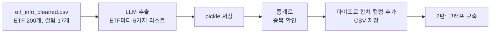
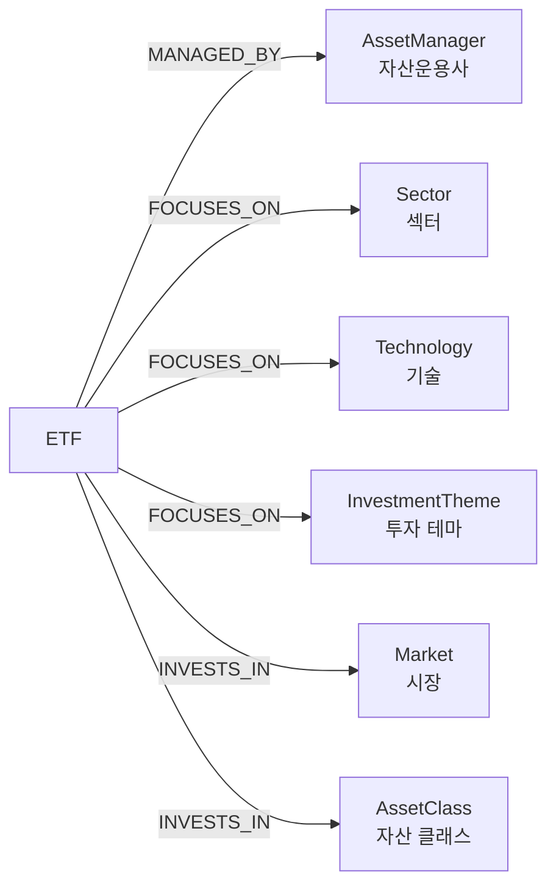
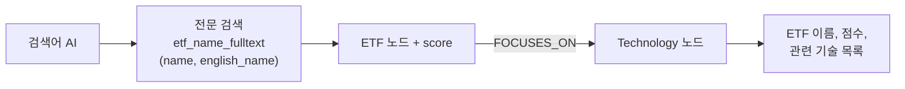
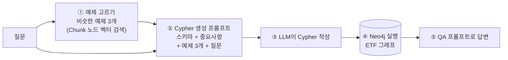
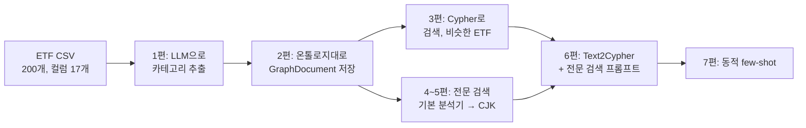

# KG_P2_02 ETF Recommendation (섹션 6)

> 강의: 프로젝트 2 - ETF 금융상품 추천. 노트북 하나(`KG_P2_02_etf_recommendation.ipynb`)를 36강부터 43강까지 여덟 강의에 걸쳐 진행해요. 그래서 이 README도 노트북 순서대로 7편으로 나눠 정리했어요(짧은 준비 강의인 36강은 37강과 묶어 1편으로). 노트북 끝(7편)까지 정리돼 있어요.
>
> - [1편: 환경 설정과 ETF 고유명사, 카테고리 추출](#1편-환경-설정과-etf-고유명사-카테고리-추출-노트북-1장--21절) (36~37강)
> - [2편: ETF 온톨로지 설계와 GraphDocument로 그래프 만들기](#2편-etf-온톨로지-설계와-graphdocument로-그래프-만들기-노트북-22절-12) (38강)
> - [3편: Cypher로 ETF 찾고 비슷한 ETF 추천하기](#3편-cypher로-etf-찾고-비슷한-etf-추천하기-노트북-22절-2) (39강)
> - [4편: 전문 검색으로 ETF 찾기](#4편-전문-검색으로-etf-찾기-노트북-22절-3) (40강)
> - [5편: 한국어 전문 검색과 CJK 분석기](#5편-한국어-전문-검색과-cjk-분석기-노트북-22절-3) (41강)
> - [6편: Text2Cypher로 ETF 그래프에 질문하기](#6편-text2cypher로-etf-그래프에-질문하기-노트북-23절-12) (42강)
> - [7편: 동적 Few-shot 프롬프트로 Text2Cypher 개선하기](#7편-동적-few-shot-프롬프트로-text2cypher-개선하기-노트북-23절-3) (43강)
> - [ETF 프로젝트를 마치며](#etf-프로젝트를-마치며)
>
> 각 편 맨 끝의 "노트북 주의점과 검증 메모"를 펼치면, 셀 번호가 붙은 노트북 버그, 실제 데이터로 세어 본 수치, 강의 설명과 다른 점을 볼 수 있어요.

> **실행 전에 꼭 확인할 것**
>
> - 노트북 1장의 `reset_database()`는 정의하는 셀에서 **바로 호출**까지 해서, 연결된 DB의 노드, 관계, 제약 조건, 인덱스를 **전부** 지워요. 그래서 `.env`의 `NEO4J_DATABASE`가 아직 뉴스 프로젝트의 `news`를 가리키면 뉴스 그래프가 다 사라져요. 1편 1절대로 Neo4j Desktop에 `etf` DB를 따로 만들고 `.env`를 바꾼 다음, 바로 앞의 노드 수 확인 쿼리가 0을 돌려주는지 보고 실행하세요.
> - 2.1절의 전체 추출은 ETF 200개마다 OpenAI `gpt-4.1`을 한 번씩 불러요(강의에서 6분 가까이 걸렸어요). 그런데 2편이 읽는 `etf_with_extracted_entities.csv`는 이 레포에 없어서, 2편부터 따라 하려면 이 추출을 한 번은 돌려야 해요. 실습이 목적이면 1편 5절처럼 개수를 줄여서 돌리세요.
> - 2.3절의 few-shot 예제 저장은 예제 15개를 OpenAI로 임베딩해서 같은 `etf` DB에 `Chunk` 노드로 넣어요. ETF 그래프와 섞이는 게 싫으면 7편 2절을 먼저 읽어 보세요.

## 1편: 환경 설정과 ETF 고유명사, 카테고리 추출 (노트북 1장 ~ 2.1절)

### 이 강의의 학습 목표

이 강의를 마치면 다음을 할 수 있어요.

1. Neo4j Desktop에 `etf` DB를 새로 만들고, `.env`의 DB 이름만 바꿔서 연결할 수 있어요.
2. 카디널리티(컬럼의 고유값 개수)를 보고, ETF CSV의 어떤 값이 노드가 될 만한지 판단할 수 있어요.
3. Pydantic 스키마와 `with_structured_output`으로 ETF마다 섹터, 기술, 시장, 자산 클래스, 투자 테마 같은 카테고리를 리스트로 뽑을 수 있어요.
4. 추출 결과를 pickle로 저장하고 다시 읽을 수 있고, 뽑은 값에 왜 정규화가 필요한지 설명할 수 있어요.

읽기 전에 이 질문 하나를 머리에 두고 보면 좋아요. **"ETF의 어떤 값을 노드로 만들어야 추천이 잘 될까?"**

### 한눈에 보기

이번 프로젝트는 ETF 추천 시스템이에요. 데이터는 섹션 4의 영화처럼 CSV로 정리돼 있어요. 그런데 추천에 정말 필요한 정보, 예를 들어 "AI 반도체에 투자하는 ETF"나 "친환경 테마 ETF" 같은 건 컬럼에 따로 들어 있지 않고, ETF 이름과 기본 정보(`basic_info`) 문장 속에 섞여 있어요. 영화 CSV에서는 장르가 처음부터 `|`로 나뉜 컬럼이라 쪼개기만 하면 Genre 노드가 됐는데([CSV 강의](../KG_P1_03_neo4j_movie_01_csv)), 이번에는 그 장르 역할을 할 값을 LLM으로 먼저 뽑아내야 해요.



36강은 노트북 1장으로, Neo4j Desktop에 새 DB를 만들고 연결하는 짧은 준비 강의예요. 그리고 37강이 2.1절로, 위 그림의 본론이에요. 37강 제목에 붙은 "High Cardinality"가 이 작업이 왜 필요한지 알려 주는 단어라서, 3절에서 먼저 풀고 들어갈게요.

### 1. Neo4j Desktop에 etf DB 추가하기

Neo4j Desktop이 무엇이고 왜 쓰는지, APOC 플러그인은 어떻게 설정하는지는 [뉴스 프로젝트 1편](../KG_P2_01_news_analysis#1편-환경-설정과-뉴스-메타데이터-추출-노트북-1장--21절)에 정리했어요. 노트북 1장의 설명도 그때와 같아서, 이번에 새로 하는 일은 DB를 하나 더 만드는 것뿐이에요.

먼저 Desktop에서 뉴스 프로젝트 때 쓰던 DBMS를 열고 **Create database**로 `etf` DB를 추가해요. 한 DBMS 안에 DB를 여러 개 둘 수 있으니, 뉴스 그래프는 그대로 두고 옆에 새로 만드는 거예요. 그다음 `.env`에서 DB 이름만 바꿔요.

```bash
NEO4J_DATABASE=etf      # 뉴스 프로젝트 때는 news
```

강의에서는 DB 이름을 "ETF"라고 부르는데, Neo4j는 DB 이름의 대소문자를 구분하지 않고 소문자로 저장해요. 그래서 `ETF`로 적든 `etf`로 적든 같은 DB예요.

연결 코드(`Neo4jGraph(..., database=os.getenv("NEO4J_DATABASE"))`)는 뉴스 프로젝트와 똑같아서 `.env`만 바꾸면 돼요. 그리고 연결한 뒤에는 노드 수를 세는 테스트 쿼리를 돌려요. 새로 만든 DB라면 0이 나와야 해요.

```cypher
MATCH (n)
RETURN count(n) AS node_count
```

#### reset_database 앞에서 한 번 멈추기

바로 다음 셀은 `reset_database()`를 정의하고 **곧바로 호출**까지 해요. 이 함수는 연결된 DB의 노드, 관계, 제약 조건, 인덱스를 전부 지워요. 그래서 강사도 "기존 데이터베이스가 잘못 삭제될 수 있으니 초기화는 항상 주의하라"고 짚었어요. 특히 `.env`를 `news`에서 안 바꾼 채 셀을 위에서부터 다 실행하면, 뉴스 프로젝트에서 LLM 비용을 들여 만든 그래프가 묻지도 않고 통째로 사라져요.

그러니까 바로 앞의 노드 수가 안전장치예요. 아직 ETF 데이터를 넣은 적이 없는데 0이 아니라면 다른 DB에 붙어 있는 거예요. 그때는 초기화 셀을 실행하지 말고 `.env`부터 확인해요.

### 2. ETF 데이터 살펴보기

데이터는 `etf_data/etf_info_cleaned.csv`예요. 국내에 상장된 ETF 중 일부를 샘플링한 것으로, ETF 200개에 컬럼 17개예요. 컬럼을 성격별로 묶으면 이래요.

| 묶음 | 컬럼 |
|---|---|
| 식별 | `id`, `korean_name`, `english_name`, `code`(종목코드) |
| 상품 조건 | `listing_date`(상장일), `fund_type`(펀드 형태), `index_name`(기초지수명), `tracking_multiplier`(추적배수), `total_fee`(총보수 %), `tax_type`(과세 유형) |
| 회사 | `management_company`(자산운용사), `ap_company`(지정참가회사) |
| 분류 | `base_market`(기초 시장), `base_asset`(기초 자산) |
| 설명, 링크 | `basic_info`(기본 정보), `investment_notice`(투자유의사항), `website`(홈페이지) |

첫 번째 ETF를 보면 감이 와요. 이 ETF는 뒤의 편에서도 계속 예시로 나와요.

| 컬럼 | 값 |
|---|---|
| `korean_name` / `english_name` | TIGER AI반도체핵심공정 / TIGER AI Semiconductor Core Tech |
| `index_name` | iSelect AI반도체핵심공정지수 |
| `management_company` | 미래에셋자산운용 |
| `base_market` | `국내\|코스피\|코스닥` |
| `base_asset` | `주식\|업종섹터\|업종테마` |
| `basic_info` | 이 ETF는 국내에 상장된 주식을 주된 투자대상자산으로 하며, ... AI 프로세스칩 및 시스템 반도체 산업의 ... 종목을 편입하는 지수입니다. |

여기서 `base_market`과 `base_asset`은 이미 카테고리가 `|`로 나뉘어 있다는 점을 기억해 두세요. 6절에서 다시 나와요.

### 3. 카디널리티: 노드가 될 값과 안 될 값

**카디널리티(cardinality)** 는 한 컬럼에 서로 다른 값이 몇 개 있는지예요. RDB에서 어느 컬럼에 인덱스를 걸지 고를 때도 쓰는 말이에요. 고유값 개수가 행 수에 가까우면 카디널리티가 높다(high cardinality)고 하고, 몇 개 안 되면 낮다고 해요. ETF CSV의 컬럼 몇 개를 이 기준으로 보면 이래요.

| 컬럼 | 고유값 개수 (200행 중) | 그대로 노드로 만들면 |
|---|---|---|
| `id`, `korean_name`, `basic_info` | 200 | ETF마다 자기 노드 하나씩이라 아무것도 안 이어져요 |
| `index_name` | 182 | 거의 다 달라서 마찬가지예요 |
| `management_company` | 21 | 운용사 하나에 ETF 여러 개가 모여요. 2편의 `AssetManager` 노드가 이거예요 |
| `fund_type` | 1 (전부 수익증권형) | 200개가 한 노드에 다 붙어서 아무것도 구분하지 못해요 |

그래프에서 노드가 쓸모 있으려면 **여러 ETF가 같이 가리켜야** 해요. 그래야 "이 ETF와 운용사가 같은 다른 ETF"처럼 노드를 거쳐 다른 ETF로 건너갈 수 있거든요. 그래서 카디널리티가 너무 높은 값은 아무것도 잇지 못하고, 반대로 너무 낮은 값은 전부를 한데 이어 버려서 쓸모가 없어요. 쓸모 있는 건 그 사이예요.

그런데 문제는 추천에 정말 필요한 정보, 즉 "어느 산업, 어떤 기술, 무슨 테마에 투자하나"가 카디널리티가 높은 컬럼(이름, `basic_info`) 속 문장에 묻혀 있다는 거예요. 그래서 이번 강의는 LLM으로 그 문장에서 **여러 ETF가 같이 쓸 만한 값**, 즉 고유명사와 카테고리를 뽑아요. 강사 말로는 "데이터베이스를 구축할 때 데이터를 정규화해서 구현하고 싶어서"예요.

여기서 **정규화**는 문장 속에 흩어진 정보를 정해진 값으로 뽑아서, 여러 ETF가 같은 값을 함께 가리키게 만드는 걸 말해요. RDB에서 반복되는 값을 별도 테이블로 빼서 여러 행이 같이 참조하게 하는 것과 같은 생각이고, 그래프에서는 그 값이 노드가 돼요. 다시 말해 카디널리티가 높은 글을 카디널리티가 낮은 카테고리로 바꾸는 작업이에요.

그리고 이 작업은 뒤쪽 Text2Cypher와도 이어져요. 카테고리 수가 적당하고 표기가 깔끔할수록, LLM이 질문을 Cypher로 바꿀 때 그래프에 실제로 있는 값을 맞히기 쉬워지거든요. 이건 6편에서 자세히 봐요.

### 4. LLM으로 고유명사와 카테고리 뽑기

방법은 [뉴스 프로젝트 1편](../KG_P2_01_news_analysis#1편-환경-설정과-뉴스-메타데이터-추출-노트북-1장--21절)과 같아요. Pydantic으로 출력 모양을 정하고, `with_structured_output`으로 LLM이 그 모양 그대로 답하게 해요. 그리고 `Field`의 `description`이 그냥 주석이 아니라 LLM에게 가는 지시라는 것도 그대로예요.

#### 스키마: 여섯 가지 리스트

```python
class ETFEntities(BaseModel):
    """ETF 상품에서 추출한 고유명사와 카테고리 정보"""
    companies: Optional[List[str]] = Field(default=None, description="ETF에 포함된 회사/기업 이름")
    sectors: Optional[List[str]] = Field(default=None, description="ETF가 속한 산업 섹터")
    technologies: Optional[List[str]] = Field(default=None, description="ETF 관련 기술 키워드")
    markets: Optional[List[str]] = Field(default=None, description="ETF 관련 시장/지역")
    asset_classes: Optional[List[str]] = Field(default=None, description="ETF 자산 클래스(주식, 채권, 원자재 등)")
    investment_themes: Optional[List[str]] = Field(default=None, description="ETF 투자 테마(AI, 친환경, 메타버스 등)")
```

뉴스 때와 다른 점은 필드가 문자열이 아니라 **리스트**라는 거예요. ETF 하나가 섹터 여러 개, 테마 여러 개에 걸칠 수 있으니까요. 그리고 `Optional[List[str]]`에 `default=None`을 준 건 "문자열 리스트이거나, 값이 없으면 `None`"이라는 뜻이에요.

#### 프롬프트와 체인

`ChatPromptTemplate.from_messages`는 system 메시지(역할과 규칙)와 human 메시지(이번에 처리할 입력)를 묶어 프롬프트를 만들어요. `{korean_name}` 같은 자리는 `invoke`할 때 넘기는 딕셔너리 값으로 채워져요.

- **system**: 필드마다 가이드라인과 예시를 줘요. 예를 들어 섹터는 "IT, 금융, 헬스케어", 기술은 "AI, 블록체인, 클라우드", 시장은 "국내, 미국, 아시아"처럼요. 그리고 "명확한 증거가 있는 항목만 포함하고, 항목이 없으면 빈 리스트를 반환하라"고 해요.
- **human**: ETF 한 행에서 컬럼 10개를 꺼내 넣어요.

```python
("human", """다음 ETF 상품에서 고유명사와 카테고리를 추출하세요:
        ...
        한글명: {korean_name}
        영문명: {english_name}
        ...
        기초지수명: {index_name}
        기초 시장: {base_market}
        기초 자산: {base_asset}
        기본 정보: {basic_info}
        """)
```

```python
llm = ChatOpenAI(model="gpt-4.1", temperature=0)
llm_with_structured_output = llm.with_structured_output(ETFEntities)
chain = prompt | llm_with_structured_output
```

참고로 자산운용사(`management_company`)는 프롬프트에 넣지 않아요. 이미 21개로 깔끔하게 정리된 값이라, 2편에서 LLM 없이 그대로 노드로 만들거든요. 뉴스 프로젝트에서 형식이 정해진 언론사와 기자는 LLM 대신 Cypher로 넣었던 것과 같은 생각이에요.

#### 실패 사례: 단어는 맞는데 뜻이 틀렸어요

강의에서 첫 행(TIGER AI반도체핵심공정)으로 돌려 보면 이렇게 나왔어요(강의에서 읽어 준 필드만 적었어요).

| 필드 | 강의 결과 |
|---|---|
| `companies` | 없음 |
| `sectors` | 반도체, IT |
| `technologies` | AI, 자연어처리 |
| `markets` | 국내, 코스피, 코스닥 |

그럴듯해 보이는데 `자연어처리`는 짚고 넘어갈 만해요. 이 ETF의 `basic_info`에는 이렇게 적혀 있어요.

> "iSelect AI반도체핵심공정 지수"는 유가증권시장 및 코스닥시장 상장기업 중 AI 프로세스칩 및 시스템 반도체 산업의 구조에 따라 선정한 키워드를 기반으로 유관 기업을 분류하기 위해 **자연어처리 키워드 필터링 기술을 활용하여** 종목을 편입하는 지수입니다.

즉 자연어처리는 이 ETF가 **투자하는 기술**이 아니라, 지수가 **종목을 고르는 방법**이에요. LLM은 "명확한 증거가 있는 항목만"이라는 지시를 글자 그대로는 지켰어요. 단어가 본문에 분명히 있으니까요. 하지만 뜻은 틀렸어요. 그래서 이대로 그래프를 만들면 AI 반도체 ETF가 `자연어처리` 기술 노드에 이어지고, 나중에 "자연어처리 관련 ETF"를 찾을 때 이 ETF가 나와요. 이런 오류는 프롬프트에 "지수의 종목 선정 방법에 쓰인 기술은 빼고, ETF가 투자하는 대상만 뽑으라"는 줄을 넣는 식으로 기준을 분명히 해 주면 줄일 수 있어요(강의 밖 내용이에요).

반면 `markets`의 국내, 코스피, 코스닥은 입력으로 넣은 `base_market` 값(`국내|코스피|코스닥`)을 그대로 옮긴 거예요. 이 점은 6절에서 다시 볼게요.

### 5. 200개 전체 추출하고 pickle로 저장하기

전체 추출은 `extract_all_entities` 함수가 맡아요. 여기서 `df.iterrows()`는 데이터프레임을 한 행씩 꺼내 주는 pandas 메서드이고, `tqdm`은 반복문에 진행 막대를 띄워 주는 라이브러리예요. 결과는 ETF `id`를 키로, `ETFEntities`를 값으로 하는 딕셔너리예요.

```python
for idx, row in tqdm(df.iterrows()):
    etf_id = row['id']
    entities = extract_entities_from_etf(row)
    all_entities[etf_id] = entities
```

행마다 LLM을 한 번씩 차례로 부르니까, 강의에서는 200개를 처리하는 데 6분 가까이 걸렸어요. 그래서 강사는 "API 호출 비용이 부담될 수 있으니, 실습이 목적이면 200개 전체를 하지 말고 개수를 줄여서 해 보라"고 했어요. 예를 들어 `extract_all_entities(df.head(20))`처럼요.

#### 짚을 점: 에러가 빈 값으로 숨어요

추출 함수는 에러가 나면 메시지만 찍고, **모든 필드를 빈 리스트로 채운 결과**를 돌려줘요.

```python
except Exception as e:
    print(f"ETF 엔티티 추출 중 오류 발생: {e}")
    return ETFEntities(companies=[], sectors=[], ...)
```

그래서 200개를 돌리다 중간에 API 호출 한도에 걸려도 노트북은 멈추지 않아요. 대신 결과에는 "뽑을 게 없었던 ETF"와 "에러가 난 ETF"가 똑같이 빈 값으로 섞여 들어가요. 그러니 다 돌린 뒤에는 여섯 필드가 모두 빈 ETF가 몇 개인지 세어 보고, 있으면 그 행만 다시 돌리는 게 좋아요(강의 밖 내용이에요).

#### pickle로 저장하기

**pickle**은 파이썬 객체를 바이트로 바꿔 파일에 저장하고(직렬화), 나중에 같은 객체로 되살리는 파이썬 표준 라이브러리예요. 여기서는 `ETFEntities` 객체 200개가 든 딕셔너리를 모양 그대로 저장해요.

```python
with open('../etf_data/all_etf_entities.pkl', 'wb') as f:
    pickle.dump(all_etf_entities, f)
```

저장하는 이유는 뉴스 프로젝트에서 JSONL로 저장했던 것과 같아요. 시간과 비용을 들여 뽑은 결과니까, 노트북을 다시 열 때 LLM을 또 부르지 않으려는 거예요. 그리고 `'wb'`는 바이너리 쓰기 모드예요. pickle은 텍스트가 아니라 바이트로 저장하거든요.

#### 읽기 전에 클래스부터 정의해야 해요

강사가 여기서 강조한 게 있어요. 노트북을 껐다가 다시 열어서 pickle을 읽을 때는 `ETFEntities` 클래스를 **먼저 정의해 둬야** 해요. 그래서 노트북도 파일을 읽기 직전에 같은 클래스를 한 번 더 정의해요.

이유는 pickle이 객체의 **데이터만** 저장하고 클래스 코드는 저장하지 않기 때문이에요. 클래스 자리에는 "`__main__` 모듈의 `ETFEntities` 클래스로 되살려라"는 이름표만 들어 있어요. 그래서 클래스를 정의하지 않은 채 읽으면 이런 에러가 나요.

```
AttributeError: Can't get attribute 'ETFEntities' on <module '__main__' ...>
```

클래스에 기대고 싶지 않다면 뉴스 프로젝트처럼 `model_dump()`로 딕셔너리로 바꿔 JSON(JSONL)으로 저장하면 돼요. 그러면 읽을 때 클래스가 없어도 되고, 파일을 열어 눈으로 확인할 수도 있어요. 그리고 pickle 파일은 읽는 순간 안에 든 코드가 실행될 수 있어서, 남에게서 받은 pickle 파일은 열지 않는 게 원칙이에요. 파이썬 공식 문서에도 경고로 적혀 있어요.

### 6. 통계로 드러난 중복: 정규화라는 숙제

통계 셀은 다시 읽은 결과에서 종류마다 값을 `set`에 모아 중복을 없앤 다음 개수를 세요. 즉 3절에서 말한 **카디널리티**를 종류별로 재는 거예요. 여기서 쓰는 `getattr(객체, "속성 이름", 기본값)`은 속성 이름을 문자열로 받아 값을 꺼내는 파이썬 내장 함수예요. 그래서 `entities.sectors`, `entities.markets`처럼 여섯 번 따로 적지 않고 반복문 하나로 돌 수 있어요.

```python
for etf_id, entities in all_entities.items():
    for entity_type in stats.keys():
        entity_list = getattr(entities, entity_type, [])
        stats[entity_type].update(entity_list)
```

강의에서는 이렇게 나왔어요.

| 종류 | 고유값 개수 (강의 결과) |
|---|---|
| `companies` (회사) | 77 |
| `sectors` (섹터) | 89 |
| `technologies` (기술) | 45 |
| `markets` (시장) | 29 |
| `asset_classes` (자산 클래스) | 24 |
| `investment_themes` (투자 테마) | 98 |

강사가 짚은 문제는 **같은 뜻이 여러 이름으로 뽑혔다**는 거예요. 예를 들어 시장에는 "North America"와 "북미"가 따로 있고, TDF도 두 가지 표현으로 갈라져 있고, "Semiconductor"와 "반도체"도 따로예요. 그래서 한글과 영어로 갈라진 표기를 하나로 맞추는 작업이 더 필요하다고 했고, 이 부분은 직접 고도화해 보라며 숙제로 넘겼어요. 즉 3절의 정규화가 문장에서 값을 뽑아 모으는 일이었다면, 여기서 남은 정규화는 **같은 뜻의 여러 표기를 대표 값 하나로 맞추는 일**이에요.

그럼 영어 표기는 어디서 들어왔을까요? 프롬프트에 한글명과 영문명을 둘 다 넣으니까, 예를 들어 `TIGER AI반도체핵심공정` / `TIGER AI Semiconductor Core Tech`처럼 같은 말이 두 언어로 함께 들어가요. 게다가 기초지수명과 `basic_info` 문장에도 영어 지수명과 회사명이 자주 섞여 있어요. 그러니 LLM이 어떤 ETF에서는 "반도체"를, 다른 ETF에서는 "Semiconductor"를 뽑을 수 있어요. 심지어 "North America"는 CSV 어디에도 없는 표현이라, LLM이 새로 만든 이름이에요.

#### 이미 정리된 컬럼은 규칙으로 충분해요

시장과 자산 클래스는 CSV에 이미 카테고리 컬럼이 있어요(2절). 그걸 규칙으로만 써도 이렇게 돼요(강의 밖 내용이에요).

| | 규칙으로 | LLM 추출 (강의 결과) |
|---|---|---|
| 시장 | `base_market`을 `\|`로 쪼갠 값 전부: 18개, 모두 한글 | 29개 |
| 자산 클래스 | `base_asset`의 첫 번째 값만: 7개 (주식, 채권, 혼합자산 등) | 24개 |

즉 이 두 가지는 LLM을 거치면서 오히려 카디널리티가 올라갔어요. 이미 정해진 값 목록이 있는 컬럼은 `split('|')` 같은 규칙이 싸고 늘 같은 결과를 내요. 반대로 LLM은 섹터, 기술, 투자 테마처럼 문장 속에만 있는 값에 쓰는 게 맞아요. 뉴스 프로젝트에서 "형식이 고정돼 있으면 정규식, 들쭉날쭉하면 LLM"이라고 했던 것과 같은 판단이에요.

LLM이 뽑은 값의 정규화는 거창하지 않아도 돼요. 가장 간단한 건 같은 뜻의 이름을 하나로 모으는 매핑 딕셔너리를 만들어, CSV로 저장하기 전에 바꿔 주는 거예요. 아니면 처음부터 허용할 값 목록을 프롬프트에 주고 그 안에서만 고르게 할 수도 있어요.

```python
# 강의 밖 예시
canonical = {"Semiconductor": "반도체", "North America": "북미"}
values = [canonical.get(v, v) for v in values]
```

### 7. 데이터프레임에 붙여 CSV로 저장하기

리스트를 `'|'.join(...)`으로 이어 붙여 문자열 하나로 만들고, `extracted_companies`부터 `extracted_investment_themes`까지 컬럼 여섯 개로 원래 데이터프레임 옆에 붙여요. 영화 CSV의 장르 컬럼과 같은 모양이에요. 그래서 2편에서는 이걸 다시 `split('|')`로 쪼개서 노드를 만들어요. 그리고 저장할 때 쓰는 `encoding='utf-8-sig'`는 파일 맨 앞에 BOM이라는 표시를 붙인 UTF-8이에요. 엑셀에서 열 때 한글이 깨지지 않게 하려고 써요.

```python
df_with_entities.loc[idx[0], 'extracted_sectors'] = '|'.join(entities.sectors) if entities.sectors else ''
...
df_with_entities.to_csv("../etf_data/etf_with_extracted_entities.csv", index=False, encoding='utf-8-sig')
```

2편은 이 CSV를 읽는 데서 시작하니까, LLM 추출을 다시 돌리지 않아도 돼요. 참고로 회사(`companies`)는 뽑기만 하고 2편의 그래프에는 넣지 않아요. 이 CSV에는 ETF의 구성 종목 컬럼이 없어서, 실제 투자 대상 회사 이름이 문장에 드물게 나오거든요.

### 8. 처음 질문으로: ETF의 어떤 값을 노드로 만들어야 추천이 잘 될까?

세 가지를 갖춘 값이에요.

1. **여러 ETF가 함께 가리키는 값이어야 해요.** 3절에서 본 대로 ETF마다 다른 값(이름, `basic_info`)은 아무것도 잇지 못하고, 모든 ETF가 같은 값(`fund_type`)은 아무것도 구분하지 못해요. 그래서 운용사처럼 적당히 모이는 값, 그리고 문장에서 뽑아낸 섹터, 기술, 테마가 노드 후보예요.
2. **같은 뜻은 같은 이름이어야 해요.** 2편의 그래프 코드는 뽑은 값을 손대지 않고 `sector-{값}` 같은 id로 바로 노드를 만들어요. 그래서 섹터에 "반도체"와 "Semiconductor"가 둘 다 있으면 서로 다른 Sector 노드가 되고, 반도체 ETF들이 두 무리로 갈라져요. 노드는 여러 ETF가 같이 가리켜야 쓸모 있는데, 이름이 갈라지면 바로 그 "같이 가리키기"가 깨지는 거예요. ETF 200개에서 테마가 98개면 ETF 두 개당 하나꼴이라, 정규화를 안 하면 카디널리티가 다시 올라가 버려요.
3. **뜻이 맞아야 해요.** `자연어처리`처럼 지수의 종목 선정 방법이 기술로 뽑히면, 그 기술과 관계없는 ETF가 같은 노드로 이어져요.

여기에 하나 더 기억할 게 있어요. 강사 말처럼 "국내"라는 값이 여러 ETF에서 같이 쓰이고 자산 클래스가 "주식"으로 모일 때 그래프가 ETF들을 이어 줘요. 다만 거의 모든 ETF가 함께 가리킬 만큼 넓은 값은 카디널리티가 너무 낮은 쪽이라, 비슷한 ETF를 고를 때는 별 단서가 못 돼요. 이건 3편에서 다시 봐요.

그러니까 LLM 추출은 절반이고, 나머지 절반은 정규화예요. 표기가 하나로 통일돼 있어야 뒤쪽 Text2Cypher에서 LLM이 고른 이름도 실제 노드와 맞아요. 그런데 노트북은 정규화 없이 2편으로 넘어가요. 그래서 뒤쪽 검색 결과가 이상하면 이 단계부터 의심해 보면 돼요.

### 정리하며 기억할 것

- 새 프로젝트는 Desktop에 DB를 하나 더 만들고 `.env`의 `NEO4J_DATABASE`만 바꾸면 돼요. 그리고 `reset_database()`를 부르기 전에 노드 수로 어느 DB에 붙었는지 꼭 확인해요.
- 카디널리티는 컬럼의 고유값 개수예요. 노드는 여러 ETF가 같이 가리킬 때 쓸모 있어서, 너무 높아도(200개 모두 다름) 너무 낮아도(1개) 노드로는 쓸모가 없어요.
- 추천에 필요한 섹터, 기술, 테마는 카디널리티가 높은 글 속에 있어서 LLM으로 카테고리를 뽑아요. 반면 이미 정리된 컬럼(운용사, 기초 시장, 기초 자산)은 규칙으로 충분해요.
- LLM은 "단어가 있다"와 "그 뜻이 맞다"를 구분하지 못할 때가 있어요(`자연어처리`). 그래서 첫 행 결과를 원문과 대조해 보는 습관이 필요해요.
- 행마다 LLM을 부르면 시간과 비용이 들어요. 실습은 개수를 줄이고, 결과는 저장하고, 에러가 빈 값으로 숨지 않았는지 확인해요.
- pickle은 클래스 코드 없이 데이터만 저장해서, 읽기 전에 Pydantic 클래스를 다시 정의해야 해요.
- 뽑은 값은 한영 표기와 동의어 때문에 쪼개져요. 정규화 없이 노드로 만들면 그래프가 덜 이어져요.

### 다음이랑 어떻게 이어지나

2편(38강)은 노트북 2.2절 "KG 온톨로지 구현"의 앞부분이에요. 이번에 저장한 `etf_with_extracted_entities.csv`를 읽어서 `ETF`, `AssetManager`(운용사), `Sector`, `Technology`, `Market`, `AssetClass`, `InvestmentTheme` 노드와 `MANAGED_BY`, `FOCUSES_ON`, `INVESTS_IN` 관계로 온톨로지를 정해요. 그리고 섹션 4의 [CSV 강의](../KG_P1_03_neo4j_movie_01_csv)처럼 `Node`, `Relationship`, `GraphDocument`를 코드로 직접 만들어 넣어요. 이번에 `|`로 합쳐 둔 값을 다시 쪼개서 노드로 만드는 게 바로 그 단계예요.

<details>
<summary>노트북 주의점과 검증 메모</summary>

- **초기화 셀:** 셀 4가 노드 수를 세고, 셀 5가 `reset_database()`를 정의하자마자 호출해요. 강의에서는 "초기화가 필요하면" 실행하라고 했지만, 정의와 호출이 한 셀에 들어 있어서 위에서부터 다 실행하면 묻지 않고 지워져요. 강의에서는 새 DB라 셀 4가 0을 돌려줬어요.
- **DB 이름:** Neo4j 공식 문서 기준으로 DB 이름은 대소문자를 구분하지 않고 소문자로 저장돼요.
- **데이터 크기와 컬럼 설명:** CSV를 직접 읽으면 `(200, 17)`이에요. 컬럼 설명 표는 노트북 셀 8에 있어요.
- **종목코드 앞자리 0:** `code`가 숫자로 저장돼서 앞자리 0이 빠진 행이 2개 있어요. KODEX 200의 종목코드는 `069500`인데 CSV에는 `69500`, `id`도 `ETF69500`으로 들어 있어요(TIGER 반도체도 `91230`). 코드로 찾을 일이 있으면 `zfill(6)`으로 여섯 자리 문자열로 맞춰 쓰는 게 안전해요.
- **"High Cardinality":** 37강 제목의 이 단어는 강의 음성에서 따로 설명하지 않아요. 3절의 카디널리티 표는 CSV에서 직접 센 값이에요.
- **`자연어처리`의 흔적:** 이 추출 결과는 노트북 2.2절 스키마 설명(셀 24)에도 "Technology: 기술 정보 노드 (예: AI, 자연어처리)"라고 예시로 그대로 들어가 있어요.
- **전체 추출 시간:** 셀 14가 200개를 처리하는 데 강의에서 약 5분 50초가 걸렸어요. 속도가 문제라면 체인을 함수 밖에서 한 번만 만들고, [graphRAG](../KG_P1_03_neo4j_movie_06_graphRAG)에서 본 `.batch()`로 여러 행을 동시에 보내는 방법도 있어요(강의 밖 내용이에요).
- **pickle 다시 읽기:** 셀 18이 셀 12와 똑같은 `ETFEntities` 클래스를 한 번 더 정의하고, 셀 19에서 파일을 읽어요. 클래스 없이 읽을 때의 `AttributeError`는 가짜 데이터로 직접 재현해 확인했어요.
- **통계 셀(셀 20)의 `None` 함정 (강의 밖):** `getattr(entities, entity_type, [])`의 기본값 `[]`는 **속성이 아예 없을 때만** 쓰여요. 그런데 필드가 `Optional[List[str]]`이고 기본값이 `None`이라, LLM이 어떤 필드를 빈 리스트 대신 `None`으로 돌려주면 속성은 있고 값만 `None`인 상태가 돼요. 그러면 `set.update(None)`이 `TypeError: 'NoneType' object is not iterable`로 멈춰요(가짜 데이터로 확인). 강의에서는 에러 없이 돌았으니 모든 필드가 리스트로 왔던 걸로 보여요. 그래도 `getattr(entities, entity_type) or []`로 쓰면 안전해요. 다음 셀(셀 21)은 `if entities.companies else ''`처럼 이미 `None`을 막고 있어요.
- **영어 표기의 출처:** 강의에서는 "기초지수나 기초자산에 영어가 많이 섞여 있어서"라고 했는데, CSV를 세어 보면 절반만 맞아요. 기초지수명(`index_name`)은 200개 중 70개가 한글이 한 글자도 없는 영어 이름이에요(예: `Nikkei 225`, `Dow Jones Target 2050 Index (Total Return)`). 반면 기초 자산(`base_asset`)은 200행 모두 한글이에요. 대신 강의에서 말하지 않은 영문명(`english_name`)이 200개 모두 영어이고, `basic_info` 문장 안에도 `FnGuide`, `S&P` 같은 영어 지수명과 회사명이 자주 섞여 있어요. 그리고 "North America"라는 문자열은 CSV 어디에도 없고, `base_market`의 값은 `국내`, `해외`, `북미`, `미국`처럼 전부 한글이에요.
- **규칙으로 센 값:** `base_market`을 `|`로 쪼갠 값은 18개로 모두 한글이에요. `base_asset`의 첫 번째 값은 7개로, 주식 150, 채권 33, 혼합자산 9, 기타 3, 부동산 2, 통화 2, 원자재 1이에요. 다만 원본에도 `국내&해외-`, `해외-`처럼 다듬어야 할 값은 있어요.
- **회사 77개는 조심해서 봐요:** CSV에 구성 종목 컬럼이 없어서, `basic_info`에 삼성전자는 0행, NVIDIA는 2행, SK하이닉스는 1행만 나와요. 반면 지수를 만드는 회사나 거래소 이름은 FnGuide 34행, S&P 18행, 한국거래소 72행처럼 자주 나와요. 게다가 프롬프트도 회사를 "ETF에 포함된 또는 관련된" 회사라고 넓게 적었어요. 그래서 강의의 회사 77개에는 투자 대상이 아닌 이런 이름이 섞였을 가능성이 커요. 추출 결과 파일이 레포에 없어서 직접 확인하지는 못했어요.

</details>

---

## 2편: ETF 온톨로지 설계와 GraphDocument로 그래프 만들기 (노트북 2.2절 (1)~(2))

### 이 강의의 학습 목표

이 강의를 마치면 다음을 할 수 있어요.

1. ETF 온톨로지(노드 7종, 관계 3종)를 읽고, 각 노드가 CSV 원본 컬럼에서 왔는지 1편의 LLM 추출에서 왔는지 구분할 수 있어요.
2. 제약 조건을 왜 `name`이 아니라 `id`에 거는지, `add_graph_documents`가 노드를 MERGE하는 방식과 묶어서 설명할 수 있어요.
3. DataFrame 행을 돌면서 `Node`와 `Relationship`을 만들고, `id` 접두어와 `node_dict`로 중복을 막아 `GraphDocument` 하나로 저장할 수 있어요.
4. Neo4j Browser와 `refresh_schema()`로 만든 그래프가 설계대로 들어갔는지 확인할 수 있어요.

읽기 전에 이 질문 하나를 머리에 두고 보면 좋아요. **"ETF와 카테고리를 잇는 관계를 하나로 둘까, `FOCUSES_ON`과 `INVESTS_IN`처럼 나눌까? 무엇을 기준으로 정해야 할까?"**

### 한눈에 보기

1편에서는 ETF 200개가 담긴 CSV에서 LLM으로 섹터, 기술, 시장, 자산 클래스, 투자 테마를 뽑아 `extracted_*` 컬럼으로 붙여 뒀어요. 이번 강의는 그 DataFrame을 그래프로 옮기는 단계예요. 방법은 섹션 4의 [CSV 강의](../KG_P1_03_neo4j_movie_01_csv)와 같아서, 온톨로지를 정하고, 제약 조건부터 걸고, 행마다 `Node`와 `Relationship`을 만들어 `GraphDocument`로 한 번에 저장해요. 그러니까 새 문법은 거의 없고, 이번 강의의 핵심은 **무엇을 노드로 만들고 어떤 관계로 이을지 정하는 설계 판단**이에요.



모든 관계가 ETF에서 출발하는 별 모양이에요. 그래서 ETF끼리는 직접 이어지지 않고, 같은 섹터나 기술 노드를 함께 가리키면서 2홉으로 이어져요. 이 2홉 연결이 다음 편에서 "이 ETF와 비슷한 ETF"를 찾는 근거가 돼요.

노드마다 어디서 왔는지 정리하면 이래요.

| 레이블 | 어디서 왔나 | ETF에서 오는 관계 | `id` 예시 |
|---|---|---|---|
| `ETF` | CSV 한 행 | (중심 노드) | `ETF471760` |
| `AssetManager` | CSV `management_company` 컬럼 그대로 | `MANAGED_BY` | `company-미래에셋자산운용` |
| `Sector` | 1편 LLM 추출 `extracted_sectors` | `FOCUSES_ON` | `sector-반도체` |
| `Technology` | 1편 LLM 추출 `extracted_technologies` | `FOCUSES_ON` | `tech-AI` |
| `InvestmentTheme` | 1편 LLM 추출 `extracted_investment_themes` | `FOCUSES_ON` | `theme-AI` |
| `Market` | 1편 LLM 추출 `extracted_markets` | `INVESTS_IN` | `market-국내` |
| `AssetClass` | 1편 LLM 추출 `extracted_asset_classes` | `INVESTS_IN` | `asset-주식` |

운용사만 CSV 원본에서 바로 만들고, 나머지 다섯 가지는 LLM이 뽑은 값으로 만든다는 점을 기억해 두면 좋아요. 원본 컬럼에서 만든 노드는 표기가 항상 같지만, LLM이 뽑은 노드는 1편의 추출 품질을 그대로 물려받거든요.

### 1. 온톨로지: 노드 7종, 관계 3종

온톨로지는 [CSV 강의](../KG_P1_03_neo4j_movie_01_csv)에서 본 대로 "어떤 노드와 어떤 관계로 나눌지" 정한 설계도예요.

- **ETF**: 중심 노드예요. CSV 한 행이 ETF 노드 하나가 되고, 이름, 종목코드, 상장일, 총보수 같은 값은 속성으로 들어가요.
- **AssetManager**: ETF를 운용하는 자산운용사예요.
- **Sector, Technology, InvestmentTheme**: ETF가 노리는 산업, 기술, 테마예요.
- **Market, AssetClass**: ETF가 담는 시장(국내, 해외, 코스피 등)과 자산 클래스(주식, 채권 등)예요.

| 관계 | 방향 | 강의 설명 |
|---|---|---|
| `MANAGED_BY` | ETF → AssetManager | 이 운용사가 관리해요 |
| `FOCUSES_ON` | ETF → Sector, Technology, InvestmentTheme | ETF가 지향하는 목적, 투자 목표예요 |
| `INVESTS_IN` | ETF → Market, AssetClass | 이 시장, 이 자산에 직접 투자해요 |

강사는 두 관계를 두고 "비슷한 의미가 될 수 있다"고 인정하면서도, 시장과 자산 클래스는 "직접적으로 어떤 시장에 투자한다는 성격이 좀 강하다"고 보고 따로 나눴어요. 이 구분이 실제로 어떤 쓸모가 있는지는 6절에서 처음 질문과 함께 답할게요.

#### 세면 나오는 값은 속성으로 두지 않아요

노트북의 설계 설명에는 AssetManager에 "관리 ETF 수" 같은 속성이 있다고 적혀 있지만, 코드는 `name` 하나만 넣어요. 강사도 "여기서는 회사 이름만 추가"한다고 했어요. 그런데 관리 ETF 수 같은 값은 속성으로 넣지 않는 편이 오히려 나아요(강의 밖 내용이에요). `MANAGED_BY` 관계를 세면 언제든 정확한 값이 나오고, ETF가 늘거나 줄어도 숫자를 따로 고칠 필요가 없거든요.

```cypher
MATCH (e:ETF)-[:MANAGED_BY]->(m:AssetManager)
RETURN m.name, count(e) AS etf_count
ORDER BY etf_count DESC
```

#### 1편에서 뽑았지만 그래프에 안 들어간 것: companies

1편에서는 여섯 가지를 뽑았는데, 이번 코드는 그중 `companies`(ETF에 포함된 회사)를 쓰지 않아요. 강의에서 이유를 말하지는 않았지만, 1편에서 본 대로 이 CSV에는 구성 종목 컬럼이 없어서 실제 투자 대상 회사 이름이 드물게 나와요. 즉 회사 노드를 만들었어도 연결이 빈약했을 거예요. 다만 그 대가로 이 그래프는 "SK하이닉스를 담은 ETF"처럼 종목 단위로 묻는 질문에는 답할 수 없다는 한계도 함께 기억해 두세요.

### 2. 제약 조건: 이번에는 id에 걸어요

[CSV 강의](../KG_P1_03_neo4j_movie_01_csv)에서 강사가 "선결 조건"이라고 강조한 대로, 데이터를 넣기 전에 제약 조건부터 걸어요. 이번에도 강사는 "그래야 ETF나 자산운용사 같은 노드가 중복 생성되는 걸 막을 수 있다"고 다시 짚었어요.

```python
constraints = [
    "CREATE CONSTRAINT IF NOT EXISTS FOR (e:ETF) REQUIRE e.id IS UNIQUE",
    "CREATE CONSTRAINT IF NOT EXISTS FOR (c:AssetManager) REQUIRE c.id IS UNIQUE",
    "CREATE CONSTRAINT IF NOT EXISTS FOR (s:Sector) REQUIRE s.id IS UNIQUE",
    # Technology, Market, AssetClass, InvestmentTheme도 똑같이 id에
]

for constraint in constraints:
    graph.query(constraint)
```

일곱 레이블 모두 `id`에 UNIQUE를 걸어요. 그런데 왜 사람이 읽는 `name`이 아니라 `id`일까요? 4절에서 보겠지만 `add_graph_documents`는 노드를 **레이블과 `id`를 기준으로** MERGE해요. 그러니까 제약 조건도 같은 `id`에 걸어야 MERGE 기준과 맞물려요. 게다가 유니크 제약 조건을 걸면 Neo4j가 그 속성에 인덱스를 함께 만들어서, MERGE가 "이미 있는 노드인지"를 빠르게 찾아요.

[뉴스 2편](../KG_P2_01_news_analysis#2편-llm으로-뉴스에서-그래프-뽑기-노트북-22절)과 비교해 보면 차이가 분명해요. 그때는 `LLMGraphTransformer`가 이름을 `id`에 넣는데 제약 조건은 `name`에 걸어서, 제약 조건이 LLM이 만든 노드를 지켜 주지 못했어요. 반면 이번에는 MERGE 기준과 제약 조건이 같은 속성이라 그런 어긋남이 없어요.

### 3. 행을 노드와 관계로 바꾸기

1편 끝에서 저장한 `etf_with_extracted_entities.csv`를 다시 읽으면, 원본 17개 컬럼 뒤에 `extracted_sectors`, `extracted_technologies` 같은 추출 컬럼이 붙어 있어요. 값이 여러 개면 1편에서 `'|'.join(...)`으로 이어 붙인 문자열이에요.

뼈대는 [CSV 강의](../KG_P1_03_neo4j_movie_01_csv)와 같아요. `Node`(`id`, `type`, `properties`)와 `Relationship`(`source`, `target`, `type`, `properties`)을 모아 `GraphDocument`로 묶는 거예요. 여기서 `Node`의 `type`이 Neo4j 레이블이 돼요.

#### ETF 노드: 컬럼 16개를 속성으로

`node_dict`는 `id`를 키로 이미 만든 `Node`를 저장해 두는 딕셔너리예요. 여기에 없을 때만 노드를 만들어서, 같은 노드를 두 번 만들지 않아요.

```python
node_dict = {}  # 노드 ID를 키로 사용하여 생성된 노드 객체를 저장
relationships = []

for _, row in tqdm(df_with_entities.iterrows(), total=len(df_with_entities), desc="ETF 온톨로지 구축 중"):
    etf_id = row['id']
    if etf_id not in node_dict:
        etf_properties = {
            "id": etf_id,
            "name": row['korean_name'],
            "english_name": row['english_name'],
            "code": row['code'],
            "listing_date": row['listing_date'],
            # ... fund_type, total_fee 등 나머지 컬럼도 같은 식으로
        }
        etf_node = Node(id=etf_id, type="ETF", properties=etf_properties)
        node_dict[etf_id] = etf_node
```

CSV 17개 컬럼 중 `management_company`만 노드로 빼고, 나머지 16개는 전부 ETF 노드의 속성으로 들어가요. 이때 꼭 기억할 게 하나 있어요. **CSV의 `korean_name`이 노드에서는 `name`이 돼요.** 그래서 그래프에서 ETF 이름은 `e.name`으로 꺼내야 하고, `e.korean_name`이라는 속성은 없어요. 뒤의 강의에서 이 차이가 다시 문제가 되니까 지금 눈여겨봐 두세요.

대신 좋은 점도 있어요. 이번 설계는 레이블과 상관없이 **사람이 읽는 이름은 모두 `name`**, `id`는 식별용 값으로 나눠 놨어요. [뉴스 5편](../KG_P2_01_news_analysis#5편-text2cypher로-뉴스-그래프에-질문하기-노트북-32절)에서 Text2Cypher가 0건을 낸 원인이 "같은 레이블 안에서 이름이 `id`와 `name`에 나뉜 것"이었는데, 이번에는 처음부터 그 문제가 생기지 않게 만든 셈이에요.

#### 운용사 노드와 MANAGED_BY

여기서는 `pd.notna()`가 새로 나와요. 값이 비어 있지(NaN) 않은지 확인하는 pandas 함수라서, 운용사가 비어 있는 행은 건너뛰게 해 줘요.

```python
    if 'management_company' in row and pd.notna(row['management_company']):
        company_name = row['management_company']
        company_id = f"company-{company_name}"

        if company_id not in node_dict:
            company_node = Node(id=company_id, type="AssetManager", properties={"name": company_name})
            node_dict[company_id] = company_node

        relationships.append(
            Relationship(source=node_dict[etf_id], target=node_dict[company_id],
                         type="MANAGED_BY", properties={})
        )
```

운용사 이름 앞에 `company-`를 붙여 `id`를 만들고, `node_dict`에 없을 때만 노드를 만들어요. 그래서 한 운용사가 ETF를 수십 개 운용해도 운용사 노드는 하나만 생기고, 관계만 ETF 수만큼 생겨요. `Relationship`은 `source`에서 `target`으로 방향까지 정하고, 이번에는 관계 속성이 없어서 `properties={}`로 비워 둬요.

그리고 운용사 이름은 CSV에 적힌 그대로 들어가요. 그런데 CSV에는 흔히 부르는 "KB자산운용" 같은 표기 대신 "케이비자산운용", "엔에이치아문디자산운용"처럼 한글로 풀어 쓴 이름이 들어 있어요. 그래서 나중에 운용사를 이름으로 정확히 찾을 때는 이 표기를 따라야 해요.

#### 섹터, 기술, 시장, 자산 클래스, 테마: 같은 패턴 다섯 번

```python
    if 'extracted_sectors' in row and pd.notna(row['extracted_sectors']):
        sectors = str(row['extracted_sectors']).split('|')
        for sector in sectors:
            if not sector:
                continue
            sector_id = f"sector-{sector}"

            if sector_id not in node_dict:
                sector_node = Node(id=sector_id, type="Sector", properties={"name": sector})
                node_dict[sector_id] = sector_node

            relationships.append(
                Relationship(source=node_dict[etf_id], target=node_dict[sector_id],
                             type="FOCUSES_ON", properties={})
            )
```

`|`로 이어 붙인 문자열을 `split('|')`로 쪼개서, 값마다 노드 하나와 관계 하나를 만들어요. 나머지 넷도 접두어(`tech-`, `market-`, `asset-`, `theme-`), 레이블, 관계 타입만 바꿔서 똑같이 반복해요.

빈 값을 막는 장치는 두 겹이에요. 1편에서 추출 결과가 없으면 빈 문자열로 저장했는데, CSV를 다시 읽으면 빈 문자열이 NaN이 돼요. 그래서 `pd.notna()`가 먼저 걸러요. 만약 이게 없으면 `str(NaN)`이 `'nan'`이라는 글자가 돼서, "nan"이라는 섹터 노드가 생겨 버려요. 그리고 `split('|')` 결과에 빈 문자열이 섞여 있을 때는 `if not sector: continue`가 건너뛰어요.

다만 노드를 합치는 기준은 문자열이 글자 하나까지 같은지예요. 그래서 1편에서 LLM이 같은 기술을 ETF마다 "AI", "인공지능"처럼 다르게 적었다면 노드도 둘로 나뉘어요. 다음 편의 첫 쿼리가 `WHERE t.name CONTAINS 'AI' OR t.name CONTAINS '인공지능'`처럼 두 표기를 함께 찾는 것도 이 때문으로 보여요.

#### 함정 1: id 접두어를 빼면 "AI 테마"가 사라져요

[CSV 강의](../KG_P1_03_neo4j_movie_01_csv)에서는 `id` 앞에 `movie-`, `person-`을 붙이는 이유를 "종류가 다른 노드끼리 id가 겹치지 않게"라고 정리했어요. 이번 데이터에서는 그 상황이 실제로 생겨요. 노트북의 설계 설명과 1편의 추출 프롬프트가 기술 예시와 투자 테마 예시에 둘 다 "AI"를 넣었거든요.

그러면 접두어 없이 `id`를 그냥 `"AI"`로 쓴다고 해 볼게요(강의 밖 내용이에요).

1. 어떤 ETF에서 기술 "AI"가 먼저 나오면 `node_dict["AI"]`에 **Technology** 노드가 들어가요.
2. 그다음 테마 "AI"를 만나면 `"AI" not in node_dict`가 거짓이라 InvestmentTheme 노드를 만들지 않아요.
3. 그리고 관계는 `node_dict["AI"]`, 즉 Technology 노드로 이어져요. 둘 다 `FOCUSES_ON`이라 겉보기에는 아무 이상이 없어요.

결국 에러 하나 없이 InvestmentTheme "AI" 노드가 아예 생기지 않고, "AI 테마 ETF"를 찾으면 0건이 나와요(테마 "AI"가 먼저 나왔다면 반대로 Technology 쪽이 사라져요). 흥미로운 건 Neo4j 쪽은 레이블과 `id`를 함께 보고 MERGE하니까 문제가 없다는 점이에요. 충돌은 레이블을 모르는 파이썬 딕셔너리 `node_dict`에서 생겨요. 즉 접두어는 이 딕셔너리 안에서 레이블마다 키를 나눠 주는 역할을 해요.

#### 함정 2: 관계 이름이 하나 틀리면 조용히 갈라져요

강의 중에 강사가 섹터 관계의 이름을 스키마에서 정한 `FOCUSES_ON`에 맞춰 고치는 장면이 있어요(원래 이름은 `BELONGS_TO`였던 것으로 보여요). 왜 고쳐야 했는지는 분명해요.

Neo4j는 관계 타입을 미리 선언하지 않아도 되는 DB예요. 그래서 섹터만 옛 이름 `BELONGS_TO`로 남겨 두거나 `FOCUS_ON`처럼 철자가 하나 틀려도, 에러 없이 새 관계 타입이 하나 더 생길 뿐이에요. 그러면 그 ETF들의 섹터는 `MATCH (e:ETF)-[:FOCUSES_ON]->(s:Sector)`로 하나도 안 잡히는데, 쿼리도 에러 없이 0건만 돌려줘요. 그리고 2절의 제약 조건은 노드의 `id`만 지키니까 이런 오타는 못 막아요.

그러니 관계 이름은 한곳에 정해 두고 재사용하고, 저장한 뒤에는 5절처럼 스키마의 관계 목록을 꼭 확인해요.

### 4. GraphDocument로 한 번에 저장하기

```python
nodes = list(node_dict.values())

graph_doc = GraphDocument(
    nodes=nodes,
    relationships=relationships
)
graph.add_graph_documents([graph_doc])

print(f"총 노드 수: {len(node_dict)}")
print(f"총 관계 수: {len(relationships)}")
```

ETF 200개를 다 돈 다음, `GraphDocument` 하나에 모든 노드와 관계를 담아 한 번에 저장해요. CSV 강의의 영화 데이터는 커서 100행씩 나눠 돌았는데, 이번에는 ETF가 200개뿐이라 나누지 않고 한 번에 돌아요.

#### add_graph_documents가 실제로 하는 일

이 메서드는 CSV 강의와 뉴스 2편에서도 썼지만, 안에서 어떤 Cypher가 도는지는 여기서 처음 볼게요(강의 밖 내용이에요). 핵심은 `apoc.merge.node`라는 APOC 프로시저예요. 보통 Cypher의 `MERGE`는 레이블을 쿼리에 직접 적어야 하는데, 이 프로시저는 레이블을 데이터에서 받아서 MERGE해 줘요. 그래서 레이블이 일곱 가지인 노드 목록을 쿼리 하나로 넣을 수 있어요. 노드 목록을 `UNWIND`로 한 행씩 풀어서 이렇게 저장해요.

```cypher
UNWIND $data AS row
CALL apoc.merge.node([row.type], {id: row.id}, row.properties, {}) YIELD node
```

그래서 ETF 노드 하나라면 아래 Cypher와 같은 뜻이에요.

```cypher
MERGE (n:ETF {id: row.id})
ON CREATE SET n += row.properties
```

여기서 알아 둘 게 세 가지예요.

- **APOC이 꼭 있어야 해요.** 뉴스 프로젝트 때 DBMS에 APOC 플러그인을 설치해 둔 이유 중 하나가 이거예요.
- **MERGE 기준이 레이블 + `id`예요.** 그래서 2절의 제약 조건을 `id`에 건 거예요. 그리고 관계도 MERGE해서, 셀을 다시 돌려도 노드와 관계가 두 벌로 생기지 않아요.
- **속성은 처음 만들 때만 들어가요.** 네 번째 인자가 빈 맵(`{}`)이라 이미 있는 노드의 속성은 바꾸지 않아요. 그래서 넣을 속성을 고친 뒤 셀만 다시 돌리면, 에러 없이 옛 속성이 그대로 남아요. 속성을 바꿨다면 1편의 `reset_database()`로 비우고 제약 조건부터 다시 만들어야 해요.

#### 저장 결과는 DB에서 세어 봐요

강의에서는 노드 506개, 관계 1,292개가 출력됐어요. 그런데 이 두 숫자는 DB를 센 게 아니라 파이썬의 `node_dict`와 `relationships` 길이예요. 예를 들어 LLM이 한 ETF에 같은 섹터를 두 번 적었다면 리스트에는 관계가 2개지만, DB에는 MERGE 덕분에 1개만 들어가요. 그래서 저장한 뒤에는 DB에서 한 번 세어 보는 게 확실해요(강의 밖 내용이에요).

```cypher
MATCH (n) RETURN labels(n)[0] AS label, count(*) AS cnt ORDER BY cnt DESC
```

```cypher
MATCH ()-[r]->() RETURN type(r) AS rel, count(*) AS cnt ORDER BY cnt DESC
```

`ETF` 200, `AssetManager` 21, `MANAGED_BY` 200이 나오면 적어도 CSV에서 온 부분은 제대로 들어간 거예요. 그리고 나머지 레이블은 1편 통계의 종류별 개수와 같아야 해요.

### 5. Browser와 스키마로 확인하기

#### Browser에서는 DB부터 골라요

강사가 "항상 다시 선택하라"고 짚은 부분이에요. Neo4j Desktop에서 Browser를 열면 기본 DB인 `neo4j`가 선택돼 있어서, 그대로 두면 방금 넣은 노드가 하나도 안 보여요. 그래서 데이터베이스 선택에서 1편에서 만든 `etf` DB를 매번 다시 골라야 해요.

DB를 고른 다음 ETF 레이블을 눌러 노드 하나를 펼치면, 그 ETF에 연결된 운용사, 섹터, 기술, 시장 등이 보여요. 반대로 운용사 노드를 펼치면 그 운용사가 관리하는 ETF들이 달려 나와요.

#### refresh_schema()로 설계와 맞춰 보기

강의 마지막에는 스키마를 새로 읽어서 노드와 관계 정보를 출력해 봐요. `graph.schema`는 연결할 때 한 번 읽어 둔 값이라, 데이터를 넣은 뒤에는 `refresh_schema()`로 다시 읽어야 최신 상태가 보여요.

```python
graph.refresh_schema()
print(graph.schema)
```

설계대로라면 출력 끝의 `The relationships:` 부분에 아래 여섯 줄이 있어야 해요(순서는 다를 수 있어요).

```
(:ETF)-[:MANAGED_BY]->(:AssetManager)
(:ETF)-[:FOCUSES_ON]->(:Sector)
(:ETF)-[:FOCUSES_ON]->(:Technology)
(:ETF)-[:FOCUSES_ON]->(:InvestmentTheme)
(:ETF)-[:INVESTS_IN]->(:Market)
(:ETF)-[:INVESTS_IN]->(:AssetClass)
```

여기에 `BELONGS_TO`, `FOCUS_ON` 같은 낯선 이름이나 `(:ETF)-[:INVESTS_IN]->(:Sector)` 같은 엉뚱한 조합이 보이면 3절의 함정 2처럼 코드에 관계 이름을 잘못 적은 거예요. 즉 스키마 출력은 설계와 실제 데이터를 맞춰 보는 가장 빠른 점검표예요. 다만 함정 1처럼 노드 일부가 조용히 빠진 건 관계 목록에 드러나지 않아서, 4절의 레이블별 개수로 확인해야 해요.

그리고 1편에서 연결할 때 `enhanced_schema=True`를 줬기 때문에 속성마다 예시 값도 같이 나와요. 값 종류가 10개 이하인 문자열 속성은 가능한 값을 전부 보여 주고(예를 들어 `tax_type`), 10개를 넘으면 예시 하나만, 숫자 속성은 최솟값과 최댓값을 보여 줘요. 다만 이 출력을 LLM이 그대로 보느냐는 체인에 따라 달라요. 6편의 `GraphCypherQAChain`은 속성 이름과 타입만 따로 뽑아 쓰고, 7편에서 직접 만드는 체인은 이 문자열을 프롬프트에 그대로 넣어요.

#### 속성 값의 타입도 한 번 보세요

ETF 속성은 CSV 값을 거르거나 바꾸지 않고 그대로 넣어요. 그래서 CSV의 타입이 그대로 노드에 들어가고, 쿼리를 짤 때 그 타입을 따라야 해요(강의 밖 내용이에요).

| 속성 | 들어가는 타입 | 쿼리할 때 알아 둘 점 |
|---|---|---|
| `code` | 정수 | `e.code = '471760'`처럼 문자열로 찾으면 0건이라 숫자로 찾아야 해요 |
| `listing_date` | 문자열 (`2023-11-21`) | `YYYY-MM-DD` 문자열이라 정렬은 되지만, `date()` 값과 크기를 비교하면 결과가 안 나와요 |
| `total_fee` | 실수, 단위 % | 숫자라서 `e.total_fee < 0.5`(0.5% 미만)처럼 비교할 수 있어요 |
| `ap_company` | 문자열, 빈 값은 NaN | 비어 있는 값이 속성 없음이 아니라 NaN 실수로 들어가서, `e.ap_company IS NULL`로는 못 찾아요 |

[읽기 전에](../KG_P0_why_graphrag)에서 "날짜 문자열을 숫자처럼 비교해서 0건이 나온" Text2Cypher 실패를 소개했는데, 그런 실패는 대개 이런 타입 문제에서 시작돼요. 그래서 그래프를 만든 직후에 타입을 한 번 봐 두면 뒤에서 헤매는 시간이 줄어요.

### 6. 처음 질문으로: 관계는 하나로 둘까, 나눌까?

정답이 하나인 문제는 아니에요. 그래도 따져 볼 기준은 분명해요. 바로 **그 구분으로 따로 묻고 싶은 질문이 있느냐**예요.

먼저, **이 설계에서는 관계 타입만으로 새 정보가 생기지 않아요.** Market과 AssetClass로는 `INVESTS_IN`만, Sector, Technology, InvestmentTheme으로는 `FOCUSES_ON`만 가거든요. 즉 끝 노드의 레이블만 알면 관계 타입이 저절로 정해져서, `MATCH (e:ETF)-->(m:Market)`과 `MATCH (e:ETF)-[:INVESTS_IN]->(m:Market)`은 같은 결과를 내요.

그런데도 나누는 데는 실제 쓸모가 있어요. **넓은 분류와 구체적인 방향을 한 번에 골라낼 수 있다**는 점이에요. 원본 CSV의 `base_asset`, `base_market`은 "주식", "국내"처럼 ETF 대부분이 함께 갖는 넓은 분류예요. 그러니 LLM이 뽑은 AssetClass, Market 노드도 대부분의 ETF가 함께 가리키는 넓은 범주일 가능성이 커요. 반면 섹터, 기술, 테마는 "AI 프로세스칩", "시스템 반도체"처럼 훨씬 구체적이고, 1편 통계로도 훨씬 잘게 나뉘어 있어요. 그래서 "TIGER AI반도체핵심공정과 비슷한 ETF"를 찾을 때 "둘 다 주식에 투자한다"는 거의 정보가 없고, "같은 섹터에 집중한다"가 진짜 단서예요. 관계를 나눠 두면 `-[:FOCUSES_ON]->`만 따라가서 구체적인 공통점만 고를 수 있어요. 반대로 둘 다 필요하면 `-[:INVESTS_IN|FOCUSES_ON]->`처럼 묶어 쓰면 되는데, 관계 패턴 안의 `|`는 "둘 중 아무 타입이나"라는 뜻이에요. 다음 편의 "비슷한 ETF" 쿼리가 바로 이렇게 두 관계를 모두 따라가니까, 결과를 볼 때 이 점을 떠올려 보세요.

물론 레이블로도 같은 일을 할 수 있어요(강의 밖 내용이에요). Neo4j 5에서는 `(n:Sector|Technology|InvestmentTheme)`처럼 노드 레이블도 `|`로 묶을 수 있거든요. 그러니까 이 설계에서 `FOCUSES_ON`은 레이블 세 개를, `INVESTS_IN`은 레이블 두 개를 이름 하나로 묶어 주는 지름길인 셈이에요.

대신 비용도 있어요. **이름이 비슷하고 경계가 애매해서 사람도 LLM도 헷갈려요.** 예를 들어 "반도체에 투자하는 ETF"라는 질문을 받으면 `INVESTS_IN`을 쓰고 싶어지는데, 이 설계에서 섹터는 `FOCUSES_ON`이라 그렇게 쓰면 0건이에요. 실제로 같은 노트북 뒤쪽의 few-shot 예제 두 개는 섹터에 지금 스키마에는 없는 `BELONGS_TO`를 써요. 섹터 관계 이름을 강의 중에 바꾼 흔적이에요. 즉 설계한 쪽에서도 이름을 바꾸다 보면 이렇게 어긋나요.

그러니까 정리하면 이래요. 관계를 나눌지는 그 구분으로 따로 묻고 싶은 질문이 있는지로 정해요. 이 데이터에서는 넓은 분류와 구체적인 방향을 가르는 쓸모가 있어서 나눌 만해요. 그리고 일단 나눴다면 스키마, 코드, 프롬프트에서 똑같은 이름을 쓰고, 저장한 뒤 `refresh_schema()`로 맞는지 확인해요. 강사가 강의 중에 `FOCUSES_ON`을 고친 것도 결국 이 "똑같은 이름" 문제였어요.

### 실무에서는

37~38강을 한 줄로 이으면 이래요. 아래는 실무에서 보통 하는 순서와 나란히 놓은 거예요.

```
강의:  ETF CSV 읽기 → LLM으로 카테고리 추출 → 파일로 저장 → 제약 조건 → 행마다 노드·관계 만들기 → GraphDocument로 저장 → Browser로 확인
실무:  데이터 읽기 → 정리된 출처 먼저 쓰기 → 나머지만 LLM 추출(허용 목록 안에서) → 파일로 저장 → 이름 정리 → 제약 조건 → UNWIND + MERGE로 적재 → 샘플 검수
```

"LLM으로 뽑은 결과는 파일로 저장해 두고, 그래프는 코드로 확정적으로 조립한다"는 뼈대는 실무에서도 그대로 써요. 다만 실무에서는 단계가 세 개 더 붙어요.

- **정리된 출처 먼저:** 실제 ETF라면 구성 종목 목록과 공식 섹터 분류 데이터가 있어요. 그래서 설명 문장에서 섹터를 추측하기보다 "구성 종목 → 종목의 섹터"로 잇는 게 정확하고, LLM은 그런 데이터가 없는 부분에만 써요.
- **허용 목록:** "섹터는 이 목록 중에서만 골라"처럼 LLM이 고를 수 있는 값을 미리 정해 줘요. 그러면 1편에서 본 것처럼 투자 테마가 수십 가지로 흩어지는 걸 막을 수 있어요.
- **이름 정리:** 그래도 갈린 표기("AI"와 "인공지능", "Semiconductor"와 "반도체")는 별칭 사전으로 한 표기로 합친 다음 노드를 만들어요. 3편 이후 검색에서 나오는 0건 문제는 대부분 이 단계를 건너뛰어서 생겨요.

그리고 데이터가 커지면 `GraphDocument` 대신 `UNWIND` + `MERGE`로 묶어 넣는 게 흔해요([CSV 강의의 실무에서는](../KG_P1_03_neo4j_movie_01_csv#5-실무에서는) 참고).

### 정리하며 기억할 것

- 순서는 CSV 강의와 같아요. 온톨로지 설계 → 제약 조건 → 행마다 `Node`, `Relationship` 만들기 → `GraphDocument`로 저장이에요.
- 운용사는 CSV 원본 컬럼에서, 섹터, 기술, 시장, 자산 클래스, 테마는 1편의 LLM 추출에서 만들어요. 그래서 뒤의 다섯 가지는 추출 품질과 표기 차이를 그대로 물려받아요.
- 제약 조건은 MERGE 기준과 같은 속성에 걸어요. `add_graph_documents`는 레이블 + `id`로 MERGE하니까 `id`에 걸어요.
- `id` 접두어는 파이썬 `node_dict` 안에서 레이블이 다른 같은 이름(기술 "AI", 테마 "AI")이 부딪히지 않게 해요. 이름은 모두 `name`에 두고, `id`는 식별용으로만 써요.
- `add_graph_documents`는 APOC의 `apoc.merge.node`로 저장해요. 다시 돌려도 중복은 안 생기지만, 속성은 처음 만들 때만 들어가요.
- 관계 타입은 미리 선언하지 않아도 돼서 오타가 나도 조용히 새 타입이 생겨요. 저장한 뒤 `refresh_schema()`의 관계 목록과 DB 개수로 확인해요.
- CSV 값은 타입 그대로 들어가요. `code`는 정수, `listing_date`는 문자열, 빈 `ap_company`는 NaN이고, CSV의 `korean_name`은 노드에서 `name`이에요.

### 다음이랑 어떻게 이어지나

다음 3편에서는 이 그래프를 Cypher로 검색해요. AI 기술에 `FOCUSES_ON`으로 이어진 ETF 찾기, 반도체 섹터와 AI 기술을 함께 가진 ETF 찾기, 그리고 "TIGER AI반도체핵심공정"과 같은 노드를 공유하는 비슷한 ETF 찾기까지 해요. 이번에 본 2홉 연결과 관계 구분이 거기서 바로 쓰여요. 그리고 4편부터는 ETF 이름에 전문(Full-text) 검색 인덱스를 붙여서, 이름의 일부만으로도 ETF를 찾게 만들어요.

<details>
<summary>노트북 주의점과 검증 메모</summary>

- **설계 설명(셀 24)과 코드의 차이:** 셀 24는 AssetClass를 "자산 유형"이라고도 부르고, AssetManager에 "이름, 관리 ETF 수 등 속성"이 있다고 적었지만, 그래프 구축 코드(셀 28)는 `name` 하나만 넣어요. 그리고 셀 24의 Technology 예시와 InvestmentTheme 예시에 둘 다 "AI"가 있어서, 함정 1의 상황이 실제로 생길 수 있어요(함정 1의 "접두어 없이 `"AI"`" 시나리오는 강의 밖 가정이에요).
- **`id` 예시:** 한눈에 보기 표의 `id` 예시는 CSV 첫 행(TIGER AI반도체핵심공정)과 노트북 쿼리, 스키마 설명에 나오는 값으로 만들었어요.
- **운용사 수:** CSV로 세면 운용사는 21곳이고, 미래에셋자산운용 44개, 삼성자산운용 36개, 케이비자산운용 30개 순이에요. 그래서 그래프가 제대로 만들어졌다면 1절의 `MANAGED_BY` 집계 쿼리도 같은 숫자를 돌려줘야 하고, Browser에서 미래에셋자산운용 노드를 펼치면 ETF 44개가 달려 나와야 해요.
- **companies를 뺀 이유:** 강의에서는 이유를 말하지 않았어요. 1편 메모대로 `basic_info`에 "삼성전자"가 나오는 행은 0개예요.
- **입력 CSV:** 셀 25가 읽는 `etf_with_extracted_entities.csv`는 1편의 LLM 추출(유료 API 호출)을 돌려야 생겨서, 이 레포의 `etf_data/`에는 원본 `etf_info_cleaned.csv`만 있어요.
- **함정 2의 원래 이름:** 38강 자막만으로는 고치기 전 관계 이름을 알기 어려워요. 다만 39강에서 강사가 섹터 관계를 `BELONGS_TO`에서 `FOCUSES_ON`으로 바꿨다고 말해서, 원래는 `BELONGS_TO`였던 것으로 보여요.
- **관계 타입 정리 규칙:** `add_graph_documents`는 관계 타입을 저장하기 전에 공백을 `_`로 바꾸고 대문자로 만들어요(langchain-neo4j 0.3.0 소스 기준). 그래서 `"focuses on"`처럼 대소문자나 띄어쓰기만 다른 건 `FOCUSES_ON`으로 맞춰지지만, `FOCUS_ON`처럼 철자가 다른 건 그대로 다른 타입이 돼요.
- **`apoc.merge.node`의 인자:** 차례로 레이블 목록, 같은 노드인지 판단할 속성, 새로 만들 때 넣을 속성, 이미 있을 때 넣을 속성이에요. 관계는 `apoc.merge.relationship`으로 MERGE해요. 이 레포에 설치된 langchain-neo4j 0.3.0 소스로 확인한 내용이에요.
- **APOC이 없으면:** 저장 셀까지 오지도 못해요. `Neo4jGraph`는 연결할 때 기본으로 `refresh_schema()`를 한 번 부르고, 이 메서드가 안에서 `apoc.meta.data()`를 쓰거든요. 그래서 1편의 연결 셀에서 APOC 프로시저를 쓸 수 없다는 에러가 먼저 나요.
- **다시 만들 때:** `reset_database()`는 제약 조건까지 지우니까, 제약 조건 셀(셀 27)부터 다시 돌려요.
- **노드 506개, 관계 1,292개 맞춰 보기:** ETF 200 + 운용사 21 = 221이고, `MANAGED_BY`는 ETF마다 하나씩 200개예요. 그러니까 나머지 노드 285개(섹터, 기술, 시장, 자산 클래스, 테마)와 관계 1,092개(`FOCUSES_ON`, `INVESTS_IN`)가 LLM 추출에서 나온 거고, ETF 하나에 카테고리가 평균 5.5개쯤 붙은 셈이에요. 1편 통계의 섹터 89, 기술 45, 시장 29, 자산 클래스 24, 투자 테마 98을 더하면 정확히 285라서, LLM이 뽑은 값 하나하나가 레이블마다 노드 하나씩 됐어요. 다만 추출 파일이 레포에 없어서 DB의 레이블별 개수를 직접 보지는 못했어요.
- **CSV 강의와 비교:** CSV 강의는 영화 데이터(노드 16,528개)를 100행씩 나눠 돌았어요.
- **`enhanced_schema`의 값 목록 기준:** langchain-neo4j 0.3.0 소스의 `DISTINCT_VALUE_LIMIT = 10`이 기준이에요. 그래서 `tax_type`(4가지)은 값이 전부 나오고, 1편의 규칙으로 뽑은 자산 클래스(7개)처럼 정규화해서 10개 이하로 모인 값도 목록 전체가 스키마 문자열에 들어가요.
- **속성 타입 세부 (CSV로 확인):** `code`는 정수이고, 0으로 시작하는 두 코드는 앞자리 0이 빠져 있어요(KODEX 200은 `69500`, `id`도 `ETF69500`). `total_fee`는 0.0099 ~ 0.99 범위예요. `tracking_multiplier`는 실수이고 값은 1.0(188개), 2.0(11개), 1.5(1개) 세 가지뿐이에요. `ap_company`는 8개가 NaN이에요. CSV 강의에서는 `pd.notna()`로 결측값을 걸렀는데, 이번 코드는 ETF 속성을 거르지 않아요. 파이썬의 NaN은 실수라서 속성이 없는 게 아니라 NaN 값으로 들어가요.

</details>

---

## 3편: Cypher로 ETF 찾고 비슷한 ETF 추천하기 (노트북 2.2절 (2))

### 이 강의의 학습 목표

이 강의를 마치면 다음을 할 수 있어요.

1. 1편에서 LLM으로 뽑은 기술 노드를 `FOCUSES_ON` 관계로 따라가서 "AI 기술에 집중하는 ETF"를 찾고, ETF 이름으로 찾을 때와 무엇이 다른지 설명할 수 있어요.
2. 같은 ETF 변수로 패턴 두 개를 엮어 "반도체 섹터이면서 AI 기술인 ETF"처럼 두 조건을 동시에 걸 수 있어요.
3. 공통 노드를 가운데 둔 V자 패턴으로 비슷한 ETF를 찾고, 공유한 노드 수로 점수를 매겨 추천 쿼리로 다듬을 수 있어요.
4. LLM이 뽑은 이름을 `=`로 비교할 때 왜 0건이 나기 쉬운지 설명하고, 조건을 걸기 전에 실제 값부터 확인할 수 있어요.

읽기 전에 이 질문 하나를 머리에 두고 보면 좋아요. **"그래프에서 '비슷한 ETF'란 무엇을 공유하는 ETF일까? 그리고 어떤 공유가 진짜 단서일까?"**

### 한눈에 보기

1~2편에서는 ETF 200개의 이름과 설명을 LLM에게 읽혀 섹터, 기술, 시장 같은 이름을 뽑고, 그 이름들을 노드로 만들어 ETF와 이었어요. 이번 강의는 그 그래프를 처음으로 **검색하는** 시간이에요. 새 문법은 거의 없고, 섹션 4의 [기본 검색](../KG_P1_03_neo4j_movie_02_basic_search)에서 배운 패턴을 ETF 도메인으로 옮겨 오는 거예요.

쿼리에 나오는 관계를 먼저 다시 보면 이래요.

```
(ETF) -FOCUSES_ON→ (Sector), (Technology), (InvestmentTheme)   ETF가 지향하는 투자 목적
(ETF) -INVESTS_IN→ (Market), (AssetClass)                      ETF가 실제로 투자하는 곳
(ETF) -MANAGED_BY→ (AssetManager)
```

그리고 이름은 모든 노드에서 `name` 속성에 들어 있어요. 섹터나 기술 노드의 `id`는 `sector-반도체`처럼 접두어가 붙은 값이라서, 검색할 때는 `name`을 써요.

| 질문 | 따라가는 패턴 | 강의 결과 |
|---|---|---|
| AI 관련 ETF는? | ETF -`FOCUSES_ON`→ Technology | 기술 이름에 AI나 인공지능이 들어간 ETF 목록 |
| 반도체 섹터이면서 AI 기술인 ETF는? | ETF → Sector, 같은 ETF → Technology | '시스템 반도체'로는 0건, '반도체'로 바꾸자 2건 |
| TIGER AI반도체핵심공정과 비슷한 ETF는? | ETF → 공통 노드 ← 다른 ETF | 반도체 섹터를 공유하는 ETF 5개 |

### 1. 관계를 따라 AI ETF 찾기

첫 쿼리는 기술 이름을 `CONTAINS`로 걸러요. `CONTAINS`는 문자열 안에 그 부분 문자열(글자 조각)이 들어 있는지 보는 연산자라서, 기술 이름이 'AI'든 '생성형 AI'든 다 걸려요. 다만 대소문자는 구분해요. [전문 검색](../KG_P1_03_neo4j_movie_03_full-text_search) README에서 본 그대로예요.

```cypher
MATCH (e:ETF)-[:FOCUSES_ON]->(t:Technology)
WHERE t.name CONTAINS 'AI' OR t.name CONTAINS '인공지능'
RETURN e.id, e.name, e.english_name, e.code
ORDER BY e.name
```

말로 풀면 "ETF가 집중하는 기술 노드를 따라가서, 그 기술 이름에 'AI'나 '인공지능'이 들어 있으면 그 ETF를 돌려줘"예요.

여기서 꼭 짚을 점은 **조건이 ETF 이름이 아니라 기술 노드의 이름에 걸려 있다**는 거예요. 즉 LLM이 ETF 설명을 읽고 뽑아 둔 기술 이름을 봐요. 그래서 이름으로 찾을 때와 결과가 달라요. 예를 들어 'KCGI 테크미디어텔레콤액티브'는 한글명에도 영문명에도 AI가 없지만, 설명(`basic_info`)에 "반도체, AI, 전기차, 5G, ..."가 나와서 LLM이 'AI' 기술 노드와 이어 줬어요. 이게 1편에서 엔티티를 따로 뽑아 노드로 만든 보람이에요. 이름에 키워드가 없어도 설명에 근거가 있으면 관계로 찾을 수 있거든요.

`OR t.name CONTAINS '인공지능'`이 붙은 건 1편에서 본 표기 문제 때문으로 볼 수 있어요. LLM이 뽑은 이름은 영어와 한글이 섞여서, 어떤 ETF에서는 'AI'가, 다른 ETF에서는 '인공지능'이 기술로 뽑혀요. 그래서 같은 뜻의 다른 표기를 사람이 손으로 OR로 덮어 준 거예요. 다만 이 방식은 표기를 미리 다 알 때만 통해요. 예를 들어 어떤 기술이 'Artificial Intelligence'나 소문자 'ai'로 뽑혔다면 이 조건에는 걸리지 않아요.

그리고 ETF 하나가 조건에 맞는 기술 두 개('AI'와 '생성형 AI')와 이어져 있으면 그 ETF는 두 줄로 나와요. `MATCH`는 패턴이 맞는 조합마다 한 줄을 만들기 때문이에요. 그래서 ETF 목록만 깔끔하게 보고 싶다면 `RETURN DISTINCT e.id, e.name, ...`처럼 쓰거나, `collect(t.name)`으로 걸린 기술을 한 줄에 모으면 돼요(강의 밖 내용이에요).

### 2. 두 조건을 함께 걸기: 반도체 섹터이면서 AI 기술

```cypher
MATCH (e:ETF)-[:FOCUSES_ON]->(s:Sector), (e)-[:FOCUSES_ON]->(t:Technology)
WHERE s.name = '반도체' AND t.name = 'AI'
RETURN e.name, e.code, s.name AS sector, t.name AS technology
```

쉼표로 적은 두 패턴이 같은 `e`를 쓰고 있어요. 그래서 "반도체 섹터에 집중하면서, **그 같은 ETF가** AI 기술에도 집중한다"는 AND 조건이 돼요. 뉴스 프로젝트 [4편](../KG_P2_01_news_analysis#4편-cypher로-뉴스-그래프-분석하기-노트북-31절)에서 본 "패턴 두 개 엮기"와 같은 모양이에요.

강사가 여기서 강조한 건 "섹터와 기술을 엔티티(고유명사)로 뽑아 뒀기 때문에 이렇게 필터링할 수 있다"는 점이에요. ETF 설명 글만 있었다면 "반도체이면서 AI"를 정확히 거르기 어렵지만, 섹터와 기술이 노드로 정리돼 있으니 `WHERE` 한 줄로 걸 수 있죠.

#### 실패 사례: '시스템 반도체'로는 0건

이 쿼리는 강의 중에 두 군데를 고쳐서 지금 모양이 됐어요.

1. **관계 이름:** 원래 섹터 쪽 관계는 `BELONGS_TO`였는데, 2편에서 그래프를 만들 때 섹터도 `FOCUSES_ON`으로 바꿨어요. 그래서 쿼리도 `FOCUSES_ON`으로 맞췄어요. 2편에서 본 것처럼 그래프에 없는 관계 타입으로 `MATCH`해도 Neo4j는 에러를 내지 않고 빈 결과만 돌려줘요. 그래서 관계 이름을 바꾼 뒤 옛 쿼리를 그대로 두면 조용히 0건이 나와요.
2. **섹터 이름:** 관계를 고친 다음 `s.name = '시스템 반도체'`로 돌렸는데 0건이었어요. 그래서 `'반도체'`로 바꾸자 'TIGER AI반도체핵심공정'과 'KCGI 테크미디어텔레콤액티브', 2건이 나왔어요.

두 번째가 이번 강의의 핵심 실패 사례예요. 관계는 이미 고친 뒤였으니 이 0건은 관계 탓이 아니에요.

`=`는 저장된 문자열과 **글자 하나까지 똑같아야** 맞아요. 그런데 여기서 저장된 값은 ETF 설명의 원문이 아니라, **LLM이 그 설명을 읽고 뽑은 이름**이에요. 'TIGER AI반도체핵심공정'의 설명에는 "AI 프로세스칩 및 시스템 반도체 산업"이라고 적혀 있고, 강사가 처음 테스트할 때는 섹터가 '시스템 반도체'로 뽑혔던 것으로 보여요. 그런데 그래프를 만든 추출에서는 이 ETF의 섹터가 '반도체'로 뽑혔어요. 강사도 "최초에 테스트했을 때랑 추출된 결과가 약간 다른 것 같다"고 설명했어요. 노트북처럼 `temperature=0`을 줘도 LLM 출력이 매번 똑같다는 보장은 없거든요.

그러니까 이 0건은 "그런 ETF가 없다"가 아니라 "**조건에 적은 이름이 그래프에 저장된 이름과 다르다**"는 뜻이에요. 뉴스 프로젝트 [5편](../KG_P2_01_news_analysis#5편-text2cypher로-뉴스-그래프에-질문하기-노트북-32절)에서 "엔비디아"와 "NVIDIA"처럼 표기가 다르면 0건이 날 수 있다고 짚었던 바로 그 경우예요. 게다가 이번 그래프는 LLM이 뽑은 이름이 정리 없이 그대로 노드가 돼서, 'Semiconductor'와 '반도체'처럼 같은 뜻의 한영 표기도 따로따로 섞여 있어요.

그러면 어떻게 하면 될까요? 세 가지 방법이 있어요.

1. **조건을 걸기 전에 실제 값부터 봐요.** 이렇게 '반도체'가 들어간 섹터 이름을 먼저 뽑아 보면 '시스템 반도체'가 지금 그래프에 있는지 바로 알 수 있어요(강의 밖 내용이에요).

    ```cypher
    MATCH (s:Sector) WHERE s.name CONTAINS '반도체' RETURN s.name
    ```

2. **추출할 때 이름을 정리해 둬요.** 강사가 1편에서 한영 표기를 더 정교하게 맞춰야 한다며 숙제로 남겨 둔 부분이에요. 'Semiconductor'를 '반도체'로 합치는 식으로 표기를 한 가지로 맞춰 두면 `=` 검색이 훨씬 안정돼요.
3. **정확히 일치 대신 느슨하게 찾아요.** `CONTAINS '반도체'`로 바꾸면 '시스템 반도체'와 '반도체'가 다 걸려요. 다만 1절에서 본 대소문자 문제와 'Semiconductor' 같은 한영 표기 문제는 그대로 남아요.

### 3. 비슷한 ETF 추천하기: V자 패턴

[기본 검색](../KG_P1_03_neo4j_movie_02_basic_search)의 V자 패턴이에요. 거기서는 가운데에 장르를 두고 "같은 장르의 다른 영화"를 찾았는데, 여기서는 가운데에 아무 노드나 두고 "같은 것을 가리키는 다른 ETF"를 찾아요. 쿼리를 읽기 전에 눈여겨볼 문법 세 가지를 먼저 볼게요.

- **`[:INVESTS_IN|FOCUSES_ON]`**: `|`는 "둘 중 아무 관계나"라는 OR예요([Introduction](../KG_P1_01_neo4j_Introduction)에서 본 그대로예요).
- **`(node)`**: 레이블을 적지 않은 노드예요. 그래서 섹터, 기술, 투자 테마, 시장, 자산 클래스 중 무엇이든 가운데에 올 수 있어요.
- **`LABELS(node)[0]`**: 가운데 노드가 어떤 종류였는지 레이블을 꺼내요(뉴스 프로젝트 [8편](../KG_P2_01_news_analysis#8편-지식-그래프로-강화한-rag-노트북-33절-6)의 함수 표 참고). 그래서 결과에 "Sector, 반도체"처럼 무엇을 공유하는지가 함께 나와요.

```cypher
MATCH (e1:ETF {name: 'TIGER AI반도체핵심공정'})-[:INVESTS_IN|FOCUSES_ON]->(node)<-[:INVESTS_IN|FOCUSES_ON]-(e2:ETF)
WHERE e1 <> e2
RETURN e2.name AS similar_etf, e2.code AS code,
       LABELS(node)[0] AS common_attribute, node.name AS attribute_name
LIMIT 5
```

길로 그리면 이런 모양이에요.

```
(TIGER AI반도체핵심공정) ─FOCUSES_ON→ (반도체:Sector) ←FOCUSES_ON─ (다른 ETF)
(TIGER AI반도체핵심공정) ─INVESTS_IN→ (국내:Market)   ←INVESTS_IN─ (다른 ETF)
```

`WHERE e1 <> e2`로 자기 자신을 빼는 것도 기본 검색에서 본 그대로예요. 강의에서는 5개 ETF가 나왔는데, 모두 반도체 섹터를 공유하는 ETF였고 이름에도 '시스템반도체', '반도체'가 많이 들어 있었어요.

#### 이 결과를 추천으로 믿어도 될까?

강의는 결과를 확인하는 데서 끝났는데, 쿼리를 뜯어보면 걸리는 점이 세 가지 있어요(강의 밖 내용이에요).

1. **한 줄이 ETF 하나가 아니에요.** 결과 한 줄은 (다른 ETF, 공유하는 노드) 한 쌍이에요. 그래서 반도체 섹터와 국내 시장을 둘 다 공유하는 ETF는 두 줄로 나와요. 강의에서는 5줄이 모두 반도체 섹터 하나를 거쳐서 마침 5개 ETF가 됐지만, 5줄이 꼭 5개 ETF라는 보장은 없어요.
2. **`ORDER BY` 없이 `LIMIT 5`만 있어요.** 정렬 없이 앞 5줄을 자르면 "가장 비슷한 5개"가 아니라 Neo4j가 먼저 찾은 5줄이 나와요. 그래서 강의 결과가 전부 반도체 섹터였던 것도 가장 비슷해서가 아니라, 탐색이 반도체 섹터 쪽부터 이뤄졌기 때문일 수 있어요.
3. **거의 모든 ETF가 연결된 노드가 있어요.** 이렇게 관계가 아주 많이 몰린 노드를 **허브 노드**(슈퍼노드라고도 해요)라고 해요. 모두가 공유하는 노드라서, 그걸 공유한다는 사실은 비슷함에 대해 거의 아무것도 말해 주지 않아요. 원본 CSV를 보면 ETF 200개 중 158개가 기초 자산에 '주식'을, 117개가 기초 시장에 '국내'를 갖고 있어요. 그래프의 Market, AssetClass 노드는 LLM이 뽑은 값이라 이 숫자와 똑같지는 않지만, 1편에서 강사도 '국내'라는 표현이 여기저기 같이 쓰이고 자산 클래스도 '주식'으로 모인다고 짚었어요. 즉 `INVESTS_IN`까지 넣으면 국내 주식형 ETF 대부분이 "비슷한 ETF" 후보가 돼요.

세 번째는 [기본 검색](../KG_P1_03_neo4j_movie_02_basic_search)에서 Apollo 13의 장르가 Drama 하나뿐이라 후보가 모두 같은 점수가 됐던 것과 같은 문제예요. 그래서 고친다면 공유한 노드 수로 점수를 매기고, 허브가 되기 쉬운 `INVESTS_IN`은 빼는 쪽이 나아요. 2편에서 강사가 `FOCUSES_ON`은 "ETF가 지향하는 목적", `INVESTS_IN`은 "직접 투자하는 시장"으로 일부러 나눴으니, 투자 목적이 비슷한 ETF를 찾을 때 `FOCUSES_ON`만 보는 건 그 설계와도 맞아요.

```cypher
// 강의 밖: 공유한 섹터, 기술, 투자 테마 수로 정렬
MATCH (e1:ETF {name: 'TIGER AI반도체핵심공정'})-[:FOCUSES_ON]->(node)<-[:FOCUSES_ON]-(e2:ETF)
WHERE e1 <> e2
RETURN e2.name AS similar_etf, e2.code AS code,
       count(node) AS shared_count, collect(node.name) AS shared
ORDER BY shared_count DESC
LIMIT 5
```

이렇게 쓰면 한 줄이 ETF 하나가 되고, 섹터, 기술, 테마를 많이 공유할수록 위로 올라와요. 필요하면 기본 검색의 복합 추천처럼 레이블마다 가중치를 다르게 줄 수도 있어요.

### 4. 처음 질문으로: 비슷한 ETF는 무엇을 공유해야 할까?

그래프에서 "비슷하다"는 **같은 노드를 함께 가리킨다**는 뜻이에요. ETF끼리는 직접 이어져 있지 않으니, 섹터, 기술, 테마 같은 노드를 가운데 두고 2홉으로 건너가는 V자 패턴이 곧 비슷함을 재는 방법이에요.

그런데 모든 공유가 같은 무게는 아니에요. 진짜 단서가 되려면 세 가지가 맞아야 해요.

- **구체적인 노드를 공유해야 해요.** '국내', '주식'처럼 거의 모든 ETF가 가리키는 허브 노드는 공유해도 아무것도 말해 주지 않아요. 반대로 '반도체' 섹터나 'AI' 기술처럼 일부 ETF만 가리키는 노드를 공유하면 투자 방향이 겹친다는 뜻이에요. 그래서 `FOCUSES_ON`만 따라가는 게 맞아요.
- **많이 공유할수록 더 비슷해요.** 하나라도 공유하면 다 같은 후보로 치지 말고, 공유한 노드 수로 점수를 매겨 정렬해요. 그래야 `LIMIT`이 "가장 비슷한 몇 개"라는 뜻이 돼요.
- **같은 뜻은 같은 노드여야 해요.** 2절의 '시스템 반도체'와 '반도체', 그리고 'Semiconductor'와 '반도체'처럼 이름이 갈라지면, 실제로는 같은 섹터에 투자하는 ETF들이 서로 다른 노드를 가리켜서 공유가 끊겨요. 즉 추천 쿼리의 품질은 1편의 정규화에 그대로 달려 있어요.

정리하면 비슷한 ETF 추천은 "2편에서 관계를 넓은 분류와 구체적인 방향으로 나눈 설계"와 "1편에서 이름을 하나로 맞추는 정규화"가 둘 다 받쳐 줘야 제대로 동작해요.

### 정리하며 기억할 것

- 1편에서 뽑은 섹터, 기술을 노드로 만들어 둔 덕분에, ETF 이름에 키워드가 없어도 `FOCUSES_ON` 관계로 "AI 기술에 집중하는 ETF"를 찾을 수 있어요.
- 같은 변수를 쓰는 패턴 두 개를 쉼표로 이으면 AND 조건이 돼요.
- `[:A|B]`와 레이블 없는 `(node)`로 V자 패턴을 만들면 "무엇이든 공유하는 다른 ETF"를 찾을 수 있어요. 다만 결과 한 줄은 (ETF, 공유 노드) 한 쌍이고, 정렬 없는 `LIMIT`은 순위가 아니에요.
- '국내', '주식'처럼 거의 모든 ETF가 연결된 허브 노드는 비슷함을 말해 주지 못해요. 그래서 추천에는 공유한 노드 수로 점수를 매기고 허브는 빼요.
- LLM이 뽑은 이름은 실행마다, 한영 표기마다 달라질 수 있어요. 그래서 `=` 검색이 0건이면 "없다"보다 "이름이 다르다"를 먼저 의심하고 실제 값을 확인해요.

### 다음이랑 어떻게 이어지나

다음 4편은 바로 이 이름 문제에서 출발해요. 강사가 "시스템 반도체냐 그냥 반도체냐 하는 부분이 검색이 잘 안 되는 경우가 있다"고 짚고, 텍스트를 토큰(단어)으로 쪼개서 대소문자 없이 찾는 전문(Full-text) 검색을 ETF 노드에 붙여요. 다만 인덱스(`etf_name_fulltext`)는 섹터 이름이 아니라 ETF의 `name`, `english_name`에 걸어서, 섹터 이름을 정확히 맞히는 대신 ETF 이름 속 단어로 찾는 방향이에요. 그리고 전문 검색으로 찾은 ETF에서 이번에 배운 `FOCUSES_ON` 관계를 따라 기술까지 이어 가는 쿼리도 나와요.

<details>
<summary>노트북 주의점과 검증 메모</summary>

- **셀 번호:** 한눈에 보기 표의 세 쿼리가 차례로 셀 30, 31, 32예요.
- **셀 30의 설명:** 강사는 처음에는 "기술의 이름"이라고 설명하지만, 결과를 보면서는 "이름 속성에 AI나 인공지능이 포함된 ETF"라고 해서 ETF 이름을 검색한 것처럼 들려요. 실제로 조건은 Technology 노드의 `name`에 걸려 있어요.
- **이름으로 찾았다면:** CSV에서 이름(`korean_name`)에 'AI'가 들어간 ETF는 200개 중 11개이고, '인공지능'이 들어간 건 하나도 없어요.
- **KCGI 테크미디어텔레콤액티브:** 영문명은 KCGI TMT Active예요. `basic_info`에 "반도체, AI, 전기차, 5G, 디지털 미디어, 메타버스 등"이 나오고, 셀 31의 `t.name = 'AI'` 조건에 실제로 걸렸어요. 셀 30의 결과 목록은 강의에서 하나하나 짚지 않았지만, 같은 그래프이니 여기에도 들어 있어야 해요.
- **표기가 갈린 증거:** 4편의 강의 화면에 'AI' 대신 '인공지능'이 기술로 뽑힌 ETF가 나와요. 또 'AI'와 '생성형 AI'에 함께 이어진 ETF도 나오는데, 두 이름 모두 'AI'를 포함하니 셀 30에서는 이 ETF가 두 줄로 나왔을 거예요.
- **`e.code`:** 2편 메모대로 앞자리 0이 빠질 수 있는 정수라서(KODEX 200은 `69500`), 사용자에게 보여 줄 때는 6자리로 맞춰 줘야 해요.
- **셀 31의 강의 음성:** "기술 이름을 반도체로 바꾼다"고 나오지만, 노트북을 보면 바꾼 건 섹터 이름이에요.
- **없는 관계 타입으로 MATCH하면:** 에러 없이 빈 결과만 나오고, Neo4j Browser에서 경고 알림이 뜨는 정도예요(강의 밖 내용이에요).
- **'시스템 반도체'의 근거:** CSV를 열어 보면 'TIGER AI반도체핵심공정'이 첫 번째 행이에요. 1편(37강)에서 강사가 이 첫 행으로 시험 추출을 했을 때는 섹터가 '반도체', 'IT', 기술이 'AI', '자연어처리'였어요. 그런데 노트북 2.2절의 스키마 설명(셀 24)을 보면 기술 예시는 이 결과와 똑같이 "AI, 자연어처리"인데 섹터 예시만 "AI 프로세스칩, 시스템 반도체"예요. 첫 행의 설명 문구와 그대로 겹치니, 강사가 처음 테스트할 때는 같은 행에서 섹터가 이렇게 뽑혔던 흔적으로 보여요(추정이에요). 처음 테스트의 프롬프트나 모델이 지금과 같았는지는 알 수 없어요. 그리고 셀 31에서 `'반도체'` + `'AI'` 조건에 이 ETF가 나왔으니, 그래프를 만든 추출에서는 섹터가 '반도체'로 뽑힌 거예요.
- **이름 수:** 1편 통계로는 섹터가 89개, 기술이 45개였고, 2편 메모에서 맞춰 본 대로 1편의 종류별 개수가 그대로 노드 수가 됐어요.
- **SOL 미국AI반도체칩메이커:** 이름만 보면 반도체이면서 AI일 것 같은데 강의 결과 2건에는 없었어요. 이 ETF는 영문명, 기초지수명, 설명에 'Semiconductor'가 함께 나와서 섹터가 영어로 뽑혔거나, 기술이 'AI'가 아닌 다른 이름으로 뽑혔을 수 있어요. 추출 결과 파일이 레포에 없어서 확인하지는 못했어요.
- **수정 전의 흔적:** `BELONGS_TO`와 '시스템 반도체'는 노트북 뒤쪽 few-shot 예제(7편)에 그대로 남아 있어요.
- **V자 쿼리의 주석:** 셀 32 주석은 가운데 노드를 "공통 속성(섹터 또는 기술)"이라고 적었지만, 레이블이 없어서 실제로는 섹터, 기술, 투자 테마, 시장, 자산 클래스가 다 걸려요.
- **허브 수치:** `base_market`에 '국내'가 들어간 117개에는 '국내&해외' 8개가 포함돼요. `base_asset`에 '주식'이 들어간 ETF는 158개예요(2편의 관계 구분 이야기에서도 이 수치를 근거로 썼어요).
- **기본 검색의 같은 문제:** Apollo 13은 장르가 Drama 하나뿐이라 후보 526편이 모두 같은 점수가 됐어요.

</details>

---

## 4편: 전문 검색으로 ETF 찾기 (노트북 2.2절 (3))

### 이 강의의 학습 목표

이 강의를 마치면 다음을 할 수 있어요.

1. ETF 노드의 한글 이름과 영문 이름에 전문 검색 인덱스를 만들고, `db.index.fulltext.queryNodes`로 관련성 점수와 함께 ETF를 찾을 수 있어요.
2. 분석기가 ETF 이름을 어떤 토큰으로 나누는지 알고, 띄어 쓴 영문 단어는 잘 찾는데 붙여 쓴 한글 단어는 거의 못 찾는 이유를 설명할 수 있어요.
3. 전문 검색으로 찾은 ETF에서 `FOCUSES_ON` 관계를 따라가 관련 기술 목록을 붙일 수 있어요.
4. 전문 검색 뒤에 `MATCH`를 붙일 때와 `OPTIONAL MATCH`를 붙일 때 결과가 어떻게 다른지 설명할 수 있어요.

읽기 전에 이 질문 하나를 머리에 두고 보면 좋아요. **"전문 검색은 무엇을 기준으로 '같은 단어'라고 판단할까? 그 기준은 붙여 쓴 한글 ETF 이름에서도 통할까?"**

### 한눈에 보기

3편의 Cypher 검색은 `s.name = '반도체'`처럼 속성 값을 문자열 그대로 비교했어요. 그래서 섹터가 '시스템 반도체'로 뽑혔는지 '반도체'로 뽑혔는지에 따라 결과가 0건과 2건으로 갈렸죠. 강사는 이번 강의를 그 이야기로 시작해요. 전문 검색은 텍스트를 토큰(단어)으로 나눠서 비교하니까, 이름이 조금 달라도 같은 단어가 들어 있으면 찾을 수 있다는 거예요.

전문 검색 자체는 섹션 4의 [전문 검색](../KG_P1_03_neo4j_movie_03_full-text_search)에서 영화 제목으로 이미 해 봤어요. 인덱스를 만들고, `queryNodes`로 찾고, 찾은 노드에서 그래프로 넓히는 틀이 그대로예요. 그래서 이번에 눈여겨볼 건 두 가지예요. 하나는 한글과 영문이 섞인 ETF 이름에서 전문 검색이 **실제로** 어떻게 동작하느냐이고, 다른 하나는 그 틀을 ETF 그래프에 옮겨 찾은 ETF의 기술까지 붙이는 쿼리예요.



### 1. ETF 이름에 전문 검색 인덱스 만들기

```cypher
CREATE FULLTEXT INDEX etf_name_fulltext IF NOT EXISTS
FOR (e:ETF) ON EACH [e.name, e.english_name]
```

섹션 4에서 "풀텍스트 인덱스"라고 불렀던 그 인덱스예요. `ON EACH`에 속성 두 개를 넣었으니, 한글 이름과 영문 이름 중 **어느 쪽에** 단어가 있어도 걸려요. 이 "영문 이름도 같이 넣었다"는 결정이 3절에서 생각보다 큰 역할을 해요.

여기서 하나 짚을 점이 있어요. 노트북의 설명 글과 코드 주석은 ETF 노드의 `korean_name`, `english_name` 속성에 인덱스를 건다고 적었는데, ETF 노드에는 `korean_name` 속성이 없어요. 2편에서 ETF 노드를 만들 때 CSV의 `korean_name` 컬럼 값을 `name` 속성에 넣었거든요. 강사도 ETF 노드를 열어 보며 한글 이름은 `name`, 영문 이름은 `english_name` 속성에 들어 있다고 짚어요. 그래서 코드의 `e.name`이 맞고, 설명 글에 적힌 `korean_name`은 CSV 컬럼 이름이에요. 노드에서 `e.korean_name`을 꺼내면 오류 없이 null만 나오니까 이 차이를 꼭 기억해 두세요. 7편의 few-shot 예제에서 다시 나와요.

만든 뒤에는 `SHOW FULLTEXT INDEXES`로 확인해요. `state`가 `ONLINE`이면 검색할 준비가 끝난 거고, `labelsOrTypes`에 `ETF`, `properties`에 `name`, `english_name`이 보이면 돼요.

### 2. ai로 검색해 보기

```cypher
CALL db.index.fulltext.queryNodes("etf_name_fulltext", $search_term)
YIELD node, score
RETURN node.id AS ETF_ID, node.name AS ETF_Name,
       node.english_name AS ETF_English_Name, score AS SearchRelevance
ORDER BY SearchRelevance DESC
LIMIT 5
```

```python
results = graph.query(cypher_query, params={"search_term": "ai"})
```

`CALL ... YIELD node, score`는 영화 때와 같아요. 인덱스 이름과 검색어를 넘기면 찾은 노드와 관련성 점수를 돌려줘요. 검색어는 [기본 검색](../KG_P1_03_neo4j_movie_02_basic_search)에서 본 파라미터(`$search_term`)로 따로 넘겨서, 쿼리는 그대로 두고 검색어만 바꿔 다시 써요. 다만 파라미터로 넘겨도 검색어 문자열 자체는 전문 검색의 검색어 문법으로 해석돼요. 그래서 영화 때 본 것처럼 `*`, `~`, 따옴표가 와일드카드, 퍼지, 구문 검색으로 동작하고, 짝이 안 맞는 따옴표가 들어가면 검색어를 해석하지 못해 오류가 나요(강의 밖 내용이에요). 사용자 입력을 그대로 검색어로 넘길 때 알아 두면 좋아요.

강의에서는 소문자 `ai`로 검색해서 이름에 AI가 들어간 ETF 다섯 개가 나왔어요. 강사가 짚은 대로 대소문자를 구분하지 않기 때문이에요. 인덱스에 넣을 이름도, 검색어도 똑같이 소문자로 바꿔서 비교하거든요(3절에서 자세히 봐요).

그런데 전문 검색이 맞추는 단위는 **부분 문자열이 아니라 단어**예요. 이 차이가 3편의 `CONTAINS`와 가장 크게 다른 점이에요.

- `CONTAINS 'AI'`는 대소문자를 구분하는 부분 문자열 검색이라, 대문자 AI가 글자 조각으로 들어 있는 이름만 걸려요.
- 대소문자를 무시하려고 `toLower(...) CONTAINS 'ai'`로 바꾸면 이번에는 Daily, Mainland, Taiwan 같은 단어 속 ai까지 걸려요.
- 전문 검색 `ai`는 `ai`라는 단어(토큰)가 있는 이름만 걸려서, 이런 엉뚱한 이름은 안 걸려요.

그리고 화면의 다섯 개는 걸린 ETF 전부가 아니라 `LIMIT 5`가 자른 점수 상위 다섯 개예요. 점수는 영화 때 본 대로 BM25라서, 같은 단어가 들어 있으면 **이름이 짧을수록** 높게 나와요. 예를 들어 `TIGER Global AI & Robotics`처럼 단어 네 개짜리 영문 이름이 `KODEX US AI TECH 10 TARGET COVERED CALL`처럼 긴 이름보다 위에 와요.

### 3. 한글 이름은 왜 안 걸릴까: 분석기와 토큰

#### 분석기가 뭐예요?

분석기(analyzer)는 텍스트를 토큰으로 자르고 다듬는 규칙 묶음이에요. 인덱스를 만들 때 이름에 한 번, 검색할 때 검색어에 한 번, 같은 분석기가 적용돼요. 그리고 두 쪽에서 나온 토큰이 **똑같아야** 걸려요.

이번 인덱스는 분석기를 따로 정하지 않았으니 Neo4j 기본값인 `standard-no-stop-words`가 쓰여요. 이 분석기는 공백과 기호에서 끊고 소문자로 바꿔요. 강의에서는 전문 검색을 "형태소 분석 기반"이라고 소개했지만, 기본 분석기는 형태소를 분석하지 않아요. 그래서 **영문, 숫자, 한글이 붙어 있으면 끊지 않고 한 토큰으로 둬요.** 실제 ETF 이름을 같은 규칙으로 나눠 보면 이렇게 돼요.

```
"TIGER AI반도체핵심공정"            → [tiger] [ai반도체핵심공정]
"TIGER AI Semiconductor Core Tech" → [tiger] [ai] [semiconductor] [core] [tech]
"PLUS 글로벌AI"                     → [plus] [글로벌ai]
"KODEX 시스템반도체"                 → [kodex] [시스템반도체]
검색어 "ai"                          → [ai]
```

한글 ETF 이름은 대부분 브랜드 뒤의 나머지를 띄어 쓰지 않아요. 그래서 한글 이름에서는 `ai`라는 토큰이 하나도 안 나오고, 2절에서 걸린 ETF는 전부 영문 이름 덕분이에요. 이게 두 가지 구멍을 만들어요.

- **영문 이름에 그 단어가 없으면 놓쳐요.** `PLUS 글로벌AI`는 이름만 봐도 AI ETF인데, 영문 이름이 `PLUS Global Artificial Intelligence`라서 `ai`로 안 찾혀요.
- **한글 단어로는 거의 못 찾아요.** 한글 이름에 '반도체'가 들어간 ETF는 9개인데, 전문 검색 `반도체`로 찾히는 건 띄어 쓴 `TIGER 반도체` 하나뿐이에요. 나머지는 '시스템반도체', 'AI반도체핵심공정'처럼 붙어 있어서 토큰이 '반도체'가 아니거든요.

즉 이번 `ai` 검색이 잘 된 것처럼 보인 건 영문 이름을 같이 인덱싱한 덕분이고, 이 검색에서 한글 이름 쪽은 하나도 기여하지 못했어요.

#### 인덱스에 걸린 분석기 확인하기

이렇게 결과가 분석기에 크게 좌우되니, 인덱스에 어떤 분석기가 걸렸는지 확인할 줄 알아야 해요. 그런데 `SHOW FULLTEXT INDEXES`의 기본 출력에는 분석기가 나오지 않아요. 그래서 `SHOW` 명령 뒤에 `YIELD`로 보고 싶은 컬럼을 직접 골라 꺼내요(강의 밖 내용이에요).

```cypher
SHOW FULLTEXT INDEXES YIELD name, options
```

`options` 안의 `indexConfig`에 `fulltext.analyzer` 값이 들어 있어요. 다음 편에서 분석기를 바꾼 뒤 확인할 때도 이렇게 보면 돼요.

### 4. 전문 검색에서 그래프로: 찾은 ETF의 기술 붙이기

```cypher
CALL db.index.fulltext.queryNodes("etf_name_fulltext", $search_term)
YIELD node as etf, score
MATCH (etf)-[:FOCUSES_ON]->(tech:Technology)
RETURN etf.name AS ETF_Name, score AS SearchRelevance,
       collect(tech.name) AS RelatedTechnologies
ORDER BY SearchRelevance DESC
LIMIT 5
```

`YIELD node as etf`로 이름을 붙이면 그다음 줄부터 평소의 `MATCH` 패턴으로 이어 쓸 수 있어요. 섹션 4에서 영화를 찾고 배우로 넓힌 쿼리와 같은 모양인데, 이번에는 찾은 ETF에서 2편에서 만든 `FOCUSES_ON` 관계를 따라 `Technology` 노드로 가요. 그리고 `collect`는 강사 설명대로 여러 행을 리스트 하나로 모으는 집계 함수예요. ETF 하나에 기술이 여러 개니까, ETF당 한 행에 기술 리스트로 정리돼요.

강의에서는 `AI`로 검색해서 다섯 개 ETF가 관련 기술과 함께 나왔어요. 강사가 강조한 건 이 차이예요. 이름으로만 찾으면 "이름에 AI가 들어간 ETF"에서 끝나지만, 그래프로 한 걸음 넓히면 그 ETF가 **실제로 어떤 기술에 주목해서 투자하는지**까지 함께 얻을 수 있다는 거예요.

그런데 결과를 잘 보면 'AI'와 '인공지능'이 **서로 다른 Technology 노드**로 따로 있어요. 같은 개념인데 1편에서 LLM이 ETF마다 다르게 뽑은 이름이 그대로 노드가 된 거예요. 3편의 AI 검색 쿼리가 `t.name CONTAINS 'AI' OR t.name CONTAINS '인공지능'`처럼 두 이름을 다 적어야 했던 이유가 바로 이거예요. 즉 이름 표기 문제는 ETF 이름에만 있는 게 아니라 그래프 쪽 노드 이름에도 있어요.

#### 짚을 점: MATCH면 기술이 없는 ETF는 사라져요

이 셀의 파이썬 코드에는 `RelatedTechnologies`가 비어 있으면 "관련 기술 정보 없음"을 찍는 `else`가 있어요. 그런데 이 분기는 절대 실행되지 않아요. `MATCH`는 패턴이 맞는 행만 남기니까, `FOCUSES_ON`으로 이어진 기술이 하나도 없는 ETF는 `collect`에 닿기 전에 이미 결과에서 빠지거든요.

게다가 `LIMIT 5`도 그 뒤에 걸려요. 그래서 기술이 없는 ETF가 점수 상위에 있었다면 조용히 빠지고, 그 아래 ETF가 대신 올라와요. 즉 2절의 상위 다섯 개와 여기의 다섯 개가 다를 수 있고, 결과만 봐서는 빠진 ETF가 있었는지 알 수 없어요.

검색된 ETF를 빠짐없이 보여 주고 싶다면, [기본 검색](../KG_P1_03_neo4j_movie_02_basic_search)에서 배운 `OPTIONAL MATCH`로 바꾸면 돼요(강의 밖 내용이에요). [벡터 검색](../KG_P1_03_neo4j_movie_04_vector_search)에서 검색한 영화에 장르 목록을 붙일 때 쓴 것과 같은 모양이에요.

```cypher
OPTIONAL MATCH (etf)-[:FOCUSES_ON]->(tech:Technology)
```

그러면 기술이 없는 ETF도 행이 남고, `collect`는 null을 건너뛰니까 빈 리스트가 돼서 `else` 분기가 제 역할을 해요.

### 5. 처음 질문으로: 전문 검색은 무엇을 '같은 단어'로 볼까?

**분석기가 자른 토큰이 똑같으면** 같은 단어로 봐요. 이름과 검색어가 같은 분석기를 거치고, 그 결과 토큰이 하나라도 겹치면 걸려요.

그래서 기본 분석기에서는 **띄어 쓴 단어**라면 앞뒤에 다른 단어가 있어도, 대소문자가 달라도 찾아요. `ai` 하나로 `TIGER Global AI & Robotics`나 `SOL US AI Software`를 찾고, 부분 문자열이 아니라 단어로 맞추니 Daily 같은 엉뚱한 이름은 안 걸려요. 게다가 관련성 점수까지 붙어요.

반대로 이 기준이 통하지 않는 곳도 분명해요.

1. **붙여 쓴 한글은 한 덩어리예요.** 기본 분석기는 한글이 붙어 있으면 끊지 않으니까, '시스템반도체'처럼 붙여 쓴 이름은 `반도체`로 안 걸려요. 한글 ETF 이름은 대부분 이 모양이에요.
2. **인덱스를 건 곳에서만 찾아요.** 3편에서 빗나간 건 `Sector` 노드의 이름인데, 이번 인덱스는 `ETF` 노드의 이름에만 걸려 있어요. 섹터나 기술 이름까지 이렇게 찾으려면 그 레이블에도 인덱스를 따로 만들어야 해요. 예를 들면 이렇게요(강의 밖 내용이에요).

   ```cypher
   CREATE FULLTEXT INDEX category_name_fulltext IF NOT EXISTS
   FOR (n:Sector|Technology|InvestmentTheme) ON EACH [n.name]
   ```

   레이블을 `|`로 이으면 인덱스 하나가 여러 레이블의 노드를 함께 덮어요. 이렇게 하면 3편처럼 `시스템 반도체`로 검색해도 띄어쓰기가 기본 OR라서 '반도체' 섹터가 걸리고, 반대로 `반도체`로 검색하면 **띄어 쓴** '시스템 반도체' 섹터가 걸려요.

그래서 전문 검색은 "이름이 조금 다른 문제"를 푸는 도구가 맞지만, 한글에서 제대로 쓰려면 **분석기부터 한글에 맞게** 바꿔야 해요. 이게 다음 편의 주제예요.

### 정리하며 기억할 것

- 전문 검색 인덱스에 한글 이름(`name`)과 영문 이름(`english_name`)을 함께 넣으면, 둘 중 어디에 단어가 있어도 찾아요. ETF 노드의 한글 이름 속성은 `korean_name`이 아니라 `name`이에요.
- 전문 검색은 분석기가 나눈 **토큰**끼리 비교해요. 대소문자는 무시하고, 부분 문자열이 아니라 단어로 맞춰요.
- 기본 분석기는 공백과 기호에서만 끊어서, 붙여 쓴 한글 이름(`AI반도체핵심공정`)은 통째로 한 토큰이 돼요. 이번 `ai` 검색이 잘 된 건 영문 이름 덕분이었어요.
- 전문 검색은 인덱스를 건 레이블과 속성에서만 찾아요. 3편처럼 섹터 이름이 문제라면 `Sector`에도 인덱스가 있어야 해요.
- 화면에 보이는 개수는 `LIMIT`이 정한 거예요. 실제로 몇 개가 걸리는지는 따로 세어 봐야 해요.
- `YIELD node as etf` 다음에 `MATCH`로 이어 가면 검색 결과를 그래프로 넓힐 수 있어요. 다만 `MATCH`는 관계가 없는 ETF를 빼 버리니까, 다 보여야 하면 `OPTIONAL MATCH`를 써요.

### 다음이랑 어떻게 이어지나

다음 5편에서는 같은 인덱스에 한글 검색어 '신재생 에너지'를 넣어 봐요. 이번 편에서 본 토큰 문제 때문에 기본 분석기로는 원하는 결과가 나오지 않고, 그래서 인덱스를 지우고(`DROP INDEX`) 한중일 언어용 `cjk` 분석기로 다시 만들어요. 왜 꼭 먼저 지워야 하는지도 거기서 짚어요.

<details>
<summary>노트북 주의점과 검증 메모</summary>

- **셀 번호:** 인덱스 생성이 셀 34, `SHOW FULLTEXT INDEXES`가 셀 35, `ai` 검색이 셀 36, 기술을 붙이는 쿼리(`else` 분기가 있는 코드)가 셀 37이에요.
- **`korean_name` 표기:** 셀 33의 설명 글은 "ETF 노드의 korean_name, english_name 속성에 대한 전문 검색 인덱스 생성", 셀 34의 주석은 "각 ETF 노드의 korean_name과 english_name 속성을 인덱싱"이라고 적었어요. 코드 자체는 `e.name`이라 맞아요.
- **영문 이름:** CSV를 보면 200개 ETF 모두 영문 이름이 채워져 있어서, 영문 이름도 빠짐없이 검색 대상이 돼요.
- **어떻게 셌나:** Neo4j의 전문 검색은 내부에서 **Lucene**이라는 오픈소스 검색 라이브러리로 돌아가요. 그래서 DB에서 돌리는 대신, Neo4j 기본 설정과 같은 규칙의 Lucene 분석기(`StandardAnalyzer`, 불용어 없음)로 CSV의 이름 200개를 `name`, `english_name` 두 필드로 색인해서 셌어요. 점수 값은 Neo4j와 조금 다를 수 있지만, 어떤 ETF가 걸리는지는 토큰 규칙으로 정해져요. 2절의 BM25 순서(`TIGER Global AI & Robotics`가 가장 높고 `KODEX US AI TECH 10 TARGET COVERED CALL`이 가장 낮음)도 이렇게 재현한 결과예요.
- **`ai` 검색 비교 (한글 이름이나 영문 이름에서):**

  | 방법 | 걸리는 ETF | 왜 |
  |---|---|---|
  | `CONTAINS 'AI'` | 11개 | 대소문자를 구분해서 대문자 AI가 부분 문자열로 든 이름만 걸려요. 이 데이터에서는 11개 모두 AI ETF예요 |
  | `toLower(...) CONTAINS 'ai'` | 20개 | Daily, Mainland, Taiwan 같은 단어 속 ai까지 걸려요 |
  | 전문 검색 `ai` | 10개 | 단어 `ai`만 걸려요. 10개 모두 영문 이름 덕분이에요 |

  즉 강의 화면의 다섯 개는 10개 중 점수 상위 다섯 개예요. 그리고 이 데이터에서는 오히려 단순한 `CONTAINS 'AI'`가 하나를 더 찾는데, 전문 검색이 놓친 그 하나가 `PLUS 글로벌AI`예요.
- **띄어쓰기 통계:** 한글 이름 200개 중 176개가 `TIGER AI반도체핵심공정`처럼 공백으로 나눈 덩어리가 딱 두 개예요.
- **'반도체' 검색:** 한글 이름에 '반도체'가 들어간 9개 중 전문 검색으로는 `TIGER 반도체` 1개만 찾혀요. 영문 `semiconductor`로 바꿔도 5개예요. `Semicon`, `Semicond`처럼 줄여 쓴 영문 이름은 다른 토큰이라서요.
- **`SHOW FULLTEXT INDEXES` 기본 출력:** 섹션 4 영화 노트북에 저장된 출력을 보면 컬럼이 `id`, `name`, `state`부터 `readCount`까지이고, 분석기를 담은 `options`는 없어요.
- **강의 화면의 기술 목록:** 첫 번째 ETF는 'AI'와 '생성형 AI', 두 번째는 '로보틱스', '인공지능' 등이었고, 나머지도 'AI'나 '인공지능'이 붙어 있었어요. 파이썬 쪽에서는 이 리스트를 `', '.join(...)`으로 이어서 출력해요. `MATCH`를 쓰면 화면에 나오는 ETF에는 늘 기술이 붙어 있으니, 강의 화면의 다섯 개도 빠진 ETF가 있었는지는 알 수 없어요.
- **카테고리 인덱스 예시:** 5절의 `category_name_fulltext`로 '시스템 반도체'와 '반도체'가 서로 걸리는지는 같은 Lucene 분석기로 확인했어요.

</details>

---

## 5편: 한국어 전문 검색과 CJK 분석기 (노트북 2.2절 (3))

### 이 강의의 학습 목표

이 강의를 마치면 다음을 할 수 있어요.

1. 기본 분석기로 만든 전문 검색 인덱스에서 '신재생 에너지'가 0건이 나오는 이유를 토큰으로 설명할 수 있어요.
2. CJK 분석기가 한국어를 어떻게 자르는지(두 글자씩 겹쳐 자르는 바이그램) 설명하고, 형태소 분석과 무엇이 다른지 말할 수 있어요.
3. 기존 인덱스를 지우고 `fulltext.analyzer` 옵션으로 CJK 전문 검색 인덱스를 다시 만들 수 있어요.
4. CJK 분석기로도 못 찾는 이름을 알아보고, 어떻게 보완할지 말할 수 있어요.

읽기 전에 이 질문 하나를 머리에 두고 보면 좋아요. **"한국어 텍스트는 어떻게 잘라 두어야 검색이 잘 될까? 띄어쓰기로 자르는 방식과 두 글자씩 자르는 방식은 무엇이 다를까?"**

### 한눈에 보기

4편에서는 ETF 이름에 전문 검색 인덱스(`etf_name_fulltext`)를 걸고 `ai`로 검색해 봤어요. 이번 강의는 같은 인덱스에 **한국어** 검색어를 넣어 보는 짧은 강의예요. 그런데 결과가 0건이 나오고, 강사는 인덱스의 분석기를 CJK로 바꿔서 이걸 고쳐요.

| 단계 | 하는 일 | 강의 결과 |
|---|---|---|
| ① | 기본 인덱스로 `신재생 에너지` 검색 | 0건 |
| ② | `DROP INDEX`로 기존 인덱스 삭제 | - |
| ③ | 같은 이름, 같은 속성으로 다시 만들되 분석기를 `cjk`로 지정 | - |
| ④ | `SHOW FULLTEXT INDEXES`로 확인 | - |
| ⑤ | ①과 같은 쿼리로 다시 검색 | '신재생에너지액티브' ETF 1건 |

①과 ⑤의 Cypher는 한 글자도 다르지 않아요. 즉 이번 강의의 핵심은 쿼리가 아니라 **인덱스가 텍스트를 어떻게 잘라 두느냐**예요.

### 1. 실패 사례: 한국어로 검색하면 0건

쿼리는 4편과 똑같고, 검색어만 한국어로 바꿨어요.

```python
cypher_query = """
CALL db.index.fulltext.queryNodes("etf_name_fulltext", $search_term)
YIELD node, score
RETURN node.id AS ETF_ID, node.name AS ETF_Name,
       node.english_name AS ETF_English_Name, score AS SearchRelevance
ORDER BY SearchRelevance DESC
LIMIT 5
"""
results = graph.query(cypher_query, params={"search_term": "신재생 에너지"})
```

강의에서는 결과가 하나도 나오지 않았어요. 그런데 데이터가 없어서가 아니에요. ETF 200개 중 이름에 '에너지'가 들어간 게 4개 있거든요.

| 한글 이름 (노드의 `name`) | 영문 이름 (`english_name`) |
|---|---|
| KODEX K-신재생에너지액티브 | KODEX K-Renewable Energy Active |
| TIMEFOLIO K신재생에너지액티브 | TIMEFOLIO K-RENEWABLE ENERGY ACTIVE |
| HANARO 글로벌신재생에너지MSCI(합성) | HANARO MSCI Global New Energy(Synth) |
| HANARO Fn친환경에너지 | HANARO Green Energy |

인덱스는 한글 이름(`name`)과 영문 이름(`english_name`) 두 속성에 다 걸려 있어요. 그런데 검색어가 한국어라서 영문 이름 쪽은 처음부터 맞을 수가 없어요. 그러니 문제는 한글 이름 쪽에 있어요.

### 2. 원인: 기본 분석기는 붙여 쓴 한국어를 통째로 묶어요

4편에서 본 대로 전문 검색은 분석기(analyzer)가 자른 **토큰**끼리 비교해요. 이름을 인덱스에 넣을 때와 검색어를 받을 때 같은 분석기를 거치고, 두 쪽 토큰이 통째로 같아야 걸려요. 그리고 4편에서 인덱스를 만들 때 분석기를 따로 정하지 않았으니, 지금 인덱스는 기본값인 `standard-no-stop-words`예요.

이 기본 분석기는 유니코드의 단어 경계 규칙을 따라 자르는데, 한국어에서는 사실상 **공백과 문장부호에서만** 잘라요. 그래서 붙여 쓴 한글은 아무리 길어도 토큰 하나예요.

```
"KODEX K-신재생에너지액티브"  →  [kodex] [k] [신재생에너지액티브]
검색어 "신재생 에너지"          →  [신재생] [에너지]
```

검색어의 `신재생`, `에너지` 중 어느 것도 `신재생에너지액티브`와 같지 않아요. 그래서 0건이 나온 거예요.

강사는 이걸 "토크나이저가 영어 기준이라 한글 부분이 인식이 잘 안 된다"고 설명했어요. 여기서 토크나이저는 분석기 안에서 텍스트를 토큰으로 자르는 부분이에요. 방향은 맞지만, 정확히는 한글을 못 읽는 게 아니라 **공백과 문장부호 단위로만** 자르는 거예요. 그래서 4편에서 본 것처럼 기본 분석기로 '반도체'를 검색해도 띄어 쓴 'TIGER 반도체'는 찾아요. 반면 'KODEX 시스템반도체'처럼 붙여 쓴 이름은 못 찾아요. 즉 걸림돌은 언어가 아니라 띄어쓰기이고, ETF 이름은 대부분 "브랜드 + 붙여 쓴 한글" 모양이라 이 규칙과 잘 안 맞는 거예요.

### 3. CJK 분석기로 인덱스 다시 만들기

#### CJK 분석기가 뭐예요?

CJK는 Chinese, Japanese, Korean의 머리글자예요. 강사 말대로 Neo4j가 기본으로 제공하는 분석기 중 하나로, 한중일 글자를 **두 글자씩 겹쳐서** 잘라요. 이렇게 n글자씩 잘라 만든 토큰을 n-gram이라고 하고, 두 글자짜리를 바이그램(bigram)이라고 해요.

```
"신재생에너지액티브"  →  [신재] [재생] [생에] [에너] [너지] [지액] [액티] [티브]
```

강의에서는 CJK를 "형태소 분석 도구"라고 소개했는데, 이건 정확하지 않아요. 형태소 분석은 사전과 문법을 써서 '신재생 / 에너지 / 액티브'처럼 뜻 단위로 나누는 거예요. 반면 CJK 분석기는 뜻을 전혀 모른 채 기계적으로 두 글자씩 잘라요. 그래서 '생에', '지액' 같은 뜻 없는 토큰도 생겨요. 그래도 검색어 역시 같은 방식으로 잘리니까, 띄어쓰기가 달라도 겹치는 토큰이 생겨서 찾을 수 있게 되는 거예요. 즉 사전 없이 간단하게 한국어 검색을 어느 정도 되게 해 주는 방법이에요.

참고로 Neo4j에서 쓸 수 있는 분석기 목록은 `CALL db.index.fulltext.listAvailableAnalyzers()`로 볼 수 있어요.

#### 분석기를 바꾸려면 지우고 다시 만들어요

분석기는 인덱스를 만들 때 정해지고, 이미 만든 인덱스의 분석기를 바꾸는 명령은 없어요. 그래서 먼저 `DROP INDEX`로 기존 인덱스를 이름으로 지우고, 같은 이름으로 다시 만들어요. 뒤에 붙은 `IF EXISTS`는 지울 인덱스가 없으면 에러 없이 넘어가라는 뜻이에요.

```cypher
DROP INDEX etf_name_fulltext IF EXISTS
```

다시 만드는 쿼리는 4편의 `CREATE FULLTEXT INDEX`와 똑같고, 뒤에 `OPTIONS`만 붙어요. 인덱스의 세부 설정은 `OPTIONS`의 `indexConfig` 안에 키-값으로 넣는데, [벡터 검색](../KG_P1_03_neo4j_movie_04_vector_search)에서 `vector.dimensions`를 넣던 자리와 같아요. 그리고 키 이름에 점(.)이 들어 있어서 백틱(`` ` ``)으로 감싸요.

```cypher
CREATE FULLTEXT INDEX etf_name_fulltext IF NOT EXISTS
FOR (e:ETF) ON EACH [e.name, e.english_name]
OPTIONS {
  indexConfig: {
    `fulltext.analyzer`: 'cjk',
    `fulltext.eventually_consistent`: true
  }
}
```

- **`fulltext.analyzer: 'cjk'`**: 이번 강의의 핵심이에요. 분석기를 CJK로 지정해요.
- **`fulltext.eventually_consistent: true`**: 노트북 주석에는 "인덱스 성능 향상"이라고만 적혀 있어요. 이 옵션을 켜면 노드를 넣거나 고치는 트랜잭션이 커밋될 때 인덱스를 함께 갱신하지 않고 뒤에서 따로 갱신해요. 그래서 빨라지는 건 **검색이 아니라 쓰기**이고, 대신 방금 넣은 노드가 잠깐 동안 검색에 안 걸릴 수 있어요(강의 밖 내용이에요).

#### 짚을 점: DROP을 빼먹으면 아무 일도 안 일어나요

강사는 기존 인덱스를 "일단 삭제"한다고만 하고 이유는 따로 말하지 않았어요. 그런데 이 순서가 중요해요. `DROP`을 빼먹으면 `CREATE` 쿼리는 **에러 없이 아무 일도 안 해요.** `IF NOT EXISTS` 때문에 같은 이름의 인덱스가 이미 있으면 설정이 달라도 그냥 넘어가거든요. 그러면 옛 분석기 인덱스가 그대로 남아서 검색도 계속 0건이고, 에러가 나지 않으니 왜 안 바뀌었는지 알아차리기도 어려워요.

반대로 노드를 다시 넣을 필요는 없어요. 인덱스를 새로 만들면 이미 있는 ETF 노드 200개를 새 분석기로 다시 잘라서 채워 주거든요.

#### 확인하기

`SHOW FULLTEXT INDEXES`로 인덱스가 다시 생겼는지 봐요. 다만 4편에서 본 대로 기본 출력에는 분석기가 나오지 않아요. 그래서 분석기가 정말 바뀌었는지까지 보려면 `YIELD`로 `options` 컬럼을 꺼내요(강의 밖 내용이에요).

```cypher
SHOW FULLTEXT INDEXES YIELD name, state, options
```

`state`가 `ONLINE`이고, `options`의 `indexConfig`에 `fulltext.analyzer`가 `cjk`로 보이면 준비된 거예요.

### 4. 다시 검색: 이번에는 찾았어요

같은 쿼리, 같은 검색어로 다시 돌리면 이번에는 '신재생에너지액티브' ETF 1개가 검색돼요. 강사는 "한국어가 어느 정도 인식이 됐다"고 정리했어요. 그 하나는 'KODEX K-신재생에너지액티브'예요. 이제 이름과 검색어가 둘 다 두 글자짜리 토큰으로 잘리니까 겹치는 토큰이 생겨요.

```
"KODEX K-신재생에너지액티브"  →  [kodex] [k] [신재] [재생] [생에] [에너] [너지] [지액] [액티] [티브]
검색어 "신재생 에너지"          →  [신재] [재생] [에너] [너지]      ← 네 토큰이 모두 겹쳐요
```

검색어의 토큰들은 OR로 묶여서, 하나만 겹쳐도 결과에 들어가고 많이 겹칠수록 점수가 높아져요. 띄어쓰기가 기본 OR인 건 [전문 검색 강의](../KG_P1_03_neo4j_movie_03_full-text_search)에서 본 그대로예요. 다만 토큰 하나만 겹쳐도 걸리니까, 데이터가 많아지면 엉뚱한 결과가 섞일 수 있다는 점은 알아 두면 좋아요. 예를 들어 '에너지'의 토큰 '너지'는 '시너지'를 잘라도 나와요.

그럼 강사가 말한 "어느 정도"는 얼마나일까요? 분명히 나아졌지만 다 찾지는 못해요. 1절의 표에서 이름에 '신재생에너지'가 들어간 ETF는 3개인데, 그중 1개만 나왔거든요. '반도체', '배당' 같은 다른 검색어로 비교해 봐도 CJK가 기본 분석기보다 훨씬 많이 찾지만, 이름에 그 말이 들어 있는 ETF의 절반에도 못 미쳐요. 처음 질문의 답이 바로 이 빈틈에 있어요.

### 5. 처음 질문으로: 한국어는 어떻게 잘라 두어야 할까?

두 분석기를 나란히 놓으면 차이가 분명해요.

| | 기본 분석기 (`standard-no-stop-words`) | CJK 분석기 (`cjk`) |
|---|---|---|
| 자르는 기준 | 공백과 문장부호 | 먼저 공백과 문장부호로 자른 뒤, 한글로만 된 토큰을 두 글자씩 겹쳐 다시 잘라요 |
| 잘 찾는 것 | 띄어 쓴 단어, 영문 단어 | 띄어쓰기가 달라도 같은 글자가 이어진 한글 |
| 못 찾는 것 | 붙여 쓴 한글 속 단어 | 한글이 영문이나 숫자와 붙은 토큰 속 단어, 그리고 뜻 없는 토큰이 겹친 엉뚱한 결과 |

CJK에서 빠지는 쪽을 자세히 볼게요. CJK 분석기도 처음에는 기본 분석기와 같은 규칙으로 토큰을 자르고, 그다음에 그중 **한글만으로 된 토큰**만 두 글자씩 다시 쪼개요. 그런데 한글이 영문이나 숫자와 붙어 있으면 첫 단계에서 한 토큰으로 묶이고, 이 토큰은 한글 토큰으로 취급되지 않아서 쪼개지지 않고 그대로 남아요.

```
KODEX K-신재생에너지액티브          →  [kodex] [k] [신재] [재생] [생에] [에너] [너지] ...   ← 찾음
TIMEFOLIO K신재생에너지액티브       →  [timefolio] [k신재생에너지액티브]                     ← 그대로
HANARO 글로벌신재생에너지MSCI(합성)  →  [hanaro] [글로벌신재생에너지msci] [합성]             ← 그대로
```

첫째와 둘째 이름을 나란히 보면 차이는 **하이픈 하나**예요. 'K-신재생'은 하이픈이 K를 떼어 줘서 한글만 남지만, 'K신재생'은 K가 붙어 있어서 통째로 한 토큰이 돼요. 셋째 이름도 뒤에 MSCI가 붙어서 같은 처지예요. 그래서 나머지 2개가 빠진 거예요. 그리고 이건 드문 경우가 아니에요. 이 데이터의 한글 ETF 이름 절반 이상이 'TIGER AI반도체핵심공정', 'BNK 2차전지양극재'처럼 한글이 영문이나 숫자와 붙은 토큰을 갖고 있어요.

그러니까 한국어는 **뜻 단위로, 그리고 영문, 숫자와 섞여 있어도 한글 부분을 떼어서** 잘라 둬야 검색이 잘 돼요. 띄어쓰기에 기대는 기본 분석기는 붙여 쓴 한글에 약하고, 두 글자씩 자르는 CJK는 띄어쓰기 문제는 풀지만 섞인 토큰과 뜻 없는 토큰이라는 새 빈틈이 있어요. 보완하는 방법은 강의 밖 내용인데, 가볍게 세 가지만 적어 둘게요.

1. **영문 이름도 같이 검색하기.** 인덱스에 `english_name`도 들어 있으니까, `renewable energy`로 검색하면 4개가 다 나와요.
2. **검색용 속성을 따로 만들기.** 한글과 영문, 숫자 사이에 공백을 넣은 이름(예: 'TIMEFOLIO K 신재생에너지액티브')을 `name`과 별도의 속성으로 저장하고 그 속성에 인덱스를 걸면, 붙어 있던 한글도 CJK가 쪼개 줘요. 다만 검색어에도 같은 처리를 해야 해요. 표시용 `name`은 그대로 두는 게 포인트예요.
3. **한국어 형태소 분석기 쓰기.** 뜻 단위로 자르니 가장 정확하지만, Neo4j 기본 분석기 목록(위의 `listAvailableAnalyzers()`)에서는 보이지 않아서 따로 추가해야 해요. 그만큼 준비가 무거워요.

### 정리하며 기억할 것

- 전문 검색은 "토큰이 같은가"를 봐요. 그리고 토큰을 어떻게 자를지는 인덱스의 분석기가 정해요. 그래서 쿼리가 같아도 분석기가 다르면 결과가 달라져요.
- 기본 분석기(`standard-no-stop-words`)는 한국어를 사실상 공백과 문장부호에서만 잘라서, 붙여 쓴 한글 이름은 통째로 한 토큰이 돼요.
- CJK 분석기는 한글을 두 글자씩 겹쳐 잘라서(바이그램) 띄어쓰기가 달라도 찾게 해 줘요. 형태소 분석은 아니에요.
- 분석기는 인덱스를 만들 때 정해져요. 바꾸려면 `DROP` 후 다시 `CREATE`해요. `IF NOT EXISTS`만 믿고 다시 만들면 옛 인덱스가 조용히 남아요.
- `fulltext.eventually_consistent`는 쓰기를 빠르게 하는 대신 검색 반영이 늦을 수 있는 옵션이에요. 검색 속도 옵션이 아니에요.
- 한글이 영문, 숫자와 붙은 토큰은 CJK도 쪼개지 않아요. 이 데이터의 한글 ETF 이름 절반 이상이 그래요. 영문 이름 검색이나 검색용 속성으로 보완해요.

### 다음이랑 어떻게 이어지나

다음 6편은 노트북 2.3절 "Text2cypher 이용한 ETF 추천"이에요. [뉴스 프로젝트 5편](../KG_P2_01_news_analysis#5편-text2cypher로-뉴스-그래프에-질문하기-노트북-32절)에서 쓴 `GraphCypherQAChain`을 ETF 그래프에 붙이고, 커스텀 프롬프트로 "ETF 이름에서 키워드를 찾을 때는 `etf_name_fulltext` 인덱스로 전문 검색을 하라"고 LLM에게 알려 줘요. 즉 이번에 CJK로 다시 만든 인덱스를 이제 LLM이 직접 불러 써요. 그리고 그 강의에는 '인프라' 전문 검색이 0건이 나오는 장면이 있는데, 이번 편의 "붙어 있는 토큰" 이야기를 기억해 두면 원인을 짐작할 수 있을 거예요.

<details>
<summary>노트북 주의점과 검증 메모</summary>

- **셀 번호:** 한눈에 보기 표의 ①~⑤가 차례로 셀 38, 39, 40, 41, 42예요. 셀 38과 셀 42의 Cypher는 한 글자도 다르지 않아요.
- **'에너지' ETF 4개:** CSV의 ETF 이름 200개에서 직접 센 값이에요.
- **어떻게 재현했나:** 4편과 같은 방법으로, Lucene 9.11.1에서 Neo4j의 두 분석기에 해당하는 분석기(`StandardAnalyzer` 불용어 없음, `CJKAnalyzer`)로 CSV의 ETF 이름 200개를 `name`, `english_name` 두 필드로 인덱싱했어요. 같은 검색어를 돌려 보면 기본 분석기 0건, CJK 1건으로 강의와 똑같이 나오고, 그 하나는 'KODEX K-신재생에너지액티브'예요. 2절과 5절의 토큰도 이 분석기로 직접 잘라 본 결과예요.
- **검색어별 비교:**

  | 검색어 | 이름에 실제로 들어 있는 ETF | 기본 분석기 | CJK 분석기 |
  |---|---|---|---|
  | 신재생 에너지 | 4개 ('에너지' 포함) | 0개 | 1개 |
  | 반도체 | 9개 | 1개 | 4개 |
  | 배당 | 9개 | 0개 | 4개 |

- **`eventually_consistent`:** 강의에서는 말로 짚지 않았고, 셀 40의 주석에만 "인덱스 성능 향상"이라고 적혀 있어요. 이 노트북은 인덱스를 만든 뒤에 ETF 노드를 새로 넣거나 고치지 않으니까, 켜든 끄든 사실상 차이가 없어요.
- **붙은 토큰이 얼마나 흔한가:** ETF 한글 이름 200개 중 116개에, 한글이 영문이나 숫자와 붙은 토큰이 하나 이상 있어요('TIGER AI반도체핵심공정', 'TIGER 200철강소재', 'BNK 2차전지양극재' 등). 'HANARO Fn친환경에너지'도 같은 이유로 '신재생 에너지' 검색에서 빠져요.
- **'2차전지':** 이름에 들어 있는 ETF가 3개인데, 두 분석기 모두 0건이에요. 검색어 '2차전지' 자체도 숫자가 붙은 한 토큰이라 쪼개지지 않거든요.
- **보완책 결과 (직접 돌려 본 값):** `renewable energy` 검색은 4개가 다 나와요. 공백을 넣은 검색용 속성에 CJK 인덱스를 걸면 '신재생 에너지'는 4개, '반도체'는 9개를 모두 찾아요. '2차전지'는 검색어 쪽도 '2 차전지'로 바꿔야 3개가 걸려요.

</details>

---

## 6편: Text2Cypher로 ETF 그래프에 질문하기 (노트북 2.3절 (1)~(2))

### 이 강의의 학습 목표

이 강의를 마치면 다음을 할 수 있어요.

1. `GraphCypherQAChain`을 ETF 그래프에 Gemini로 붙이고, 주요 옵션과 체인이 스키마를 언제 가져가는지 설명할 수 있어요.
2. 체인이 LLM에게 넘기는 스키마에 무엇이 있고 무엇이 없는지(값, 인덱스) 알고, 그 때문에 생기는 0건을 진단할 수 있어요.
3. 커스텀 Cypher 프롬프트로 LLM에게 전문 검색 인덱스 쓰는 법을 가르치고, QA 프롬프트와 왜 맞물려야 하는지 설명할 수 있어요.
4. 전문 검색 '인프라'가 0건인 이유를 5편에서 본 CJK 분석기의 토큰 규칙으로 설명할 수 있어요.

읽기 전에 이 질문 하나를 머리에 두고 보면 좋아요. **"Text2Cypher에서 LLM은 무엇을 보고 Cypher를 짤까? 그 정보만으로 그래프에 저장된 값을 맞힐 수 있을까?"**

### 한눈에 보기

Text2Cypher는 섹션 4의 [Text2Cypher](../KG_P1_03_neo4j_movie_05_text2cypher)와 [뉴스 프로젝트 5편](../KG_P2_01_news_analysis#5편-text2cypher로-뉴스-그래프에-질문하기-노트북-32절)에서 이미 써 봤어요. 질문을 받으면 LLM이 스키마를 보고 Cypher를 짜고, Neo4j가 그 쿼리를 실행하고, 그 결과로 LLM이 답을 쓰는 구조예요. 이번에는 같은 `GraphCypherQAChain`을 2편에서 만든 ETF 그래프에 붙여요.

그런데 이번 강의도 뉴스 5편처럼 진짜 내용은 **실패**예요. 강사는 체인과 질문을 바꿔 가며 여섯 가지로 물었고, 결과는 이랬어요.

| # | 체인 | 질문 (요지) | LLM이 고른 검색 방식 | 결과 (강의) |
|---|---|---|---|---|
| ① | 기본 프롬프트 | 글로벌 인프라에 투자하는 ETF | 투자 테마 이름이 `'글로벌 인프라'`와 같은 것 | 못 찾음 |
| ② | 기본 프롬프트 | 인프라에 투자하는 ETF | 투자 테마 이름이 `'인프라'`와 같은 것 | 찾음 |
| ③ | 커스텀 프롬프트 | 글로벌 인프라에 투자하는 ETF | ETF 이름 전문 검색 `"글로벌 인프라"` | 5개를 찾았지만 인프라 ETF는 없음 |
| ④ | 커스텀 프롬프트 | 인프라에 투자하는 ETF | ETF 이름 전문 검색 | 0건 |
| ⑤ | 커스텀 프롬프트 | '인공지능'으로 바꿔서 | 전문 검색 → 테마 `MATCH` | 못 찾음 |
| ⑥ | 커스텀 프롬프트 | 'AI'로 바꿔서 | 전문 검색 → 테마 `MATCH` | 찾음 |

여섯 번 모두 LLM이 짠 쿼리의 **모양**은 그럴듯했어요. 결과가 갈린 곳은 늘 "검색어가 그래프에 저장된 값과 어떻게 만나느냐"였어요. 이 표를 옆에 두고 읽으면 돼요.

### 1. 스키마 확인하고 체인 만들기

```python
graph.refresh_schema()
print(graph.schema)
```

강사는 체인을 만들기 전에 `refresh_schema()`로 스키마부터 최신화해요. 2편 이후로 노드와 관계를 바꾸진 않았으니 이번에는 내용이 달라지지 않지만, 순서는 습관으로 들여 두는 게 좋아요. 체인은 **만드는 순간의 스키마를 복사해서** 들고 있거든요. 그래서 순서가 꼭 "`refresh_schema()` → 체인 생성"이어야 해요. 체인을 먼저 만들고 나중에 스키마를 새로 읽으면, 체인 안의 LLM은 계속 옛 스키마를 봐요.

```python
llm = ChatGoogleGenerativeAI(model="gemini-2.0-flash", temperature=0)

cypher_chain = GraphCypherQAChain.from_llm(
    llm=llm,
    graph=graph,
    validate_cypher=True,             # 관계 방향을 스키마에 맞게 바로잡아요
    return_intermediate_steps=True,   # 생성된 Cypher와 검색 결과를 같이 돌려줘요
    allow_dangerous_requests=True,    # LLM이 짠 쿼리를 그대로 실행하는 데 동의
    cypher_kwargs={"timeout": 60},    # 실행 시간 제한 (의도는 이랬어요)
    top_k=5,                          # 검색 결과 중 앞 5개만 답변 단계로
)
cypher_chain.invoke({"query": "글로벌 인프라에 투자하는 ETF는 무엇인가요?"})
```

LLM은 뉴스 5편과 같은 Gemini 2.0 Flash이고, 옵션 대부분은 [Text2Cypher](../KG_P1_03_neo4j_movie_05_text2cypher)의 옵션 표와 뉴스 5편에서 정리했어요. 그래서 여기서는 강사가 이번에 따로 말한 두 개만 짚을게요.

- **`top_k=5`**: 강사 말대로 "LLM이 처리할 쿼리 결과를 최대 5개로" 줄여요. 다만 Cypher에 `LIMIT`을 붙이는 게 아니라, DB가 돌려준 결과 중 앞 5개만 답변 단계로 넘기는 거예요.
- **`cypher_kwargs={"timeout": 60}`**: 강사는 "쿼리 실행이 너무 오래 걸리면 문제가 될 수 있으니 타임아웃을 건다"고 했어요. 그런데 이 줄은 **아무 일도 하지 않아요.** `GraphCypherQAChain`에는 이런 설정이 없고, 모르는 인자는 에러 없이 조용히 버려지거든요(강의 밖 내용이에요).

타임아웃을 정말 걸고 싶다면 그래프 연결 쪽에 걸어야 해요. `Neo4jGraph`는 `timeout`(초) 인자를 받아서, 그 연결로 실행하는 모든 쿼리에 적용해요.

```python
# 노트북에는 없는 코드예요
graph = Neo4jGraph(url=..., username=..., password=..., database=...,
                   enhanced_schema=True, timeout=60)
```

LLM이 홉 제한 없는 무거운 쿼리를 짤 수 있다는 건 [Text2Cypher](../KG_P1_03_neo4j_movie_05_text2cypher)에서 본 위험이에요. 그러니 타임아웃은 "걸었다고 생각하는 자리"가 아니라 실제로 걸리는 자리에 걸어야 해요.

### 2. LLM이 보는 스키마에는 값이 없어요

#### 실패 사례 1: '글로벌 인프라' 테마는 없었어요

"글로벌 인프라에 투자하는 ETF는 무엇인가요?"라고 물었더니 LLM은 이런 모양의 Cypher를 짰어요(강사 설명을 바탕으로 모양만 옮긴 거예요).

```cypher
MATCH (e:ETF)-[:FOCUSES_ON]->(t:InvestmentTheme)
WHERE t.name = '글로벌 인프라'
RETURN e.name
```

강사 말대로 "쿼리 자체는 잘 만들어 낸 것 같은데" 결과가 없었어요. `ETF -FOCUSES_ON→ InvestmentTheme`은 2편 온톨로지 그대로예요. 문제는 값이에요. 1편에서 LLM이 뽑은 투자 테마에는 `'인프라'`는 있어도 `'글로벌 인프라'`라는 값은 없었거든요. `=`는 글자가 하나라도 다르면 다른 값으로 보니까 0건이에요. 그래서 강사가 질문을 "인프라에 투자하는 ETF"로 바꾸자 테마가 `'인프라'`로 뽑힌 ETF를 찾아왔어요.

이건 3편에서 섹터가 `'시스템 반도체'`가 아니라 `'반도체'`로 뽑혀서 쿼리를 고쳐야 했던 것과 같은 문제예요. 테마, 섹터, 기술 노드의 이름은 사람이 정한 목록이 아니라 **LLM이 ETF마다 그때그때 뽑은 값**이라, 어떤 표기로 저장됐는지 미리 알 수 없어요. 게다가 추출을 다시 돌리면 표기가 또 달라질 수 있어요. 그런데 사용자는 그 표기를 모른 채 질문하죠. 그러니 질문을 "인프라"로 바꾼 건 결과를 보려는 우회일 뿐, 해결책은 아니에요.

#### 체인이 LLM에게 주는 스키마

그럼 LLM은 왜 `'글로벌 인프라'`라고 썼을까요? 체인이 LLM에게 주는 스키마에 **값이 없기** 때문이에요(강의 밖 내용이에요).

`print(graph.schema)`로 보는 스키마에는 `enhanced_schema=True` 덕분에 속성마다 예시 값이 붙어 있어요. 다만 2편에서 본 대로 값 종류가 10개를 넘는 속성은 예시를 하나만 보여 줘요. 그리고 더 중요한 건, `GraphCypherQAChain`이 이 문자열을 쓰지 않는다는 점이에요. 체인은 만들 때 그래프의 구조화된 스키마에서 **속성 이름과 타입만** 뽑아 스키마 문자열을 따로 만들어요. 그래서 Cypher를 짜는 LLM이 실제로 보는 건 이런 모양이에요(형식만 보이려고 줄였어요).

```
Node properties are the following:
ETF {id: STRING, name: STRING, english_name: STRING, ...},InvestmentTheme {id: STRING, name: STRING},...
Relationship properties are the following:

The relationships are the following:
(:ETF)-[:FOCUSES_ON]->(:InvestmentTheme),(:ETF)-[:MANAGED_BY]->(:AssetManager),...
```

즉 LLM은 `InvestmentTheme`에 `name`이 있다는 것까지만 알고, 그 안에 `'인프라'`가 있는지 `'글로벌 인프라'`가 있는지는 몰라요. 그러니 질문에 적힌 말을 그대로 옮겨 적을 수밖에 없어요.

그리고 이건 앞 README의 설명을 바로잡는 부분이기도 해요. 섹션 4의 [Text2Cypher](../KG_P1_03_neo4j_movie_05_text2cypher)와 뉴스 5편에서는 `enhanced_schema=True`의 예시 값이 LLM에게 단서가 된다고 정리했어요. 그런데 `GraphCypherQAChain.from_llm`으로 만든 체인에서는 그렇지 않아요(이 레포의 langchain-neo4j 0.3.0 기준). 그러니 예시 값은 사람이 `print(graph.schema)`로 볼 때 도움이 되는 정보라고 기억해 두세요.

실제로 어떤 표기로 저장됐는지는 Browser에서 직접 보면 돼요. 이 쿼리로 인프라 ETF들의 테마가 모두 `'인프라'`로 뽑혔는지, 아니면 다른 표기로 갈렸는지 보면, 정확히 일치하는 값으로 찾는 방식이 얼마나 아슬아슬한지 바로 보여요.

```cypher
// 확인용 쿼리예요 (노트북에는 없어요)
MATCH (e:ETF)-[:FOCUSES_ON]->(t:InvestmentTheme)
WHERE t.name CONTAINS '인프라'
RETURN t.name, collect(e.name) AS etfs
```

### 3. 커스텀 프롬프트로 전문 검색 가르치기

강사가 다음으로 고른 방향은 **전문 검색**이에요. 커스텀 프롬프트로 "ETF 이름에서 키워드를 찾을 땐 전문 검색을 써라"고 LLM에게 알려 줘요. 전문 검색은 값 전체가 같지 않아도 토큰이 겹치면 찾으니까, 테마 표기를 맞히지 못해도 ETF 이름으로 찾을 길이 생겨요.

#### 왜 프롬프트에 직접 적어야 해요?

기본 Cypher 프롬프트(langchain-neo4j에 들어 있는 것)에는 이런 지시가 들어 있어요.

```
Use only the provided relationship types and properties in the schema.
```

그런데 위에서 본 스키마 문자열에는 **인덱스 정보가 없어요.** 그래서 LLM은 `etf_name_fulltext`라는 인덱스가 있는지조차 몰라요. 즉 기본 프롬프트로는 전문 검색 쿼리를 기대하기 어려워요. 그래서 인덱스 이름과 호출 형식을 프롬프트에 직접 적어 줘요.

#### Cypher 생성 프롬프트

`PromptTemplate`은 프롬프트 문자열에 `{schema}` 같은 빈 자리를 두고, 실행할 때 값을 채워 넣는 LangChain 클래스예요.

```python
CYPHER_GENERATION_TEMPLATE = """
당신은 질문을 Cypher로 번역하는 Neo4j 전문가입니다.
스키마: {schema}

중요사항: 
- Cypher 쿼리에서 APOC 함수를 사용하지 마세요!
- 전문 검색을 위해서는 반드시 "etf_name_fulltext" 인덱스 이름만 사용하세요
...
- 펀드 이름이나 ETF 이름에서 키워드를 검색할 때는 항상 전문 검색을 사용하세요
- "RETURN *" 또는 "RETURN DISTINCT *"를 변수 없이 사용하지 마세요
- 항상 "RETURN node.name, node.code"와 같이 명시적인 반환 변수를 지정하세요
...
- 전문 검색 쿼리는 반드시 다음과 같은 형식으로 작성하세요:
  CALL db.index.fulltext.queryNodes("etf_name_fulltext", "검색어")
  YIELD node, score
  RETURN node.name AS ETF_Name, node.english_name AS ETF_English_Name, score AS SearchRelevance

질문: {question}
"""

cypher_prompt = PromptTemplate(
    template=CYPHER_GENERATION_TEMPLATE,
    input_variables=["schema", "question"],
)
```

규칙은 세 묶음으로 보면 돼요.

| 묶음 | 규칙 | 왜 |
|---|---|---|
| 전문 검색 | 인덱스 이름, `CALL ... YIELD node, score` 형식, "이름에서 키워드를 찾을 땐 항상 전문 검색" | 스키마에 없는 인덱스를 LLM에게 알려 주고, 언제 쓸지 신호를 줘요 |
| 반환 | `RETURN *` 금지, 반환할 속성을 명시 | 변수가 하나도 없는 패턴에서 `RETURN *`를 쓰면 Cypher 에러가 나요. 그리고 노드를 통째로 돌려주면 `basic_info`, `investment_notice` 같은 긴 글이 답변 단계로 넘어가요 |
| 기타 | APOC 금지, 변수 이름 소문자, 변수를 먼저 정의 | 강의에서 이유를 따로 설명하진 않았어요. LLM이 흔히 내는 실수(없는 함수, 정의하지 않은 변수)를 미리 막는 규칙으로 보면 돼요 |

여기서 같이 알아 둘 점이 두 가지 있어요.

- **`{schema}`, `{question}` 이름은 그대로 써야 해요.** 체인이 실행할 때 이 두 이름으로 값을 채워 넣거든요. QA 프롬프트도 마찬가지로 `{question}`, `{context}`라는 이름을 써야 해요.
- **커스텀 프롬프트는 기본 프롬프트를 통째로 갈아 끼워요.** 덧붙는 게 아니에요. 그래서 기본 프롬프트에 있던 "스키마에 있는 관계와 속성만 써라", "Cypher 말고 다른 글은 쓰지 마라" 같은 지시도 함께 사라져요. 이번 템플릿에는 둘 다 빠져 있으니, 필요하면 직접 다시 넣어야 해요.

#### QA 프롬프트

```python
QA_TEMPLATE = """
당신은 ETF 데이터베이스 분석 전문가로서 ETF 데이터에 대한 명확하고 간결한 정보를 한국어로 제공합니다.

질문: {question}
검색 결과: {context}
...
- 컨텍스트가 부족하거나 근거가 없을 경우 정보가 부족하다고 명확히 언급하세요
...
- 상장일, 수수료율, 투자 테마, 시장 등과 같은 관련 세부 정보를 포함하세요
...
"""

qa_prompt = PromptTemplate(
    template=QA_TEMPLATE,
    input_variables=["question", "context"],
)

cypher_chain = GraphCypherQAChain.from_llm(
    llm=llm,
    graph=graph,
    cypher_prompt=cypher_prompt,  # Cypher를 짜는 단계의 프롬프트
    qa_prompt=qa_prompt,          # 결과로 답을 쓰는 단계의 프롬프트
    ...                           # 나머지 옵션은 1절과 같아요
)
```

검색 결과(`{context}`)를 근거로 ETF 정보를 정리하라는, 전형적인 RAG 프롬프트예요. 강사는 응답 구조("분석 결과:", "주요 특징:", "추가 정보:")까지 정해 뒀어요. 두 프롬프트는 각각 `cypher_prompt=`, `qa_prompt=`로 넘겨요.

### 4. 실패 사례 2: 전문 검색도 '인프라'를 못 찾았어요

#### ③ '글로벌 인프라': 5개를 찾았는데 답이 없어요

커스텀 프롬프트로 같은 질문을 다시 하면, 이번에는 LLM이 `db.index.fulltext.queryNodes`로 '글로벌 인프라'를 전문 검색했어요. 강사가 "이 점을 기억하시면 될 것 같다"고 강조한 게 바로 이 부분이에요. 프롬프트에 적은 규칙을 보고 LLM이 스스로 전문 검색을 골랐다는 거죠.

그런데 답은 검색된 5개 ETF 중에 글로벌 인프라에 직접 투자하는 ETF는 없다는 내용이었어요. 이유는 두 겹이에요.

1. **답변 LLM이 받은 게 이름뿐이었어요.** Cypher 프롬프트가 전문 검색은 `ETF_Name`, `ETF_English_Name`, `SearchRelevance`만 돌려주라고 정해 뒀거든요. 반면 QA 프롬프트는 "상장일, 수수료율, 투자 테마, 시장을 포함하라"고 해요. 즉 두 프롬프트가 서로 어긋나서, 답변 LLM은 이름만 보고 인프라 ETF인지 판단해야 했어요. 강사가 "ETF의 펀드 이름만 전달받았기 때문"이라고 한 게 이 뜻이에요. 그래도 지어내지 않고 "없다"고 답한 건, QA 프롬프트의 "근거가 없으면 정보가 부족하다고 말하라"는 규칙과 맞는 동작이에요.
2. **애초에 인프라 ETF가 검색되지 않았어요.** 강사도 이름만 가지고 판단해도 인프라 관련 펀드는 없을 수 있겠다고 했어요. 이건 바로 아래 ④와 같은 원인이에요.

#### ④ '인프라': 0건이 나온 이유

"인프라에 투자하는 ETF"로 바꾸자 전문 검색이 아예 0건이었어요. 강사는 "CJK 분석기가 한글을 지원하긴 하지만 한글을 처리하는 성능이 그렇게 좋지는 않다"고 정리했어요. 방향은 맞는데, 5편에서 본 규칙을 떠올리면 왜 하필 '인프라'에서 막혔는지 정확히 설명할 수 있어요. CJK 분석기는 **한글로만 된 토큰**만 두 글자씩 겹쳐 자르고(바이그램), 한글이 영문이나 숫자와 붙어 한 토큰이 되면 쪼개지 않고 통째로 둬요.

검색어도 같은 분석기를 거쳐요. 그래서 `인프라`는 `인프`, `프라` 두 토큰이 되고, 인덱스에 이 토큰이 있는 ETF를 찾아요. 그런데 이름에 '인프라'가 들어간 ETF 세 개는 전부 한글이 영문에 붙어 있어요.

| ETF 이름 | 분석기가 만드는 토큰 | `인프`, `프라`로 찾힐까 |
|---|---|---|
| TIGER S&P글로벌인프라(합성) | `tiger`, `p글로벌인프라`, `합성` | 안 찾혀요 |
| TIGER 글로벌AI인프라액티브 | `tiger`, `글로벌ai인프라액티브` | 안 찾혀요 |
| SOL 미국AI전력인프라 | `sol`, `미국ai전력인프라` | 안 찾혀요 |
| (비교) RISE 글로벌메타버스 | `rise`, `글로`, `로벌`, `벌메`, `메타`, `타버`, `버스` | 한글로만 돼 있어서 두 글자씩 잘려요 |

`S&P글로벌인프라`에서 `&`는 단어를 끊지만, `P`와 `글로벌인프라`는 붙어 있어서 `p글로벌인프라`가 한 토큰이 돼요. 그러면 '인프라'는 이 토큰 안에 묻혀서 검색어의 `인프`, `프라`와 만날 수가 없어요. 그래서 0건이에요. 그리고 5편에서 본 대로 이렇게 붙은 이름이 절반 이상이라서, '인프라'만의 문제도 아니에요.

③의 '글로벌 인프라'도 같은 규칙으로 설명돼요. 검색어는 `글로`, `로벌`, `인프`, `프라`가 되는데, 인프라 ETF 세 개는 위처럼 어느 토큰과도 안 맞아요. 대신 RISE 글로벌메타버스처럼 '글로벌...'이 한글로만 떨어져 있는 이름들이 `글로`, `로벌`로 걸려요. 그중 인프라 ETF는 없으니, 어떤 5개가 나왔든 "인프라 ETF가 없다"는 답이 나올 수밖에 없었던 거예요.

#### ⑤ '인공지능'과 ⑥ 'AI'

마지막으로 강사는 '인공지능'으로 물었다가 실패하고, 'AI'로 바꾸자 찾았어요. 두 번 모두 LLM은 전문 검색으로 ETF를 먼저 찾고, 이어서 `MATCH`로 그 ETF의 테마를 따라가는 쿼리를 짰어요. 강사는 '인공지능'이 어느 단계에서 실패했는지 "명확하게 확인은 안 된다"면서, 테마를 찾는 뒷단 쪽이 아닐까 추정했어요.

그런데 데이터를 보면 첫 단계에서 이미 막혔을 가능성이 커요. ETF 200개의 한글 이름과 영문 이름 어디에도 '인공지능'이라는 말이 **없거든요.** '인공지능'은 몇몇 ETF의 `basic_info` 설명에만 나오는데, 전문 검색 인덱스는 이름 두 속성에만 걸려 있어요. 그리고 영문 이름의 'Artificial Intelligence'(PLUS 글로벌AI)는 검색어가 한글이라 만날 수가 없죠. 그러니 전문 검색어가 질문 그대로 '인공지능'이었다면 결과는 0건이고, 뒤의 `MATCH`는 출발할 노드조차 없었던 거예요. 이런 건 `intermediate_steps`의 Cypher에서 검색어만 보면 바로 가릴 수 있어요.

반대로 'AI'가 통과한 건 4편에서 본 대로 **영문 이름 덕분**이에요. 한글 이름의 AI는 모두 `AI반도체핵심공정`, `미국AI빅테크10`처럼 한글에 붙어 있어서 CJK 분석기도 쪼개지 않고, 영문 이름에서 AI가 띄어 쓰인 ETF만 걸려요. 그래서 PLUS 글로벌AI는 이번에도 빠져요.

### 5. 처음 질문으로: LLM은 무엇을 보고 Cypher를 짤까?

`GraphCypherQAChain`의 LLM이 보는 건 **레이블, 관계 타입, 속성의 이름과 타입**, 그리고 프롬프트에 적힌 규칙이 전부예요. 그래프에 실제로 저장된 **값**도, 어떤 **인덱스**가 있는지도 스키마에 없어요. 그래서 LLM이 Cypher 문법을 틀린 게 아닌데도, 막힌 네 번(①③④⑤)도 통과한 두 번(②⑥)도 결과를 가른 건 **검색어와 저장된 값이 만나는 방식**이었어요. 그리고 그 방식이 두 가지라서 실패도 두 종류로 나왔어요.

| 검색 방식 | 찾히는 조건 | 이번에 막힌 이유 |
|---|---|---|
| 그래프 패턴 + `=` (①②) | 저장된 값과 글자까지 같아야 해요 | 테마 값은 LLM이 뽑은 표기라 예측할 수 없고, 체인의 스키마에는 값이 없어서 Cypher를 짜는 LLM도 몰라요 |
| 이름 전문 검색 (③~⑥) | 분석기가 만든 토큰이 겹쳐야 해요 | 인덱스는 이름만 보고, CJK 분석기는 영문에 붙은 한글을 자르지 않아요. 이름에 없는 말('인공지능')은 아예 못 찾아요 |

즉 처음 질문의 답은 "그 정보만으로는 저장된 값을 맞힐 수 없다"예요. 뉴스 5편에서 "LLM이 쿼리를 잘못 짠 게 아니라 데이터가 일관되지 않았다"고 했던 것과 결이 같은 결론이에요. 그래서 Text2Cypher가 0건을 내면 이 순서로 보면 돼요.

1. `return_intermediate_steps`로 생성된 Cypher를 꺼내서 **검색어**가 뭔지 봐요.
2. 그 검색어가 그래프에 그 표기 그대로 있는지 직접 쿼리해 봐요(2절의 `CONTAINS` 쿼리처럼).
3. 전문 검색이라면, 찾으려던 이름이 분석기에서 어떤 토큰이 되는지 따져 봐요.

고치는 방향도 이 두 갈래에 맞춰 생각하면 돼요. 강의에서 직접 하지는 않은 내용이에요.

- **LLM에게 실제 값을 보여 줘요.** 테마나 섹터 이름 목록을 프롬프트에 넣거나, 올바른 값이 들어간 예시 쿼리를 보여 줘요. 예시 쿼리를 보여 주는 쪽이 7편의 few-shot이에요.
- **영문 이름으로도 검색해요.** 5편에서 본 보완책 그대로예요. 영문 이름은 띄어 쓰여 있어서 토큰이 깔끔하고, 인프라 ETF 세 개의 영문 이름에는 INFRASTRUCTURE, INFRA, Infrastructure가 각각 단어로 들어 있어요. 그래서 와일드카드 검색어 `infra*`로 돌리면 세 개가 모두 걸려요.
- **답변 LLM에게 판단 근거를 넘겨요.** 전문 검색 뒤에 이름만이 아니라 테마나 기초지수(`index_name`)를 같이 `RETURN`하게 하면, 답변 LLM이 이름만 보고 짐작하지 않아도 돼요. 그리고 QA 프롬프트가 요구한 상장일(`listing_date`), 수수료율(`total_fee`)도 같이 돌려줘야 두 프롬프트가 맞물려요. 다만 `basic_info` 같은 긴 글을 통째로 넘기면 토큰이 커지니까, 필요한 속성만 골라요. 그리고 ③처럼 인프라 ETF가 아예 검색되지 않은 경우는 이것만으로 풀리지 않으니, 위의 검색 쪽 보완과 같이 가야 해요.

### 정리하며 기억할 것

- `GraphCypherQAChain`은 ETF 그래프에도 그대로 붙어요. 다만 노트북의 `cypher_kwargs={"timeout": 60}`은 조용히 무시되니, 타임아웃은 `Neo4jGraph(timeout=60)`에 걸어요.
- 체인은 만드는 순간의 스키마를 들고 있고, 그 스키마에는 속성 이름과 타입만 있어요. 값도 인덱스도 없어요. 그래서 LLM은 테마 이름을 질문에서 베껴 쓰고, 표기가 조금만 달라도 0건이 나와요.
- 전문 검색을 쓰게 하려면 인덱스 이름과 호출 형식을 프롬프트에 직접 적어요. 그리고 커스텀 프롬프트는 기본 프롬프트를 통째로 갈아 끼운다는 것도 기억해요.
- 답변 LLM은 Cypher가 `RETURN`한 것만 볼 수 있어요. 그래서 Cypher 프롬프트와 QA 프롬프트는 같이 설계해요.
- CJK 분석기는 한글로만 된 토큰만 두 글자씩 잘라요. 영문이나 숫자에 붙은 한글(`글로벌AI인프라액티브`)은 통째로 남아서 그 안의 말('인프라')로는 못 찾아요.
- 0건이 나오면 LLM 탓을 하기 전에, 생성된 Cypher의 검색어가 데이터에 그 모양 그대로 있는지부터 확인해요.

### 다음이랑 어떻게 이어지나

강사도 다음 강의를 "앞에서 보셨던 것처럼 쿼리 생성하는 데 실패를 많이 하죠"로 시작해요. 7편(43강)에서는 질문과 Cypher를 짝지은 예시 15개를 만들어 두고, `SemanticSimilarityExampleSelector`로 질문과 비슷한 예시 3개를 골라 프롬프트에 넣는 few-shot 프롬프트를 만들어요. 예시들은 임베딩해서 Neo4j 벡터 인덱스에 저장해 두고, 질문이 들어올 때마다 그때그때 골라요. 이번 강의에서 본 "LLM이 실제 값과 쿼리 패턴을 모른다"는 문제를, 예시를 보여 주는 방식으로 풀어 보는 거예요. 다만 예시가 효과를 내려면 예시 속 값과 속성 이름이 그래프와 맞아야 하는데, 7편에서는 그 부분부터 확인해 봐요.

<details>
<summary>노트북 주의점과 검증 메모</summary>

- **셀 번호:** 스키마 확인이 셀 45, `cypher_kwargs`가 들어간 기본 체인이 셀 47, 첫 질문이 셀 48, 커스텀 프롬프트 두 개와 체인이 셀 49, 그 체인으로 다시 묻는 게 셀 50이에요.
- **`cypher_kwargs`가 무시되는 근거:** 이 레포에 설치된 `langchain-neo4j` 0.3.0 코드를 보면 `GraphCypherQAChain`에는 `cypher_kwargs`라는 설정이 없어요. 이 체인은 Pydantic 모델인데, 정의되지 않은 인자는 에러 없이 조용히 버리도록 설정돼 있어요(`extra='ignore'`). 그리고 체인이 쿼리를 실행하는 줄은 `self.graph.query(generated_cypher)`라서 타임아웃이 전달될 자리가 없어요. 가짜 LLM과 가짜 그래프로 체인을 만들어 확인해 보면, 에러도 안 나고 체인 객체에 `cypher_kwargs`도 남아 있지 않아요.
- **①의 Cypher:** 실제 쿼리 문장은 노트북에 출력이 남아 있지 않아요. 본문의 쿼리는 강사 설명을 바탕으로 모양만 옮긴 거예요.
- **②의 결과:** 강사가 짚은 건 TIGER S&P글로벌인프라(합성)이에요.
- **체인 스키마의 출처:** 체인은 만들 때 `graph.get_structured_schema`에서 속성 이름과 타입만 뽑아요(langchain-neo4j 0.3.0). 가짜 그래프로 체인을 만들어 LLM에게 가는 프롬프트를 찍어 보면 `Example`이 하나도 없어요. `graph.schema`에서 값 종류가 10개를 넘는 속성은 `Example: "..."`로 하나만 보여요.
- **이름에 '인프라'가 든 ETF:** CSV의 한글 이름 기준으로 TIGER S&P글로벌인프라(합성), TIGER 글로벌AI인프라액티브, SOL 미국AI전력인프라 세 개예요. 이 셋의 테마가 실제로 어떤 값으로 뽑혔는지는 추출 결과 파일이 레포에 없어서 확인하지 못했어요.
- **④ 재실행:** 강의에서는 다시 돌려도 0건이었어요.
- **토큰과 검색 결과를 어떻게 확인했나:** Neo4j에서 직접 돌린 게 아니에요. 5편과 같은 방법으로 Lucene 9.11.1의 `CJKAnalyzer`에 CSV의 ETF 이름 200개를 `name`, `english_name` 두 필드로 넣고 검색해 본 결과예요. 그렇게 돌려 보면 '인프라' 0건, '글로벌 인프라' 7건(인프라 ETF 없음)으로 강의 결과와 맞아요. `S&P글로벌인프라`의 앞 `S`는 이 분석기의 불용어 목록에 들어 있어서 빠져요.
- **'글로벌 인프라'로 걸리는 7개:** RISE 글로벌메타버스, RISE 글로벌농업경제, TIMEFOLIO 글로벌소비트렌드액티브처럼 '글로벌...'이 한글로만 떨어져 있는 이름 7개예요.
- **'인공지능':** ETF 200개의 한글 이름과 영문 이름 어디에도 없고, 세 ETF의 `basic_info`에만 나와요. 자막만으로는 ⑤에서 LLM이 넣은 검색어를 확인할 수 없어서 첫 단계에서 막혔다고 단정할 수는 없어요.
- **'AI':** 한글 이름에 AI가 들어간 11개는 모두 한글에 붙어 있어서 CJK 분석기도 쪼개지 않아요. 영문 이름에서 AI가 띄어 쓰인 10개만 걸려요.
- **`infra*` 검색:** 4절과 같은 Lucene 방법으로 직접 확인했어요.
- **기초지수로 판단하는 예:** TIGER 글로벌AI인프라액티브가 검색됐다면, 기초지수 'Mirae Asset AI Infrastructure 지수'를 보고 인프라 ETF라고 판단할 수 있어요.

</details>

---

## 7편: 동적 Few-shot 프롬프트로 Text2Cypher 개선하기 (노트북 2.3절 (3))

### 이 강의의 학습 목표

이 강의를 마치면 다음을 할 수 있어요.

1. few-shot 예제를 매번 전부 넣지 않고, 질문과 비슷한 것만 골라 넣는 동적 few-shot이 무엇이고 왜 쓰는지 설명할 수 있어요.
2. `SemanticSimilarityExampleSelector`와 `Neo4jVector`로 예제를 Neo4j에 벡터로 저장하고, 질문과 비슷한 예제 3개를 Cypher 생성 프롬프트에 넣는 체인을 LCEL로 만들 수 있어요.
3. `GraphCypherQAChain`에 few-shot 프롬프트와 ETF 추천용 QA 프롬프트를 붙이고, `invoke`에 넣은 추가 입력이 프롬프트까지 가는 경로를 설명할 수 있어요.
4. few-shot 예제를 실제 그래프와 대조해 검증하고, 예제가 정말 LLM에게 전달됐는지 확인할 수 있어요.

읽기 전에 이 질문 하나를 머리에 두고 보면 좋아요. **"few-shot 예제를 질문마다 골라 넣으면 무엇이 좋아질까? 그리고 그 예제는 어떤 조건을 갖춰야 효과를 낼까?"**

### 한눈에 보기

6편에서 본 것처럼 Text2Cypher는 쿼리를 짜다가 자주 실패해요. 그래서 이번 강의는 섹션 4의 [Text2Cypher](../KG_P1_03_neo4j_movie_05_text2cypher) 강의에서 "가장 효과가 좋다"고 정리했던 few-shot 예제를 ETF 그래프에 붙여요. 다만 이번에는 예제를 프롬프트에 고정해 두지 않고, **질문이 들어올 때마다 비슷한 예제를 골라서** 넣어요.



노트북은 네 단계로 진행돼요.

| 단계 | 하는 일 |
|---|---|
| 예제 저장 | 예제 15개를 벡터로 저장하고, 질문과 비슷한 3개를 골라 주는 예제 선택기를 만들어요 |
| LCEL 체인 | 예제를 넣은 Cypher 생성 체인을 LCEL로 직접 만들고, 생성된 쿼리를 `graph.query`로 실행해요 |
| `GraphCypherQAChain` 1차 | 같은 프롬프트를 `GraphCypherQAChain`에 붙이려고 해요. 그런데 여기에 함정이 있어요(4절) |
| `GraphCypherQAChain` 2차 | 답변 프롬프트를 ETF 추천용으로 바꿔서 처음부터 끝까지 돌려요 |

### 1. Few-shot을 왜 '골라서' 넣나요?

**few-shot 프롬프트**는 "이런 질문에는 이런 답"이라는 예시 몇 개를 프롬프트에 같이 넣어서, LLM이 그 모양을 따라 하게 만드는 기법이에요. Text2Cypher에서는 (자연어 질문, 정답 Cypher) 한 쌍이 예시 하나가 돼요. 강사는 특히 "자주 쓰는 패턴이나 LLM이 Cypher를 짜다가 자주 실패하는 패턴"을 예제로 주는 게 유용하다고 했어요.

노트북에는 이런 예제가 15개 있어요. 운용사, 총보수, 투자 테마, 레버리지, 과세 유형, 전문 검색 같은 질문 유형을 골고루 담았어요. 아래는 그중 두 개만 남긴 거예요.

```python
ETF_EXAMPLES = [
    # ... (1~8번 생략)
    {   # 9번
        "question": "교보악사자산운용에서 관리하는 ETF는 무엇인가요?",
        "query": "MATCH (e:ETF)-[:MANAGED_BY]->(:AssetManager {name: '교보악사자산운용'}) RETURN e.korean_name, e.code, e.fund_type LIMIT 5",
    },
    # ... (10~11번 생략)
    {   # 12번
        "question": "전문 검색으로 인공지능 관련 ETF를 찾고 관련도 점수를 알려주세요.",
        "query": "CALL db.index.fulltext.queryNodes('etf_name_fulltext', 'AI') YIELD node, score RETURN node.korean_name AS ETF_Name, node.english_name AS ETF_English_Name, score AS SearchRelevance ORDER BY SearchRelevance DESC LIMIT 5",
    },
    # ... (13~15번 생략)
]
```

그런데 예제가 이만큼 많아지면 전부 넣기가 부담스러워요. 프롬프트가 길어지는 만큼 토큰 비용이 늘고, 질문과 상관없는 예제가 오히려 LLM을 헷갈리게 할 수도 있거든요. 그래서 강사는 **사용자 질문과 비슷한 예제만 찾아서 그때그때 프롬프트를 구성하는 동적 프롬프팅**을 구현해요. 예를 들어 운용사를 묻는 질문에는 운용사 예제가, 전문 검색을 요청하는 질문에는 전문 검색 예제가 들어가는 식이에요.

강사가 따로 짚은 건 12번 예제예요. "전문 검색으로"로 시작하는 질문에는 `db.index.fulltext.queryNodes`를 부르고, 찾은 ETF 노드의 이름과 점수를 **바로 반환**하게 했어요. 뒤에 `MATCH`를 이어 붙여 그래프를 더 타는 후속 작업은 넣지 않았고요. 반대로 바로 다음 13번("AI 관련 ETF와 연결된 기술들을 모두 찾아주세요")은 전문 검색 뒤에 `MATCH`로 `Technology`까지 이어 가요.

그리고 12번은 질문에는 "인공지능"이라고 적혀 있는데, 검색어는 `'AI'`예요. 6편 마지막에서 '인공지능'으로 물으면 못 찾고 'AI'로 바꾸자 찾았던 바로 그 차이예요. '인공지능'은 ETF 이름에 없는 말이고, 'AI'는 이름에 실제로 적힌 표기거든요. 즉 이 예제는 "사용자 말을 데이터에 실제로 적힌 표기로 바꿔서 검색하라"는 것까지 보여 줘요. 이런 요령은 규칙 문장으로 설명하기보다 예제 하나로 보여 주는 게 빨라요.

### 2. 예제를 Neo4j에 저장하고 골라 오기

#### SemanticSimilarityExampleSelector가 뭐예요?

LangChain의 **예제 선택기(example selector)** 는 예제 목록 중에서 "이번 입력에 넣을 예제"를 골라 주는 부품이에요. 그중 `SemanticSimilarityExampleSelector`는 이름 그대로 **의미가 비슷한** 예제를 골라요. 방법은 [벡터 검색](../KG_P1_03_neo4j_movie_04_vector_search)과 같아요. 예제를 미리 임베딩해서 벡터 스토어에 넣어 두고, 질문이 오면 질문도 임베딩해서 가장 가까운 예제 k개를 꺼내요.

```python
example_selector = SemanticSimilarityExampleSelector.from_examples(
    ETF_EXAMPLES,
    OpenAIEmbeddings(model="text-embedding-3-small"),
    Neo4jVector,                # 예제를 저장할 벡터 스토어 클래스
    k=3,                        # 가장 비슷한 예제 3개
    input_keys=["question"],    # question만 임베딩
    url=os.environ["NEO4J_URI"],
    username=os.environ["NEO4J_USERNAME"],
    password=os.environ["NEO4J_PASSWORD"],
    database=os.environ["NEO4J_DATABASE"],
)

example_selector.select_examples({"question": "전문 검색으로 AI 관련 ETF를 찾아서 정리해주세요."})
```

`from_examples` 안에서 일어나는 일은 이래요.

- **`input_keys=["question"]`**: 예제의 질문 문장만 임베딩해요. 사용자 질문과 비교할 대상이니까 질문끼리 비교하는 거예요.
- **`Neo4jVector`를 넘기면** 내부에서 `Neo4jVector.from_texts`가 불려서 예제마다 노드가 하나씩 생겨요. 레이블은 기본값 `Chunk`이고, 질문 문장은 `text`, 벡터는 `embedding` 속성에 들어가요. 그리고 예제 딕셔너리의 `question`, `query`도 노드 속성으로 함께 저장돼요. 벡터 인덱스 이름도 기본값인 `vector`예요. 뒤에 붙은 `url`, `database` 같은 연결 정보는 그대로 `from_texts`에 넘어가서, 어느 DB에 저장할지를 정해요.
- **`select_examples`** 는 질문을 임베딩해서 이 인덱스에서 3개를 찾고, 노드 속성에서 `question`, `query`를 꺼내 딕셔너리 리스트로 돌려줘요.

강의에서 위 질문으로 테스트하니 예제 3개가 나왔고, 그 안에 전문 검색 예제도 들어 있었어요. 그리고 Neo4j Browser에서 보면 `Chunk` 노드가 새로 생겨 있고, 노드마다 질문과 Cypher 쿼리가 속성으로 붙어 있어요.

#### 어느 DB에 저장할까?

강사는 선택지를 두 가지 줬어요. 하나는 Desktop에서 예제 전용 DB를 새로 만들어 `database=`에 그 이름을 넣는 것이고, 다른 하나는 지금 쓰는 ETF DB에 같이 넣는 거예요. 강의에서는 예제가 몇 개 안 되니까 ETF DB에 함께 저장했어요. 레이블이 `Chunk`로 다르니까 ETF 그래프의 노드와는 구분된다는 거죠.

여기에 강의 밖 내용을 두 가지 덧붙일게요.

- **레이블로 구분은 되지만, 스키마에는 섞일 수 있어요.** `Neo4jGraph`는 `refresh_schema()`를 부를 때(객체를 새로 만들 때 포함) DB의 레이블을 내부용 몇 개만 빼고 전부 읽어요. 그래서 예제를 저장한 뒤에 스키마를 새로 읽으면, LLM이 보는 스키마에 `Chunk {text, question, query, ...}`가 끼어들 수 있어요. 노트북 순서대로라면 마지막 스키마 갱신이 예제 저장보다 앞이라 괜찮지만, 커널을 다시 켜고 DB 리셋 없이 이어서 돌릴 때는 조심해야 해요. 이게 신경 쓰이면 예제 전용 DB를 쓰는 게 가장 깔끔해요. `GraphCypherQAChain`만 쓴다면 스키마에서 뺄 레이블 목록인 `exclude_types=["Chunk"]`를 `from_llm`에 줘도 돼요.
- **셀을 다시 돌려도 노드가 중복되지는 않아요.** 노드의 `id`가 질문 문장의 해시값이고 `MERGE`로 저장되기 때문이에요. 다만 돌릴 때마다 예제 15개를 다시 임베딩하니까 OpenAI 임베딩 호출은 그때마다 나가고, `select_examples`도 질문 하나에 임베딩 호출이 한 번씩 나가요.

### 3. 예제를 넣은 Text2Cypher 체인 직접 만들기

#### 예제를 글로 바꾸기

선택기가 돌려준 딕셔너리 3개를 프롬프트에 넣을 글로 바꾸는 함수예요.

```python
def format_few_shot_examples(examples):
    return "\n\n".join([
        f"Question: {ex['question']}\nCypher query: {ex['query']}"
        for ex in examples
    ])
```

#### 프롬프트: 6편의 규칙 + 예제 변수

Cypher 생성 프롬프트는 6편에서 만든 것을 거의 그대로 가져와요. 스키마, "APOC 함수를 쓰지 말 것", "전문 검색은 `etf_name_fulltext` 인덱스만, 이 형식으로" 같은 중요사항이 그대로 있고, 끝부분만 바뀌어요.

```python
CYPHER_TEMPLATE = """
당신은 질문을 Cypher로 번역하는 Neo4j 전문가입니다.
스키마: {schema}

중요사항: 
- Cypher 쿼리에서 APOC 함수를 사용하지 마세요!
...

Few-shot Examples:
{few_shot_examples}

Question: {question}
Cypher query:
"""

CYPHER_GENERATION_PROMPT = PromptTemplate(
    input_variables=["schema", "question", "few_shot_examples"],
    template=CYPHER_TEMPLATE
)
```

입력 변수가 `schema`, `question`에 `few_shot_examples`까지 세 개로 늘었어요. 그리고 마지막을 `Question: ...` / `Cypher query:`로 끝낸 게 요령이에요. 위의 예제들과 똑같은 모양으로 끝나니까, LLM이 그 뒤를 이어 쓰듯 Cypher만 쓰도록 유도하는 거예요.

#### LCEL로 잇기

부품을 `|`로 이어 체인을 만드는 LangChain 문법인 LCEL은 [graphRAG](../KG_P1_03_neo4j_movie_06_graphRAG) README 4절에서 배웠어요. 이번에는 프롬프트 앞에 입력 세 개를 준비하는 단계가 붙어요.

```python
text2cypher_chain = (
    {
        "question": lambda x: x["question"],
        "schema": lambda x: graph.schema,
        "few_shot_examples": lambda x: format_few_shot_examples(
            example_selector.select_examples({"question": x["question"]})
        )
    }
    | CYPHER_GENERATION_PROMPT
    | llm
    | StrOutputParser()
)

cypher_query = text2cypher_chain.invoke({"question": "전문 검색으로 AI 관련 ETF를 찾고 관련도 점수를 알려주세요."})
result = graph.query(cypher_query)
```

맨 앞의 딕셔너리는 graphRAG README에서 본 `RunnableParallel`이에요. 같은 입력 `{"question": ...}`이 세 갈래로 동시에 들어가서, `question`은 그대로 꺼내고, `schema`는 입력과 상관없이 `graph.schema`를 넣고, `few_shot_examples`는 질문으로 예제 3개를 골라 글로 바꿔요. 그렇게 모인 세 값이 프롬프트를 채우고, LLM을 거쳐 `StrOutputParser`로 Cypher 문자열만 남아요.

즉 이 체인은 Cypher를 **만들기만** 해요. 실행은 `graph.query(cypher_query)`로 따로 해요. 강의에서는 생성된 쿼리가 예제를 참고해서 잘 나왔고, 실행하니 ETF 이름이 담긴 결과가 나왔어요. 그리고 강사는 예제에는 "인공지능 관련"으로 적어 뒀는데 이번 질문은 "AI 관련"이라는 점을 짚었어요.

다만 하나 조심할 게 있어요(강의 밖 내용이에요). LLM이 Cypher를 마크다운 코드 블록(백틱 세 개)으로 감싸 답하는 날이 있는데, 직접 만든 이 체인에는 그걸 벗겨 내는 단계가 없어서 `graph.query`가 문법 에러를 내요. 반면 `GraphCypherQAChain`은 이걸 알아서 벗겨 줘요.

### 4. GraphCypherQAChain에 붙이기

#### 추가 입력은 어떻게 프롬프트까지 가나요?

`GraphCypherQAChain`은 Cypher 생성 프롬프트에 `schema`와 `question`만 채워 줄 것 같지만, 실제로는 `invoke`에 넣은 딕셔너리를 통째로 프롬프트 입력에 합쳐요.

```python
# langchain_neo4j GraphCypherQAChain._call 안 (라이브러리 코드)
args = {"question": question, "schema": self.graph_schema}
args.update(inputs)   # invoke에 넣은 few_shot_examples도 여기에 들어가요
```

그래서 few-shot을 붙이려면 두 가지가 맞아야 해요. 하나는 체인의 Cypher 생성 프롬프트가 `{few_shot_examples}` 변수를 가진 우리 프롬프트여야 하고, 다른 하나는 `invoke`할 때 `few_shot_examples` 키로 예제 글을 넣어 줘야 해요. 노트북의 `query_graph`가 두 번째를 맡아요.

```python
def query_graph(question):
    result = cypher_qa_chain.invoke({
        "query": question,
        "few_shot_examples": format_few_shot_examples(
            example_selector.select_examples({"question": question})
        )
    })
    return result
```

질문이 체인의 입력(`query`)으로도 들어가고, 예제 선택기의 입력으로도 들어가는 구조예요.

#### 실패 사례: 예제가 LLM에게 가지 않았어요

첫 번째 조건을 위해 강의에서는 `cypher_llm_chain_kwargs`라는 인자를 썼어요.

```python
cypher_qa_chain = GraphCypherQAChain.from_llm(
    llm=llm,
    graph=graph,
    verbose=True,
    allow_dangerous_requests=True,
    return_intermediate_steps=True,
    cypher_llm_chain_kwargs={
        "llm": llm,
        "prompt": CYPHER_GENERATION_PROMPT
    }
)
```

강사는 "few-shot을 처리하려면 이렇게 별도로 설정해 줘야 한다"고 했어요. 그런데 이 레포에 고정된 langchain-neo4j 버전의 `from_llm`에는 이런 이름의 인자가 없어요(강의 밖 내용이에요). 비슷한 이름의 진짜 인자는 `cypher_llm_kwargs`예요. 게다가 6편의 `cypher_kwargs`처럼 모르는 인자를 넘겨도 에러가 나지 않고 **조용히 무시돼요.** 그래서 이 체인은 LangChain 기본 Cypher 프롬프트를 쓰고, `few_shot_examples`는 프롬프트에 들어갈 변수가 없어서 버려져요.

이건 체인 속 프롬프트의 입력 변수를 찍어 보면 한 줄로 확인할 수 있어요.

```python
# 확인용 코드 (강의 밖)
print(cypher_qa_chain.cypher_generation_chain.first.input_variables)
# cypher_llm_chain_kwargs만 준 체인: ['question', 'schema']                       ← 기본 프롬프트
# cypher_prompt를 준 체인:           ['few_shot_examples', 'question', 'schema']  ← 우리 프롬프트
```

그럼 강의에서 결과를 출력하며 "few-shot 예제가 result에 포함돼 있다", "이 세 개의 예제를 참고해서 쿼리를 생성했다"고 한 건 뭘까요? 앞의 말은 맞아요. 다만 그건 LangChain 체인이 `invoke`의 입력 키를 결과 딕셔너리에 그대로 돌려주기 때문이에요. 즉 결과에 예제가 보인다고 해서 LLM이 예제를 봤다는 뜻은 아니고, 그래서 뒤의 말은 이 체인에서는 맞지 않아요.

고치는 법은 간단해요. 다음 단계의 체인처럼 `cypher_prompt=CYPHER_GENERATION_PROMPT`를 주거나, 진짜 이름인 `cypher_llm_kwargs={"prompt": CYPHER_GENERATION_PROMPT}`를 주면 돼요. 다만 둘을 같이 주면 `ValueError`가 나니까 하나만 골라요. 그리고 이름만 바꾸면서 노트북의 `"llm": llm` 키까지 그대로 두면 안 돼요. `cypher_llm_kwargs`에서 `prompt`를 꺼낸 나머지 키는 LLM 호출 옵션으로 붙거든요.

하나 더, 두 체인은 LLM에게 보여 주는 스키마 글도 달라요. 6편에서 본 것처럼 `GraphCypherQAChain`은 속성 이름과 타입만 담은 스키마를 써요. 반면 3절의 LCEL 체인은 `graph.schema`를 그대로 넣어서, `enhanced_schema=True` 덕분에 속성 값 예시(`Example: ...`)까지 보여요. 그래서 같은 프롬프트라도 두 체인의 결과가 다를 수 있어요.

### 5. ETF 추천 QA 프롬프트

마지막으로 답변 단계의 프롬프트를 바꿔요. QA 프롬프트는 `{question}`과 `{context}`(Cypher 실행 결과 중 앞 `top_k`개)를 받아 최종 답을 쓰는 프롬프트예요([Text2Cypher](../KG_P1_03_neo4j_movie_05_text2cypher) 5절). 강사는 이걸 "최종 ETF 추천을 하는 추천 프롬프트"라고 소개했어요.

이번에는 `PromptTemplate` 대신 `ChatPromptTemplate.from_template`을 써요. 템플릿 문자열 하나로 사람 메시지 하나짜리 채팅 프롬프트를 만드는 함수예요. 다만 6편처럼 문자열 프롬프트(`PromptTemplate`)를 채팅 모델에 넣어도 사람 메시지 하나로 바뀌어 들어가니까, LLM이 받는 모양은 사실상 같아요.

```python
etf_recommendation_prompt = ChatPromptTemplate.from_template(ETF_RECOMMENDATION_TEMPLATE)

etf_qa_chain = GraphCypherQAChain.from_llm(
    llm=llm,
    graph=graph,
    verbose=True,
    cypher_prompt=CYPHER_GENERATION_PROMPT,   # few-shot 변수가 있는 프롬프트
    qa_prompt=etf_recommendation_prompt,       # ETF 추천 답변 프롬프트
    validate_cypher=True,
    return_intermediate_steps=True,
    allow_dangerous_requests=True,
    top_k=5,
    return_direct=False,
    cypher_llm_chain_kwargs={"llm": llm, "prompt": CYPHER_GENERATION_PROMPT},   # 무시돼요(4절)
)
```

템플릿에는 "검색 결과에서 핵심을 요약하라", "근거가 없으면 정보가 부족하다고 말하라", "추측은 피하라" 같은 가이드라인과 `분석 결과 / 주요 특징 / 추가 정보` 형식이 들어 있어요.

강의에서는 "전문 검색으로 AI 관련 ETF를 찾고 관련도 점수를 알려주세요"로 실행했어요. 그러자 `etf_name_fulltext` 인덱스로 전문 검색을 해서 ETF 5개의 이름과 관련도 점수를 가져왔고, 답변에는 관련성 평가, 주요 특징, 추가 정보가 정리돼 나왔어요.

다만 짚을 점이 있어요(강의 밖 내용이에요). 이름은 "추천" 템플릿인데, 내용은 6편의 `QA_TEMPLATE`과 글자 하나 다르지 않고 똑같아요. 게다가 "추측이나 개인적인 해석은 피하세요"라는 지시가 있어서, 실제로 하는 일은 추천보다 검색 결과 요약에 가까워요. 그러니 진짜 추천을 하려면 "총보수가 낮은 순", "질문한 테마와 맞는 정도" 같은 고르는 기준을 프롬프트나 쿼리에 넣어야 해요.

### 6. 예제부터 검증하기: 예제가 그래프와 어긋나요

few-shot 예제는 LLM이 강하게 따라 하는 신호라서, 예제가 틀리면 틀린 쿼리를 그대로 배워요. 그래서 노트북의 예제 15개를 2편에서 만든 그래프와 실제 CSV에 대조해 봤어요(강의 밖 내용이에요). 먼저 그래프를 짧게 상기하면, ETF의 한글 이름은 **`name`** 속성에 들어 있고, 관계는 `MANAGED_BY`(→ AssetManager), `FOCUSES_ON`(→ Sector, Technology, InvestmentTheme), `INVESTS_IN`(→ Market, AssetClass) 세 가지예요.

| 예제가 쓰는 것 | 해당 예제 | 실제 그래프와 데이터 | 그대로 따라 하면 |
|---|---|---|---|
| `e.korean_name`, `node.korean_name`, `etf.korean_name` | **15개 전부** | 한글 이름은 `name`에 있어요(2편) | 이름 자리에 null이 나와요 |
| `-[:BELONGS_TO]->(:Sector)` | 반도체 섹터, 시스템 반도체+AI (2개) | 섹터는 `FOCUSES_ON`으로 이어져 있어요 | 결과 0건(`validate_cypher=True`면 쿼리가 아예 빈 문자열로 바뀌어요) |
| `e.trading_volume`, `e.dividend_yield` | 인버스 거래량, 배당수익률 (2개) | ETF 노드 속성에도, CSV 컬럼에도 없어요 | 정렬 기준이 null이거나 조건이 항상 거짓 |
| `e.tracking_multiplier < 0` | 인버스 (1개) | 추적배수는 모두 양수로 저장돼 있어요(인버스도 양수) | 0건 |

눈여겨볼 건 3편에서 고친 흔적이에요. 강의 중에 섹터 관계를 `BELONGS_TO`에서 `FOCUSES_ON`으로 바꾸고 '시스템 반도체'를 '반도체'로 고쳤는데, 예제에는 `BELONGS_TO`와 '시스템 반도체'가 그대로 남아 있어요. 그리고 `korean_name`은 프롬프트 안에서 지시끼리 부딪쳐요. 중요사항은 `RETURN node.name AS ETF_Name`이라고 하는데, 바로 아래 예제는 `node.korean_name AS ETF_Name`이라고 하거든요.

섹션 4의 [Text2Cypher](../KG_P1_03_neo4j_movie_05_text2cypher) README에서 "예시가 틀리면 틀린 패턴을 가르친다, 넣기 전에 DB에서 한 번씩 돌려 보라"고 정리했던 게 여기서 그대로 반복된 셈이에요. 그리고 `validate_cypher`가 이걸 대신 잡아 주지도 않아요. 이 옵션은 레이블과 관계(타입과 방향)만 스키마와 대조하고, 속성 이름은 보지 않아서 `korean_name` 쿼리를 그대로 통과시켜요. 그러니 예제는 넣기 전에 이렇게 직접 돌려 보는 수밖에 없어요.

```python
# 예제 검증 (강의 밖)
for ex in ETF_EXAMPLES:
    rows = graph.query(ex["query"])
    print(len(rows), rows[:1], ex["question"])
```

결과가 0건이거나 값이 `None`으로 나오는 예제는 고치거나 빼요.

### 7. 처음 질문으로: 예제를 골라 넣으면 무엇이 좋아지고, 예제는 어떤 조건을 갖춰야 할까?

골라 넣으면 좋아지는 건 세 가지예요. 프롬프트가 짧아져서 **토큰이 줄고**, 질문과 상관없는 예제가 빠지니 **LLM이 덜 헷갈리고**, 12번처럼 "사용자 말을 데이터의 표기로 바꾸는" 요령을 **필요한 질문에만 정확히** 보여 줄 수 있어요.

그런데 이번 강의는 예제가 효과를 내려면 세 가지 조건이 먼저 맞아야 한다는 것도 보여 줘요.

1. **예제가 실제로 프롬프트에 들어가야 해요.** 4절의 체인은 예제를 골라 놓고도 LLM에게 전하지 못했어요. 그런데도 쿼리와 답이 나온 건, 그때 던진 질문("미래에셋자산운용에서 운용하는 ETF")이 `MANAGED_BY` 한 홉짜리라 기본 프롬프트와 스키마만으로도 풀리는 질문이었기 때문이에요. 그러니 결과가 잘 나왔다는 것만으로는 알 수 없고, 프롬프트의 입력 변수에 `few_shot_examples`가 있는지 봐야 해요.
2. **예제가 그래프와 맞아야 해요.** 6절에서 본 것처럼 이번 예제는 15개 모두 없는 속성(`korean_name`)을 쓰고, 2개는 바꾸기 전 관계(`BELONGS_TO`)를 써요. 예제가 틀리면 LLM은 틀린 쿼리를 충실히 따라 해요. 그래서 예제는 DB에서 직접 돌려 검증하고, 스키마를 바꾸면 예제도 같이 고쳐요.
3. **효과는 예제와 겹치지 않는 질문으로 재야 해요.** 3절과 5절의 테스트 질문은 12번 예제에서 "인공지능"을 "AI"로 한 단어만 바꾼 질문이에요. 그래서 잘 나온 건 "거의 같은 질문의 정답을 따라 썼다"는 뜻이지, 처음 보는 질문도 잘 푼다는 증거는 아니에요. 게다가 실제 사용자가 "전문 검색으로"라고 먼저 말해 줄 일도 드물고요. 그러니 "총보수가 가장 낮은 레버리지 ETF는?"처럼 예제 두 개를 섞어야 하는 질문으로 시험해 봐야 해요.

그래서 few-shot을 붙였다면 이 순서로 확인해요. 먼저 예제 자체가 DB에서 맞는 결과를 내는지 검증하고, 그다음 `cypher_generation_chain.first.input_variables`로 예제가 프롬프트에 들어갔는지 보고, `intermediate_steps`의 쿼리를 읽어 스키마에 맞는지와 결과에 null이 섞였는지 보고, 마지막으로 예제와 겹치지 않는 질문으로 시험해요.

### 정리하며 기억할 것

- few-shot은 (질문, 정답 Cypher) 예시를 프롬프트에 넣어 LLM이 따라 하게 하는 기법이에요. 예제가 많으면 질문과 비슷한 것만 골라 넣는 동적 few-shot이 토큰도 아끼고 헷갈림도 줄여요.
- `SemanticSimilarityExampleSelector.from_examples(..., Neo4jVector, k=3, input_keys=["question"])`는 예제 질문을 임베딩해 `Chunk` 노드로 저장하고, `select_examples`로 비슷한 예제 3개를 꺼내요.
- Cypher 생성 프롬프트를 예제와 같은 모양(`Question:` / `Cypher query:`)으로 끝내면 LLM이 쿼리만 이어 쓰도록 유도할 수 있어요.
- `GraphCypherQAChain`은 `invoke`에 넣은 추가 키를 프롬프트 입력에 합쳐 줘요. 대신 프롬프트는 `cypher_prompt`(또는 `cypher_llm_kwargs`)로 넘겨야 해요. 노트북의 `cypher_llm_chain_kwargs`는 없는 인자라 조용히 무시돼요.
- 결과 딕셔너리에 `few_shot_examples`가 보이는 건 입력이 되돌아온 것일 뿐이에요. LLM이 예제를 봤는지는 프롬프트의 입력 변수로 확인해요.
- 예제는 넣기 전에 DB에서 직접 돌려 검증하고, 스키마를 바꾸면 예제도 같이 고쳐요. `validate_cypher`는 속성 이름을 검사하지 않아요.

### 다음이랑 어떻게 이어지나

ETF 노트북은 여기서 끝나요. 다음 섹션은 프로젝트 3, 기업 보고서(10-K) 분석이에요. 1편부터 7편까지의 흐름은 바로 아래에서 한 번에 돌아봐요.

<details>
<summary>노트북 주의점과 검증 메모</summary>

- **셀 번호:** 한눈에 보기 표의 네 단계가 차례로 셀 52(예제 저장과 선택기), 셀 54(LCEL 체인), 셀 55(`cypher_llm_chain_kwargs`만 준 `GraphCypherQAChain`), 셀 57(`cypher_prompt`와 추천 QA 프롬프트를 준 체인)이에요.
- **12번 예제의 표기:** '인공지능'은 ETF의 한글 이름과 영문 이름 어디에도 없고(6편 메모), 'AI'는 한글 이름에 11개(`TIGER AI반도체핵심공정`, `PLUS 글로벌AI` 등) 들어 있어요.
- **`from_examples` 내부:** LangChain 소스로 확인한 내용이에요.
- **스키마에 `Chunk`가 섞이는 조건:** langchain-neo4j 0.3.0 소스를 보면 `refresh_schema()`에서 빼 주는 건 Bloom 전용 레이블 같은 내부용 레이블 몇 개뿐이고, `Chunk`는 빠지지 않아요. 노트북에서는 마지막 `refresh_schema()`(셀 45)가 예제 저장(셀 52)보다 앞이라 괜찮아요. 커널을 다시 켜고 DB 리셋 없이 이어서 돌리면 소스대로라면 `Chunk`가 끼어드는데, 실제 DB로 확인하지는 않았어요.
- **코드 블록 벗기기:** `GraphCypherQAChain`이 코드 블록을 벗겨 내는 함수는 `extract_cypher`예요.
- **추가 입력이 합쳐지는 코드:** 본문의 `args.update(inputs)`는 langchain-neo4j 0.3.0의 `GraphCypherQAChain._call`이에요.
- **셀 55를 어떻게 확인했나:** 유료 API 대신 가짜 LLM과 가짜 그래프로 셀 55와 같은 설정을 만들어 확인했어요. LLM이 받은 프롬프트는 기본 프롬프트("Task:Generate Cypher statement to query a graph database. ...")였고 예제 글은 없었어요. `input_variables`는 셀 55가 `['question', 'schema']`, 셀 57이 `['few_shot_examples', 'question', 'schema']`예요. 셀 55의 결과 키는 `query`, `few_shot_examples`, `result`, `intermediate_steps`예요.
- **고칠 때의 세부:** `cypher_prompt`와 `cypher_llm_kwargs`를 같이 주면 `ValueError`가 나요. `cypher_llm_kwargs`에서 `prompt`를 꺼낸 나머지 키는 `cypher_llm.bind(...)`로 LLM 호출 옵션이 돼요. 그리고 셀 57이 제대로 동작하는 건 `cypher_prompt`를 줬기 때문이고, 거기에도 같이 들어간 `cypher_llm_chain_kwargs`는 여전히 아무 일도 하지 않아요.
- **두 체인의 스키마:** 셀 54는 셀 3의 `enhanced_schema=True`로 만든 `graph.schema`를 그대로 넣어요.
- **추천 템플릿:** 셀 57의 `ETF_RECOMMENDATION_TEMPLATE`은 셀 49의 `QA_TEMPLATE`과 직접 비교해 보면 글자 하나 다르지 않아요.
- **예제 검증 대상:** 2편의 그래프 구축 코드(셀 28)와 CSV에 대조했어요. 셀 28은 한글 이름을 `"name": row['korean_name']`으로 넣고, ETF 노드 속성은 16개, CSV 컬럼은 17개예요.
- **추적배수 값:** 1.0(188개), 2.0(11개), 1.5(1개)뿐이고, `TIGER 인버스`도 1.0이에요.
- **레버리지 예제(6번):** "레버리지(추적배수 2배)"를 `tracking_multiplier = 2.0`으로 찾는데, 이 조건은 2배 인버스도 같이 잡아요. 2.0인 11개 중 3개가 `RISE 200선물인버스2X`, `KOSEF 미국달러선물인버스2X`, `TIGER 200선물인버스2X`예요. 그리고 LLM이 이 예제에서 "레버리지 = 2.0"을 배우면, 그냥 "레버리지 ETF"를 물었을 때 1.5인 `HANARO 코스닥150선물레버리지1.5X`는 빠뜨릴 수 있어요.
- **맞는 부분:** `AssetManager`의 '미래에셋자산운용'(44개)과 '교보악사자산운용'(2개), `tax_type = '비과세'`(45개)는 CSV 값과 그대로 맞아요. `total_fee`는 % 단위 숫자(0.0099~0.99)라서 `< 0.5`가 "0.5% 미만"과 맞고, `listing_date`는 `YYYY-MM-DD` 문자열이라 정렬도 맞아요.
- **확인하지 못한 값:** `Technology {name: '인공지능'}`, `Market {name: '해외'}`, `InvestmentTheme {name: '원자력'}` 같은 값은 1편에서 LLM이 무엇을 뽑았느냐에 달려 있는데, 추출 결과 파일이 레포에 없어서 확인하지 못했어요.
- **왜 어긋났을까 (추정):** 3편(39강)에서 강사가 섹터 관계를 `BELONGS_TO`에서 `FOCUSES_ON`으로 바꿨다며 쿼리를 고쳤고, '시스템 반도체' 섹터도 다시 추출하면서 '반도체'로 바뀌어 0건이 났었죠. 그러니 예제는 스키마를 바꾸기 전에 써 두고 고치지 않은 것으로 보여요. `korean_name`도 같은 경우일 거예요. 노트북 셀 33의 설명과 셀 34의 주석에 아직 "korean_name 속성을 인덱싱"이라고 남아 있거든요.
- **`validate_cypher`의 검사 범위:** 레이블과 관계(타입과 방향)만 스키마와 대조하고 속성 이름은 보지 않는다는 건 직접 확인한 내용이에요.
- **테스트 질문:** 셀 54와 57의 테스트 질문 "전문 검색으로 **AI** 관련 ETF를 찾고 관련도 점수를 알려주세요"는 12번 예제 "전문 검색으로 **인공지능** 관련 ETF를 찾고 관련도 점수를 알려주세요"에서 한 단어만 바뀐 질문이에요. 예제를 정말 그대로 따라 썼다면 `node.korean_name` 때문에 한글 이름 자리가 null이었을 거예요. 강의 화면에서 쿼리가 `name`과 `korean_name` 중 무엇을 썼는지는 자막만으로는 확인할 수 없었어요.
- **셀 55의 질문:** "미래에셋자산운용에서 운용하는 ETF는 무엇인가요??"예요. CSV에서 미래에셋자산운용 ETF는 44개라 결과가 비어 있을 일도 없어요.

</details>

---

## ETF 프로젝트를 마치며

7편에 걸쳐 한 일을 한 줄로 이으면 이래요. 뉴스 프로젝트가 "글에서 그래프를 만들고, 그 그래프로 RAG를 강화하기"였다면, 이번에는 **"CSV 속 글에서 카테고리를 뽑아 그래프를 만들고, 그 그래프를 Cypher, 전문 검색, Text2Cypher로 찾아보기"**였어요.



그리고 이 프로젝트에서 반복해서 나온 교훈은 두 가지예요.

첫째, **0건은 대개 "그런 ETF가 없다"가 아니라 "검색어와 저장된 값이 만나지 못했다"예요.** 3편의 '시스템 반도체', 4~5편의 붙여 쓴 한글 이름, 6편의 '글로벌 인프라', '인프라', '인공지능'이 모두 그랬어요. 그리고 그 뿌리는 1편에서 숙제로 남긴 정규화예요. LLM이 뽑은 표기가 실행마다, 한영마다 갈렸는데 그 이름이 정리 없이 그대로 노드가 됐거든요. 뉴스 프로젝트에서는 이름이 든 **속성**이 `id`와 `name`으로 갈려서 Text2Cypher가 0건을 냈어요. 이번에는 2편에서 이름을 모두 `name`에 둬서 그 문제는 피했지만, 대신 **값의 표기**가 갈렸어요. [읽기 전에](../KG_P0_why_graphrag)의 단점 목록에 있던 "같은 대상을 하나로 합치는 문제"('삼성전자'와 'Samsung Electronics')가 이번에는 'Semiconductor'와 '반도체', 'AI'와 '인공지능'으로 그대로 나타난 거예요. 게다가 원본이 CSV여도 추천에 필요한 정보가 글 컬럼 속에 있으면, 결국 뉴스처럼 LLM 추출과 그 뒤의 이름 정리가 필요하다는 것도 확인했어요.

둘째, **에러가 안 났다고 동작한 건 아니에요.** 이번 노트북에는 조용히 실패하는 자리가 유난히 많았어요. 추출 에러는 빈 리스트로 숨고(1편), 관계 이름이 한 글자만 달라도 새 관계 타입이 생기고(2편), `IF NOT EXISTS`는 분석기 설정이 다른 인덱스를 그냥 건너뛰어요(5편). 또 `cypher_kwargs`와 `cypher_llm_chain_kwargs`는 에러 없이 버려졌고(6~7편), 결과에 few-shot 예제가 보여도 LLM은 그걸 받지 못했어요(7편). 그래서 결과가 그럴듯해 보여도 생성된 Cypher, 그래프에 실제로 저장된 값, 프롬프트의 입력 변수를 직접 열어 확인하는 습관이 필요해요. 뉴스 프로젝트의 결론이 "그래프를 어떻게 만들었느냐가 그 뒤의 모든 것을 정해요"였다면, 이번 프로젝트는 거기에 "그리고 만든 그래프와 체인이 의도대로 동작하는지는 직접 열어 봐야 알 수 있어요"라는 한 줄을 더한 셈이에요.
